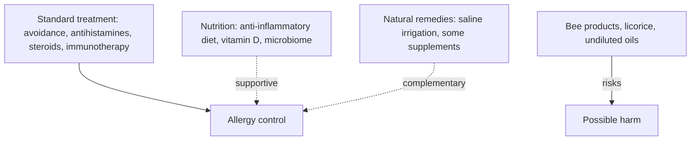

# Allergy: nutrition and natural remedies

## Summary

Diet can support people with allergies by reducing inflammation and supporting the immune system: plenty of vegetables and fruit, omega-3 fatty acids, anti-inflammatory spices, fermented foods and prebiotics, adequate vitamin D, zinc and selenium, and less ultra-processed food, sugar and alcohol. People with food allergies need elimination diets and must watch for cross-reactivity between pollen and foods. Many natural remedies are promoted for allergy symptoms; a few (saline nasal irrigation, possibly spirulina and butterbur-like extracts) have some support, most have little, and some (bee products, licorice) carry risks. They can complement but not replace standard treatment.

*This note is educational. It is not medical advice and does not replace a doctor, dietitian or pharmacist, especially during pregnancy, illness or when taking medicines.*

## Prerequisites

- [Allergy](allergy.md)

## Core concepts

### Definition

*Elimination diet* means avoiding a food allergen. *Pollen-food allergy syndrome* (oral allergy syndrome) is cross-reactivity between pollen allergens and similar proteins in raw fruits, vegetables or nuts. *Saline nasal irrigation* rinses the nasal passages with salt water.

### Analogy

Nutrition for allergy is like maintaining the soil around a sensitive plant: it does not change the plant's nature (the allergy) but can make it less reactive. Avoiding allergens is like keeping the plant out of harsh wind. The analogy breaks because no diet cures an IgE-mediated allergy.

### Mechanism

### Nutrition

**1. Anti-inflammatory foods.**

- *Vegetables and fruit* rich in antioxidants such as vitamins C and E (berries, citrus, broccoli, peppers, spinach) may reduce oxidative stress and inflammation.
- *Omega-3 fatty acids* (salmon, mackerel, sardines, walnuts, chia, flaxseed) reduce inflammation and may ease asthma and allergic rhinitis ([Omega-3 fatty acids](../../../natural-sciences/chemistry/biochemistry/lipids/omega-3-fatty-acids.md)).
- *Spices* such as turmeric (curcumin), ginger and garlic have anti-inflammatory properties ([Turmeric (Curcuma longa)](../nutrition/herbal-extracts/turmeric.md)).

**2. Immune support.**

- *Probiotics and prebiotics*: fermented foods (yogurt, kefir, sauerkraut, kimchi) support the gut microbiome, which regulates immunity ([Fermented foods](../nutrition/foundations/fermented-foods.md)); prebiotics are in onions, garlic, bananas, asparagus and whole grains ([Prebiotics overview](../nutrition/prebiotics/prebiotics-overview.md)).
- *Vitamin D*: low levels are linked to higher risk of allergy and asthma; sources are fatty fish, fortified dairy, eggs and mushrooms, and supplements may be needed in winter or with little sun ([Vitamin D](../nutrition/vitamins/vitamin-d.md)).
- *Zinc and selenium* support immune function: zinc from meat, fish, nuts and seeds; selenium from Brazil nuts, fish, meat and whole grains.

**3. Foods that may worsen symptoms.**

- Processed and fried foods high in trans and saturated fats and sugar may increase inflammation.
- Excess sugar and sweeteners may contribute to inflammation.
- Alcohol and caffeine can worsen symptoms in some people by increasing vessel permeability or histamine release (wine and beer contain histamine).

**4. Food allergy diets.**

- *Substitutes*: plant drinks (almond, soy, oat) for cow\'s milk allergy; rice, potatoes, corn and millet for gluten-related disorders.
- *Cross-reactivity*: people allergic to birch pollen may react to apples, carrots or hazelnuts; they should know their cross-reactions and avoid trigger foods (cooking often destroys the cross-reacting proteins).

**5. Hydration.** Drinking enough water helps thin mucus in hay fever and rhinitis.

### Natural remedies

**Essential oils** are used for their anti-inflammatory, antibacterial and antihistamine-like properties ([Essential oils overview](../complementary-medicine/essential-oils/essential-oils-overview.md)):

- *Peppermint* may relax airway smooth muscle; inhaling it may make a blocked nose feel clearer ([Peppermint oil](../complementary-medicine/essential-oils/peppermint.md)).
- *Lavender* is soothing and may reduce skin allergy symptoms; laboratory studies suggest reduced histamine release ([Lavender oil](../complementary-medicine/essential-oils/lavender.md)).
- *Eucalyptus*: eucalyptol may ease nasal congestion; steam inhalation with a few drops in hot water is common ([Eucalyptus oil](../complementary-medicine/essential-oils/eucalyptus.md)).
- *Chamomile* may soothe itching and redness of skin allergy ([Chamomile oil](../complementary-medicine/essential-oils/chamomile.md)).

**Herbs and supplements.** The table lists remedies from the notes with what is known.

| Remedy | Claim | Evidence |
| --- | --- | --- |
| Quercetin | Inhibits histamine release from mast cells; eases seasonal allergy and asthma | Laboratory and animal data; very limited human evidence ([Quercetin](../nutrition/phytonutrients/quercetin.md)) |
| Spirulina | Anti-inflammatory; may inhibit histamine release; reduced rhinitis symptoms | One small trial in allergic rhinitis; limited ([Spirulina](../nutrition/algae/spirulina.md)) |
| Bromelain | Reduces swelling and congestion of nasal mucosa | Small studies in sinusitis; limited |
| Stinging nettle (Urtica dioica) | Antihistamine and anti-inflammatory; eases hay fever | One small trial with marginal benefit; limited |
| Bee bread (perga) | Anti-inflammatory, reduces histamine release | Laboratory data; bee products can trigger severe allergic reactions |
| Reishi | Inhibits histamine release, immune modulation | Laboratory data ([Reishi](../nutrition/mushrooms/reishi.md)) |
| Boswellia serrata | Anti-inflammatory; may improve asthma | Small trials in asthma; limited |
| Royal jelly | Immune modulation | Little evidence; can cause severe allergic reactions and asthma |
| Pelargonium sidoides | Immunomodulatory; reduces cold symptoms | Some evidence for acute bronchitis and colds (Cochrane, low quality); no allergy evidence |
| Vitamin C | Natural antihistamine; lowers histamine | Small, mixed studies |
| Vitamin E | Reduces inflammation; may help allergic asthma | Inconsistent trials |
| Magnesium | Supports breathing; low levels linked to asthma | Intravenous magnesium is used in severe asthma attacks; oral supplements limited |
| Ashwagandha | Adaptogen supporting immunity and stress | No allergy evidence ([Ashwagandha (Withania somnifera)](../nutrition/herbal-extracts/ashwagandha.md)) |
| Rhodiola | Adaptogen supporting immunity and less fatigue | No allergy evidence ([Rhodiola (Rhodiola rosea)](../nutrition/herbal-extracts/rhodiola.md)) |
| Ginkgo biloba | Anti-inflammatory; natural bronchodilator | Small Chinese studies in asthma; very limited ([Ginkgo (Ginkgo biloba)](../nutrition/herbal-extracts/ginkgo.md)) |
| Licorice (Glycyrrhiza glabra) | Anti-inflammatory and immunomodulatory; supports airways | Little evidence; long-term use raises blood pressure and lowers potassium |
| Ginger | Reduces airway inflammation | One small trial in allergic rhinitis ([Ginger (Zingiber officinale)](../nutrition/herbal-extracts/ginger.md)) |

**Other methods.**

- *Saline nasal irrigation* is a simple, effective way to remove allergens and excess mucus; a meta-analysis found reduced symptoms and medication use in allergic rhinitis.
- *Local honey* is claimed to build tolerance to local pollen; a randomized trial found no benefit, and flower pollen in honey differs from the wind-borne pollen that causes hay fever.

### Safety

Some essential oils and herbs cause allergic reactions or interact with medicines; consult a doctor, especially with a tendency to allergies. Essential oils must never be applied undiluted to skin; inhalation or diffusion is generally safe, but avoid overuse.

The flowchart shows where nutrition and natural remedies fit.

### Interventions and evidence

Each entry states an intervention and how strong the evidence is, using the grades in [Evidence grades](../nutrition/evidence-grades.md).

- **Saline nasal irrigation reduces rhinitis symptoms.** Meta-analysis of randomized trials. Evidence: moderate.
- **Omega-3 and anti-inflammatory diet reduce allergy symptoms.** Observational links; trials mixed. Evidence: limited.
- **Vitamin D supplementation reduces allergy.** Mixed results; helps if deficient. Evidence: limited.
- **Local honey reduces hay fever.** A randomized trial found no benefit. Evidence: not supported.
- **Spirulina reduces allergic rhinitis symptoms.** One small trial. Evidence: limited.
- **Bee products help allergy.** Little evidence; risk of severe reactions. Evidence: very limited.

## Worked example

A person with hay fever adds daily saline nasal rinses to their antihistamine. In a meta-analysis (Hermelingmeier and colleagues, 2012), saline irrigation reduced symptom scores by about 27 percent and medication use by about 62 percent. They also try local honey, but a randomized trial (Rajan and colleagues, 2002) found it no better than placebo, so they stop.

## Trade offs and when to use it

Diet and lifestyle support overall health and may ease symptoms, but cannot replace avoidance, medication or immunotherapy. People with allergies should be especially cautious with plant and bee products, which can themselves be allergenic.

## Common mistakes

- **Using bee pollen or royal jelly with pollen allergy.** They can trigger severe reactions.
- **Replacing an adrenaline auto-injector with natural remedies.** Anaphylaxis needs adrenaline.
- **Taking licorice long term.** It raises blood pressure and lowers potassium.

## Practice

1. Which natural method has moderate evidence for allergic rhinitis?
2. What did a trial find about local honey?
3. Which foods cross-react with birch pollen?

### Answers

1. Saline nasal irrigation.
2. No benefit over placebo.
3. Apples, carrots and hazelnuts.

## Further reading

- Hermelingmeier, K. E., Weber, R. K., Hellmich, M. et al. (2012). Nasal irrigation as an adjunctive treatment in allergic rhinitis: a systematic review and meta-analysis. American Journal of Rhinology and Allergy, 26(5), e119-e125. [DOI](https://doi.org/10.2500/ajra.2012.26.3787). Meta-analysis of nasal irrigation in allergic rhinitis.
- Rajan, T. V., Tennen, H., Lindquist, R. L. et al. (2002). Effect of ingestion of honey on symptoms of rhinoconjunctivitis. Annals of Allergy, Asthma and Immunology, 88(2), 198-203. [DOI](https://doi.org/10.1016/S1081-1206(10)61996-5). Trial of honey for rhinoconjunctivitis.
- Cingi, C., Conk-Dalay, M., Cakli, H. et al. (2008). The effects of spirulina on allergic rhinitis. European Archives of Oto-Rhino-Laryngology, 265(10), 1219-1223. [DOI](https://doi.org/10.1007/s00405-008-0642-8). Trial of spirulina in allergic rhinitis.
- Timmer, A., Günther, J., Motschall, E. et al. (2013). Pelargonium sidoides extract for treating acute respiratory tract infections. Cochrane Database of Systematic Reviews, CD006323. [DOI](https://doi.org/10.1002/14651858.CD006323.pub3). Cochrane review of Pelargonium sidoides.
- Calder, P. C., Carr, A. C., Gombart, A. F. et al. (2020). Optimal nutritional status for a well-functioning immune system is an important factor to protect against viral infections. Nutrients, 12(4), 1181. [DOI](https://doi.org/10.3390/nu12041181). Nutrients and immune function.
