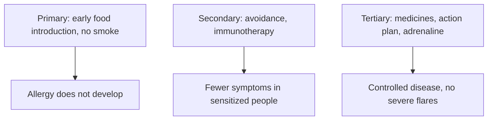

# Allergy prevention and treatment

## Summary

Allergy prevention works at three levels: primary (preventing allergy from developing, for example by introducing allergenic foods early in infancy), secondary (preventing symptoms in sensitized people, for example by avoiding allergens and allergen immunotherapy) and tertiary (managing established allergy to prevent flare-ups and complications). Treatment combines symptom relief (antihistamines, corticosteroids, leukotriene antagonists, bronchodilators, biologics), allergen immunotherapy, the only treatment that can change the natural course of allergy, and education, including adrenaline auto-injectors for people at risk of anaphylaxis.

*This note is educational. It is not medical advice and does not replace a doctor, dietitian or pharmacist, especially during pregnancy, illness or when taking medicines.*

## Prerequisites

- [Allergy](allergy.md)

## Core concepts

### Definition

*Primary prevention* aims to stop allergy from developing; *secondary prevention* aims to prevent symptoms in sensitized people; *tertiary prevention* manages established disease. *Allergen immunotherapy* (AIT) gives gradually increasing doses of an allergen to induce tolerance, as *sublingual* (SLIT) or *subcutaneous* (SCIT) immunotherapy.

### Analogy

Treating allergy is like dealing with a building whose fire alarm is too sensitive. Antihistamines are earplugs (they block the noise), steroids turn down the volume, and immunotherapy recalibrates the alarm so it stops reacting to harmless smoke. The analogy breaks because recalibration takes years and does not work for every allergy.

### Mechanism

### Primary prevention

- *Early introduction of allergenic foods*: introducing foods such as peanuts and eggs in infancy, usually between 4 and 6 months (from around 4 to 11 months in trials), reduces the risk of food allergy ([Allergy](allergy.md)). In the LEAP trial, early peanut introduction in high-risk infants reduced peanut allergy by about 80 percent.
- *Breastfeeding* for at least 4 to 6 months is recommended for immune development and may reduce allergy risk, though studies are mixed.
- *Avoiding smoke and pollution* in pregnancy and childhood may reduce asthma and respiratory allergy.
- *Gut microbiome*: probiotics in pregnancy or for infants are a promising approach; a meta-analysis found reduced eczema risk, but more research is needed.

### Secondary prevention

- *Allergen avoidance*: house dust mite control (special mattress and pillow covers, washing bedding at high temperature, HEPA vacuum cleaners); pollen avoidance (closing windows in pollen season, air conditioning, staying indoors at high pollen counts); eliminating trigger foods.
- *Allergen immunotherapy*: increasing doses of allergen reduce hypersensitivity; effective for inhaled allergens (pollen, mites) and insect venom.
- *Environmental control*: indoor humidity of about 30 to 50 percent, removal of mold and pet dander for people with allergic asthma.

### Tertiary prevention

- Regular antihistamines and inhaled corticosteroids to prevent flare-ups in seasonal allergy or allergic asthma.
- An anaphylaxis action plan and an adrenaline (epinephrine) auto-injector for people at risk of severe reactions.
- Comprehensive care of coexisting conditions (atopic dermatitis, asthma).

### Symptomatic treatment

| Drug class | Examples | How it works | Use |
| --- | --- | --- | --- |
| Antihistamines | Cetirizine, loratadine (over the counter); desloratadine, fexofenadine (prescription in some countries) | Block H1 histamine receptors | Itching, sneezing, runny nose, watery eyes |
| Corticosteroids | Budesonide, fluticasone (inhaled or nasal); oral; creams | Reduce inflammation | Asthma, chronic rhinitis, atopic dermatitis |
| Mast cell stabilizers | Sodium cromoglicate | Prevent degranulation | Prevention in allergic rhinitis and conjunctivitis |
| Leukotriene antagonists | Montelukast | Block leukotriene receptors | Add-on therapy in asthma and rhinitis |
| Bronchodilators | Salbutamol (short-acting), salmeterol (long-acting) | Relax bronchial muscle | Quick relief and control of asthma |
| Biologics | Omalizumab (anti-IgE), dupilumab (anti-IL-4/IL-13) | Block IgE or Th2 cytokines | Severe asthma, atopic dermatitis |

### Allergen immunotherapy

Immunotherapy is the only treatment that can change the natural course of allergy rather than only relieve symptoms. SLIT uses tablets or drops under the tongue, mainly for grass pollen, house dust mites and animal dander. SCIT uses regular injections, usually in the arm, effective for inhaled allergens and insect venom. Benefits include long-lasting tolerance, fewer symptoms, less medication and better quality of life; a course lasts about 3 to 5 years.

### Treatment of specific allergies

- *Food allergy*: strict avoidance is key; people at risk of anaphylaxis always carry an adrenaline auto-injector (for example EpiPen) and know how to use it. Oral immunotherapy (OIT) for peanut is approved in some countries.
- *Contact allergy*: avoid the allergen; treat eczema with topical corticosteroids, calcineurin inhibitors and emollients.
- *Allergic asthma*: bronchodilators and inhaled corticosteroids, plus environmental control and allergen avoidance.

### Modern approaches

Biologics (omalizumab, dupilumab) target IgE or IL-4/IL-13. Gene therapy and gene editing (CRISPR) to modulate allergic responses are at an experimental stage.

The flowchart shows the three levels of prevention and treatment.

### Interventions and evidence

Each entry states an intervention and how strong the evidence is, using the grades in [Evidence grades](../nutrition/evidence-grades.md).

- **Early peanut introduction prevents peanut allergy.** LEAP trial: about 80 percent reduction in high-risk infants. Evidence: strong.
- **Allergen immunotherapy for pollen, mites and venom.** Well established in guidelines. Evidence: strong.
- **Antihistamines and nasal steroids for allergic rhinitis.** First-line treatments in ARIA guidelines. Evidence: strong.
- **Probiotics prevent eczema.** Meta-analysis found reduced eczema risk; guidelines suggest conditional use. Evidence: limited.
- **Breastfeeding prevents allergy.** Mixed evidence. Evidence: limited.
- **Adrenaline is the first-line treatment for anaphylaxis.** Established in all guidelines. Evidence: strong.

## Worked example

In the LEAP trial (Du Toit and colleagues, 2015), 640 infants aged 4 to 11 months with severe eczema or egg allergy were randomized to eat peanut regularly or avoid it until age 5. Peanut allergy at 5 years was 17.2 percent in the avoidance group and 3.2 percent in the consumption group. This reversed earlier advice to delay allergenic foods.

## Trade offs and when to use it

Symptomatic drugs work quickly but must be taken continuously; immunotherapy requires years of commitment but can provide lasting benefit. High-risk infants should start allergenic foods under medical guidance.

## Common mistakes

- **Delaying allergenic foods in infants.** Early introduction reduces food allergy risk.
- **Not carrying adrenaline when at risk of anaphylaxis.** Antihistamines do not stop anaphylaxis.

## Practice

1. What are the three levels of allergy prevention?
2. Which treatment can change the natural course of allergy?
3. What did the LEAP trial show?

### Answers

1. Primary, secondary and tertiary.
2. Allergen immunotherapy.
3. Early peanut introduction reduced peanut allergy by about 80 percent.

## Further reading

- Du Toit, G., Roberts, G., Sayre, P. H. et al. (2015). Randomized trial of peanut consumption in infants at risk for peanut allergy. New England Journal of Medicine, 372(9), 803-813. [DOI](https://doi.org/10.1056/NEJMoa1414850). LEAP trial of early peanut introduction.
- Bousquet, J., Schünemann, H. J., Togias, A. et al. (2020). Allergic Rhinitis and its Impact on Asthma (ARIA) guidelines: 2019 revision. Journal of Allergy and Clinical Immunology, 145(1), 70-80. [DOI](https://doi.org/10.1016/j.jaci.2019.06.049). ARIA guidelines for allergic rhinitis.
- Muraro, A., Roberts, G., Worm, M. et al. (2014). Anaphylaxis: guidelines from the European Academy of Allergy and Clinical Immunology. Allergy, 69(8), 1026-1045. [DOI](https://doi.org/10.1111/all.12437). EAACI anaphylaxis guidelines.
- Cuello-Garcia, C. A., Brożek, J. L., Fiocchi, A. et al. (2015). Probiotics for the prevention of allergy: a systematic review and meta-analysis of randomized controlled trials. Journal of Allergy and Clinical Immunology, 136(4), 952-961. [DOI](https://doi.org/10.1016/j.jaci.2015.04.031). Meta-analysis of probiotics for allergy prevention.
