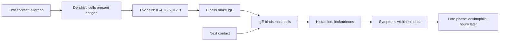

# Allergy

## Summary

Allergy is an excessive immune reaction to substances that are harmless to most people, called allergens: plant pollen, animal dander, foods, drugs, house dust mites, molds and many others. The immune system of an allergic person treats these substances as threats and produces antibodies, most often immunoglobulin E (IgE). On later contact, IgE on mast cells triggers the release of histamine and other mediators, causing symptoms from sneezing and hives to asthma and life-threatening anaphylaxis. Genetic predisposition and environment (early exposures, hygiene, pollution, climate) both contribute.

*This note is educational. It is not medical advice and does not replace a doctor, dietitian or pharmacist, especially during pregnancy, illness or when taking medicines.*

## Prerequisites

No prior notes are needed.

## Core concepts

### Definition

*Allergy* is a hypersensitivity reaction initiated by specific immune mechanisms. The common type is *IgE-mediated (type I) hypersensitivity*. *Atopy* is the genetic tendency to produce IgE to common allergens. *Anaphylaxis* is a severe, potentially fatal systemic allergic reaction.

### Analogy

An allergy is like a security system that mistakes the postman for a burglar. The first visit, it takes a photo and prints wanted posters (IgE) for all its guards (mast cells). On the next visit, every guard sounds the alarm at once, causing chaos (symptoms) over a harmless visitor. The analogy breaks because the "alarm" can become so strong that it endangers the house itself (anaphylaxis).

### Mechanism

**1. Sensitization.** The first contact, when the immune system identifies the allergen as a threat:

- *Antigen presentation*: the allergen enters through the airways, skin or gut and is taken up by antigen-presenting cells such as dendritic cells, which display its fragments on MHC class II molecules.
- *T cell activation*: these cells migrate to lymph nodes and present the antigen to T helper 2 (Th2) cells, which release IL-4, IL-5 and IL-13.
- *IgE production*: these cytokines drive B cells to become plasma cells producing allergen-specific IgE.
- *IgE binding*: IgE binds high-affinity receptors (Fc epsilon RI) on mast cells and basophils, preparing for an immediate reaction on the next contact.

**2. Effector phase (allergic reaction).** On re-exposure:

- *Degranulation*: the allergen cross-links IgE on mast cells and basophils, which release stored mediators: histamine, tryptase, and newly made leukotrienes and prostaglandins.
- *Histamine* dilates blood vessels, increases their permeability, contracts bronchial smooth muscle and causes itching: sneezing, runny nose, nasal swelling, shortness of breath and hives.
- *Newly synthesized mediators* (leukotrienes, prostaglandins) sustain inflammation and can cause later symptoms such as asthma attacks.

**3. Late-phase reaction.** Hours later, eosinophils, neutrophils and T cells migrate to the site. Eosinophils release toxic proteins and free radicals that damage tissue. In some people this becomes chronic inflammation: asthma, allergic rhinitis or atopic dermatitis.

**4. Cytokines and chemokines** regulate the whole process: IL-4, IL-5 and IL-13 drive the Th2 response and IgE production, while TNF-alpha and chemokines recruit inflammatory cells.

**Causes and risk factors.**

- *Genetics*: predisposition is often inherited; children of allergic parents have higher risk, though possibly for different allergies.
- *Environment*: early exposure to allergens shapes the developing immune system; children growing up on farms or with pets have different risks than urban children.
- *Hygiene hypothesis*: reduced early contact with microbes may prevent proper immune development, leading to overreaction later; today it is often framed as the "old friends" or microbiome hypothesis.
- *Climate change*: longer pollen seasons increase exposure.
- *Air pollution*: high pollution increases the risk, especially in predisposed people.

The flowchart shows the phases of an IgE-mediated allergy.

### Risk factors and evidence

Each entry states a risk factor and how strong the evidence for it is, using the grades in [Evidence grades](../nutrition/evidence-grades.md).

- **Genetic predisposition.** Family history strongly increases risk. Evidence: strong.
- **Hygiene and microbiome hypothesis.** Supported by farm and family size studies; mechanisms debated. Evidence: moderate.
- **Air pollution increases allergy and asthma risk.** Consistent epidemiological evidence. Evidence: moderate.
- **Climate change lengthens pollen seasons.** Documented pollen season changes. Evidence: moderate.

## Worked example

A child with birch pollen allergy sneezes and has itchy eyes in April. At first exposure years earlier, their immune system produced birch-specific IgE. Now pollen cross-links IgE on mast cells in the nose, releasing histamine within minutes. Because birch pollen proteins resemble proteins in apples and hazelnuts, the child also gets an itchy mouth when eating raw apples (oral allergy syndrome).

## Trade offs and when to use it

Understanding the mechanism explains why antihistamines help immediate symptoms, why steroids control late-phase inflammation, and why immunotherapy, which shifts the immune response, can change the course of the disease.

## Common mistakes

- **Confusing allergy with intolerance.** Intolerances (for example lactose) do not involve the immune system.
- **Ignoring early signs of anaphylaxis.** Breathing difficulty or swelling of the throat needs emergency adrenaline.

## Practice

1. Which antibody drives typical allergies?
2. Which cytokines drive the Th2 response?
3. Which cells dominate the late-phase reaction?

### Answers

1. Immunoglobulin E (IgE).
2. IL-4, IL-5 and IL-13.
3. Eosinophils.

## Further reading

- Murphy, K., Weaver, C., Berg, L. (2022). *Janeway's Immunobiology (10th ed.)*. W. W. Norton. Immunology textbook on hypersensitivity.
- Strachan, D. P. (1989). Hay fever, hygiene, and household size. BMJ, 299(6710), 1259-1260. [DOI](https://doi.org/10.1136/bmj.299.6710.1259). Original hygiene hypothesis paper.
