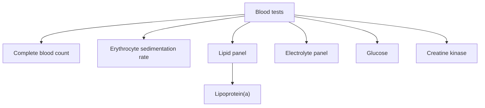

# Diagnostics

Laboratory tests measure substances in blood and other fluids to detect disease, assess risk and monitor treatment. These notes cover common blood tests: the complete blood count, the erythrocyte sedimentation rate, the lipid panel, the electrolyte panel, blood glucose and creatine kinase. Lipoprotein(a) is covered in [Lipoprotein(a)](../../../natural-sciences/chemistry/biochemistry/lipids/lipoprotein-a.md). Reference ranges differ between laboratories; results must be interpreted by a clinician in context.

## Map

## Reading order

1. [Complete blood count](complete-blood-count.md)
2. [Erythrocyte sedimentation rate](erythrocyte-sedimentation-rate.md)
3. [Lipid panel](lipid-panel.md)
4. [Electrolyte panel](electrolyte-panel.md)
5. [Blood glucose](blood-glucose.md)
6. [Creatine kinase](creatine-kinase.md)
