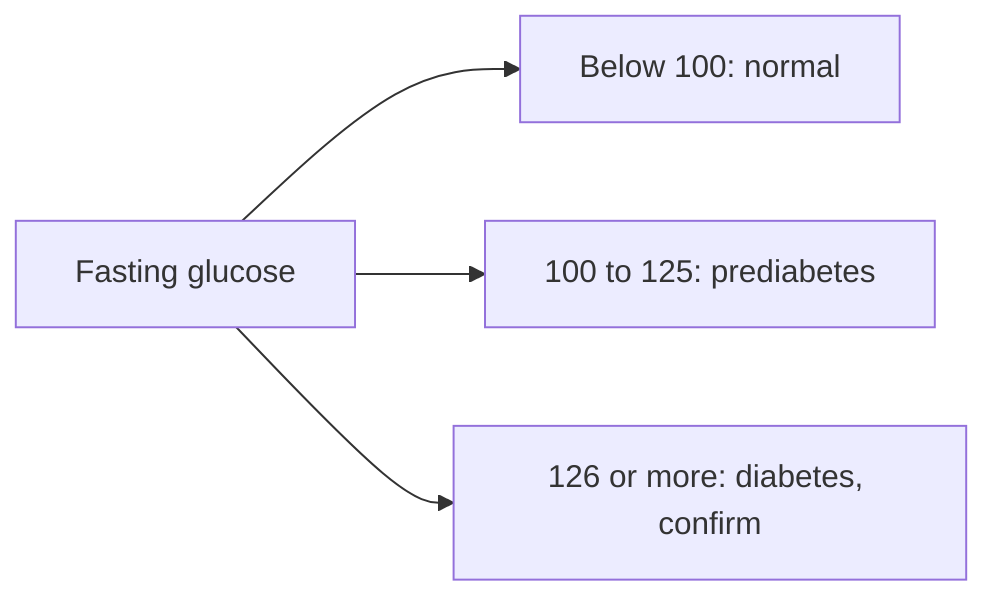

# Blood glucose

## Summary

Blood glucose testing is the basic test for diagnosing and monitoring diabetes and assessing the risk of developing it. Fasting plasma glucose, the oral glucose tolerance test and HbA1c are used. Diabetes is diagnosed with fasting glucose of 126 mg/dL (7.0 mmol/L) or more, a 2-hour glucose of 200 mg/dL (11.1 mmol/L) or more in the tolerance test, or HbA1c of 6.5 percent or more; prediabetes lies between normal and these values.

*This note is educational. It is not medical advice and does not replace a doctor, dietitian or pharmacist, especially during pregnancy, illness or when taking medicines.*

## Prerequisites

No prior notes are needed.

## Core concepts

### Definition

*Fasting plasma glucose* (FPG) is measured after at least 8 hours without food. *HbA1c* (glycated hemoglobin) reflects average glucose over about 2 to 3 months. The *oral glucose tolerance test* (OGTT) measures glucose 2 hours after drinking 75 g glucose.

### Analogy

Fasting glucose is a snapshot of the sugar level at one moment; HbA1c is like a long-exposure photograph showing the average over months, because glucose gradually "sticks" to hemoglobin in red cells. The analogy breaks because conditions that change red cell lifespan (anemia, blood loss) distort the long exposure.

### Mechanism

Insulin keeps blood glucose within a narrow range ([Glycogen metabolism](../../../natural-sciences/chemistry/biochemistry/glycogen-metabolism.md)). In insulin resistance and beta-cell failure, glucose rises.

| Test | Normal | Prediabetes | Diabetes |
| --- | --- | --- | --- |
| Fasting glucose | Below 100 mg/dL (5.6 mmol/L) | 100 to 125 mg/dL | 126 mg/dL (7.0 mmol/L) or more |
| 2-hour OGTT | Below 140 mg/dL (7.8 mmol/L) | 140 to 199 mg/dL | 200 mg/dL (11.1 mmol/L) or more |
| HbA1c | Below 5.7 percent | 5.7 to 6.4 percent | 6.5 percent or more |

Criteria from the American Diabetes Association; WHO uses 110 to 125 mg/dL for impaired fasting glucose. Diagnosis needs confirmation unless symptoms are clear.

The flowchart shows diagnostic categories by fasting glucose.

### Clinical uses and evidence

Each entry states a clinical use of the test and how well established it is, using the grades in [Evidence grades](../nutrition/evidence-grades.md).

- **Diagnosis of diabetes.** Standard criteria. Evidence: strong.
- **Monitoring treatment with HbA1c.** Lower HbA1c reduces microvascular complications. Evidence: strong.
- **Identifying prediabetes for prevention.** Lifestyle intervention reduces progression to diabetes by about 58 percent (Diabetes Prevention Program). Evidence: strong.

## Worked example

A 45-year-old with overweight has fasting glucose 112 mg/dL and HbA1c 6.0 percent: prediabetes. A program of about 7 percent weight loss and 150 minutes of activity weekly, as in the Diabetes Prevention Program, can greatly reduce the chance of progressing to diabetes. Fiber-rich, low glycemic index meals help ([Glycemic index](../nutrition/foundations/glycemic-index.md)).

## Trade offs and when to use it

Glucose tests are cheap and widely available; HbA1c is convenient but unreliable in some anemias and hemoglobin variants.

## Common mistakes

- **Not fasting before a fasting glucose test.** Fast at least 8 hours.
- **Relying on one borderline result.** Confirm with a repeat test.

## Practice

1. What fasting glucose indicates diabetes?
2. What does HbA1c reflect?
3. What HbA1c range defines prediabetes?

### Answers

1. 126 mg/dL (7.0 mmol/L) or more.
2. Average glucose over about 2 to 3 months.
3. 5.7 to 6.4 percent.

## Further reading

- American Diabetes Association Professional Practice Committee (2024). Diagnosis and classification of diabetes: Standards of Care in Diabetes 2024. Diabetes Care, 47(Suppl 1), S20-S42. [DOI](https://doi.org/10.2337/dc24-S002). ADA diagnostic criteria for diabetes.
