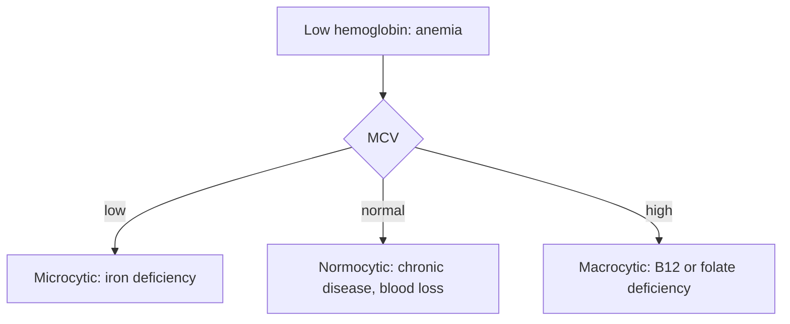

# Complete blood count

## Summary

The complete blood count (CBC, in Polish "morfologia") is a basic blood test that measures hemoglobin and counts and characterizes the cellular elements of blood: red blood cells, white blood cells and platelets. It is done in routine check-ups and to diagnose many conditions, including anemia, polycythemia (too many red cells), infections, inflammation and other blood diseases.

*This note is educational. It is not medical advice and does not replace a doctor, dietitian or pharmacist, especially during pregnancy, illness or when taking medicines.*

## Prerequisites

No prior notes are needed.

## Core concepts

### Definition

A *complete blood count* measures hemoglobin (Hb), hematocrit (Hct), red blood cell count (RBC), red cell indices (MCV, mean cell volume; MCH; MCHC; RDW), white blood cell count (WBC) with a differential (neutrophils, lymphocytes, monocytes, eosinophils, basophils) and platelet count (PLT).

### Analogy

A complete blood count is like a census of the city in your blood vessels: it counts the oxygen carriers (red cells), the defense forces (white cells) and the repair crews (platelets), and notes their size. The analogy breaks because a census does not explain why a population changed; further tests are needed.

### Mechanism

Automated analyzers count and size cells by impedance and light scatter.

| Parameter | Typical adult range | Low suggests | High suggests |
| --- | --- | --- | --- |
| Hemoglobin | Women about 12 to 15.5 g/dL; men about 13.5 to 17.5 g/dL | Anemia | Polycythemia, dehydration |
| MCV | About 80 to 100 fL | Iron deficiency (microcytic) | B12 or folate deficiency (macrocytic) |
| White blood cells | About 4 to 10 × 10^9/L | Bone marrow problems, some infections | Infection, inflammation, leukemia |
| Platelets | About 150 to 400 × 10^9/L | Bleeding risk | Inflammation, iron deficiency, marrow disorders |

Ranges vary by laboratory, age and sex.

The flowchart shows how anemia is classified using MCV.

### Clinical uses and evidence

Each entry states a clinical use of the test and how well established it is, using the grades in [Evidence grades](../nutrition/evidence-grades.md).

- **Diagnosis and classification of anemia.** Standard first-line test. Evidence: established physiology.
- **Detection of infection and inflammation.** White cell count and differential guide diagnosis. Evidence: established physiology.
- **Routine screening in healthy adults.** Common practice; value in asymptomatic people is limited. Evidence: limited.

## Worked example

A woman with fatigue has hemoglobin 10.5 g/dL and MCV 72 fL: microcytic anemia. Ferritin is low, confirming iron deficiency ([Iron](../nutrition/minerals/iron.md)). Her doctor looks for the cause (heavy periods) and treats with iron.

## Trade offs and when to use it

The CBC is cheap and informative, but abnormal values need interpretation and often further tests.

## Common mistakes

- **Interpreting single values out of context.** Look at the pattern and clinical picture.
- **Assuming normal hemoglobin rules out iron deficiency.** Ferritin can be low before anemia appears.

## Practice

1. Which three cell types does a CBC count?
2. What does a low MCV suggest?
3. What does a high MCV suggest?

### Answers

1. Red blood cells, white blood cells and platelets.
2. Iron deficiency.
3. B12 or folate deficiency.

## Further reading

- Rifai, N., Horvath, A. R., Wittwer, C. T. (Eds.) (2018). *Tietz Textbook of Clinical Chemistry and Molecular Diagnostics (6th ed.)*. Elsevier. Textbook of clinical chemistry and laboratory medicine.
