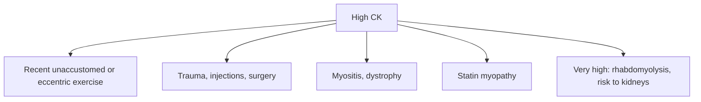

# Creatine kinase

## Summary

Creatine kinase (CK, total CK or CK-NAC) is an enzyme in the cytoplasm and mitochondria that catalyzes the reversible phosphorylation of creatine. It is most abundant in skeletal muscle, followed by brain, heart muscle and smaller amounts in other organs. Blood CK rises markedly with muscle injury, muscular dystrophies, shock and circulatory disorders, and moderately after myositis, surgery, injections, alcohol poisoning and unaccustomed exercise. Low values occur with reduced muscle mass and steroid therapy. CK is used to monitor statin treatment.

*This note is educational. It is not medical advice and does not replace a doctor, dietitian or pharmacist, especially during pregnancy, illness or when taking medicines.*

## Prerequisites

No prior notes are needed.

## Core concepts

### Definition

*Creatine kinase* catalyzes creatine + ATP ⇌ phosphocreatine + ADP. Isoenzymes: CK-MM (skeletal muscle), CK-MB (heart), CK-BB (brain). *CK-NAC* refers to the assay method using N-acetylcysteine as an enzyme activator. *Rhabdomyolysis* is severe muscle breakdown.

### Analogy

CK in the blood is like broken glass on the street after a storm: the more broken windows (damaged muscle cells), the more glass you find. The analogy breaks because exercise, especially new or eccentric exercise, "breaks windows" harmlessly, so high CK after training is often normal.

### Mechanism

CK keeps ATP levels stable by transferring phosphate between phosphocreatine and ADP ([Creatine](../nutrition/supplements/creatine.md)). When muscle membranes are damaged, CK leaks into the blood, peaking about 24 to 72 hours after injury or exercise.

**Causes of raised CK.**

- *Marked rise*: muscle trauma, muscular dystrophies, shock, circulatory disorders, rhabdomyolysis.
- *Moderate rise*: myositis, surgery, intramuscular injections, alcohol poisoning, physical exercise in people unused to it ([Delayed onset muscle soreness (DOMS)](../exercise-and-fitness/recovery/doms.md)).
- *Low CK*: reduced muscle mass (cachexia), steroid therapy.

Typical reference range: about 30 to 200 U/L (higher in men and in people with more muscle and in people of African ancestry).

The flowchart shows causes and interpretation of high CK.

### Clinical uses and evidence

Each entry states a clinical use of the test and how well established it is, using the grades in [Evidence grades](../nutrition/evidence-grades.md).

- **Detecting muscle damage.** Established marker. Evidence: established physiology.
- **Monitoring statin-associated muscle symptoms.** CK above 4 times normal guides management. Evidence: strong.
- **Diagnosing rhabdomyolysis.** CK above 5 times normal with symptoms. Evidence: strong.

## Worked example

A recreational runner does an intense downhill run and has a routine blood test the next day: CK is 1,500 U/L. Without symptoms such as dark urine or severe pain, this reflects exercise-induced muscle damage and usually returns to normal within a week. Repeating the test after 7 days of rest confirms it. Very high values (for example above 10,000 U/L) with dark urine require urgent care for rhabdomyolysis.

## Trade offs and when to use it

CK is sensitive but not specific; recent exercise must be considered before testing.

## Common mistakes

- **Testing CK right after hard training.** Avoid strenuous exercise for several days before testing.
- **Ignoring dark urine with muscle pain.** It can signal rhabdomyolysis.

## Practice

1. Where is CK most abundant?
2. Name two causes of a moderate CK rise.
3. Which treatment is monitored with CK?

### Answers

1. In skeletal muscle.
2. Unaccustomed exercise and intramuscular injections (also surgery, myositis, alcohol poisoning).
3. Statin therapy.

## Further reading

- Baird, M. F., Graham, S. M., Baker, J. S. et al. (2012). Creatine-kinase- and exercise-related muscle damage implications for muscle performance and recovery. Journal of Nutrition and Metabolism, 2012, 960363. [DOI](https://doi.org/10.1155/2012/960363). Review of CK and exercise-related muscle damage.
- Rifai, N., Horvath, A. R., Wittwer, C. T. (Eds.) (2018). *Tietz Textbook of Clinical Chemistry and Molecular Diagnostics (6th ed.)*. Elsevier. Laboratory medicine reference.
