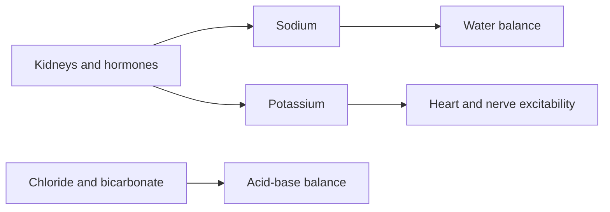

# Electrolyte panel

## Summary

An electrolyte panel (ionogram) measures the main electrolytes in blood: sodium, potassium, chloride and often bicarbonate, sometimes calcium and magnesium. It is especially indicated in kidney, endocrine, respiratory and cardiovascular diseases, with diuretic and other drug treatment, and in dehydration. Abnormal sodium and potassium levels can cause confusion, muscle weakness and dangerous heart rhythms.

*This note is educational. It is not medical advice and does not replace a doctor, dietitian or pharmacist, especially during pregnancy, illness or when taking medicines.*

## Prerequisites

No prior notes are needed.

## Core concepts

### Definition

*Electrolytes* are minerals that carry an electrical charge in body fluids. An *ionogram* measures sodium (Na+), potassium (K+), chloride (Cl-) and bicarbonate (HCO3-). The *anion gap* is Na+ - (Cl- + HCO3-).

### Analogy

An electrolyte panel is like checking the salt and charge balance of a battery: too much or too little of any ion disturbs how the battery works. The analogy breaks because the body constantly corrects these levels through kidneys and hormones.

### Mechanism

Sodium determines water distribution between compartments; potassium sets membrane potentials of nerves and heart ([Potassium](../nutrition/minerals/potassium.md)); chloride and bicarbonate reflect acid-base status.

| Electrolyte | Typical range | Low (examples of causes) | High (examples of causes) |
| --- | --- | --- | --- |
| Sodium | 135 to 145 mmol/L | Excess water, diuretics, heart failure | Dehydration |
| Potassium | 3.5 to 5.0 mmol/L | Diuretics, vomiting, diarrhea | Kidney failure, some blood pressure drugs |
| Chloride | 98 to 107 mmol/L | Vomiting | Dehydration, some acidosis |
| Bicarbonate | 22 to 29 mmol/L | Metabolic acidosis | Vomiting, metabolic alkalosis |

The flowchart shows main roles of electrolytes.

### Clinical uses and evidence

Each entry states a clinical use of the test and how well established it is, using the grades in [Evidence grades](../nutrition/evidence-grades.md).

- **Monitoring kidney disease and diuretic treatment.** Standard practice. Evidence: established physiology.
- **Detecting dangerous potassium levels.** Essential in many clinical settings. Evidence: established physiology.

## Worked example

A person taking a thiazide diuretic for blood pressure feels weak and has muscle cramps. The panel shows potassium 3.0 mmol/L. The doctor adjusts treatment and recommends potassium-rich foods or supplements under supervision.

## Trade offs and when to use it

Results can be falsely high for potassium if the blood sample is hemolyzed or delayed; repeat testing may be needed.

## Common mistakes

- **Ignoring hemolysis as a cause of high potassium.** Repeat with a fresh sample.

## Practice

1. Which four electrolytes form a basic panel?
2. What is the normal range of potassium?
3. Name a cause of low potassium.

### Answers

1. Sodium, potassium, chloride and bicarbonate.
2. About 3.5 to 5.0 mmol/L.
3. Diuretics, vomiting or diarrhea.

## Further reading

- Rifai, N., Horvath, A. R., Wittwer, C. T. (Eds.) (2018). *Tietz Textbook of Clinical Chemistry and Molecular Diagnostics (6th ed.)*. Elsevier. Laboratory medicine reference.
