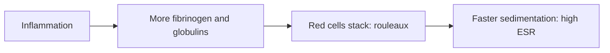

# Erythrocyte sedimentation rate

## Summary

The erythrocyte sedimentation rate (ESR; in Polish OB, "odczyn Biernackiego", after the Polish physician Edmund Biernacki who described it in 1897) is the rate at which red blood cells settle in a tube of anticoagulated blood over one hour. It rises with inflammation, because inflammatory proteins (mainly fibrinogen) make red cells stick together and fall faster. It is a non-specific test used to detect and monitor inflammation.

*This note is educational. It is not medical advice and does not replace a doctor, dietitian or pharmacist, especially during pregnancy, illness or when taking medicines.*

## Prerequisites

No prior notes are needed.

## Core concepts

### Definition

*Erythrocyte sedimentation rate* is the distance (in mm) red blood cells fall in a vertical tube in one hour. *Rouleaux* are stacks of red cells promoted by fibrinogen and immunoglobulins.

### Analogy

ESR is like watching sand settle in water: when sticky proteins glue grains into clumps, the clumps sink faster. The analogy breaks because many things besides inflammation change the "stickiness", including anemia, age and pregnancy.

### Mechanism

Red cells normally repel each other because of negative surface charges. Acute phase proteins, especially fibrinogen, neutralize these charges, allowing rouleaux formation and faster sedimentation. Normal values rise with age; a rough upper limit is age/2 mm/h for men and (age + 10)/2 for women. C-reactive protein (CRP) responds faster and is now often preferred.

The flowchart shows why ESR rises in inflammation.

### Clinical uses and evidence

Each entry states a clinical use of the test and how well established it is, using the grades in [Evidence grades](../nutrition/evidence-grades.md).

- **Detection and monitoring of inflammation.** Non-specific marker. Evidence: established physiology.
- **Monitoring giant cell arteritis and polymyalgia rheumatica.** Standard use. Evidence: strong.
- **Screening healthy people.** Not useful because of low specificity. Evidence: not supported.

## Worked example

A 70-year-old woman with new headaches and jaw pain when chewing has an ESR of 85 mm/h. This, with her symptoms, raises suspicion of giant cell arteritis, which needs urgent treatment to prevent vision loss.

## Trade offs and when to use it

ESR is cheap but non-specific and slow to change; CRP is often more useful for acute inflammation.

## Common mistakes

- **Treating a mildly raised ESR as disease.** It rises with age, anemia and pregnancy.

## Practice

1. Who described the ESR?
2. Which protein mainly raises ESR?
3. Which marker responds faster to inflammation?

### Answers

1. Edmund Biernacki, in 1897.
2. Fibrinogen.
3. C-reactive protein.

## Further reading

- Rifai, N., Horvath, A. R., Wittwer, C. T. (Eds.) (2018). *Tietz Textbook of Clinical Chemistry and Molecular Diagnostics (6th ed.)*. Elsevier. Laboratory medicine reference.
