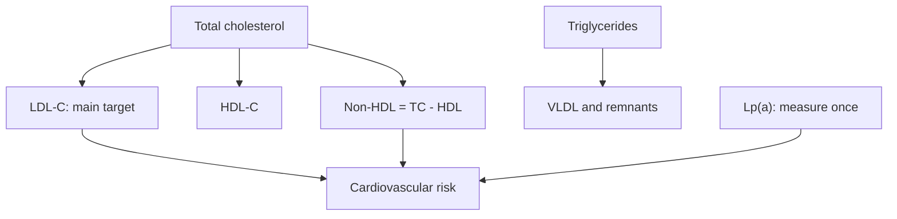

# Lipid panel

## Summary

A lipid panel (lipidogram) measures blood lipids to assess the risk of atherosclerosis, stroke and cardiovascular disease. It includes total cholesterol, LDL cholesterol, HDL cholesterol and triglycerides, and often non-HDL cholesterol. Cholesterol itself is essential: it builds cell membranes, is a precursor of steroid hormones and vitamin D, and is needed for bile acids that help digest fat. Lipoprotein(a) should be measured at least once in a lifetime.

*This note is educational. It is not medical advice and does not replace a doctor, dietitian or pharmacist, especially during pregnancy, illness or when taking medicines.*

## Prerequisites

No prior notes are needed.

## Core concepts

### Definition

A *lipid panel* measures total cholesterol (TC), LDL cholesterol (LDL-C), HDL cholesterol (HDL-C) and triglycerides (TG). *Non-HDL cholesterol* is TC minus HDL-C. LDL-C may be measured directly or calculated (Friedewald: LDL = TC - HDL - TG/2.2 in mmol/L). See [Cholesterol](../../../natural-sciences/chemistry/biochemistry/lipids/cholesterol.md) and [Lipoproteins](../../../natural-sciences/chemistry/biochemistry/lipids/lipoproteins.md).

### Analogy

A lipid panel is like counting delivery trucks on the roads: LDL particles deliver cholesterol to tissues and can crash into artery walls, HDL particles carry it back. Counting the trucks estimates traffic risk. The analogy breaks because particle number (apoB) and particle type also matter, not only cholesterol content.

### Mechanism

LDL particles that enter the artery wall become oxidized, are taken up by macrophages and form plaques. Higher LDL-C, sustained over years, causally increases cardiovascular risk. Triglycerides reflect VLDL and remnant particles. HDL-C is inversely associated with risk, but raising HDL with drugs did not reduce events.

**Targets (ESC/EAS 2019).** LDL-C targets depend on total risk: below 3.0 mmol/L (116 mg/dL) for low risk, below 2.6 (100) for moderate, below 1.8 (70) for high and below 1.4 mmol/L (55 mg/dL) for very high risk. Fasting triglycerides below 1.7 mmol/L (150 mg/dL) are desirable.

**Other markers.** Oxidized LDL and homocysteine are sometimes measured; they are not routine. Lipoprotein(a) is genetically determined and should be measured once ([Lipoprotein(a)](../../../natural-sciences/chemistry/biochemistry/lipids/lipoprotein-a.md)).

The flowchart shows the components of the panel.

### Clinical uses and evidence

Each entry states a clinical use of the test and how well established it is, using the grades in [Evidence grades](../nutrition/evidence-grades.md).

- **Assessing cardiovascular risk.** LDL-C is a causal, established risk factor. Evidence: strong.
- **Guiding statin and lipid-lowering treatment.** Standard practice. Evidence: strong.
- **Raising HDL to reduce risk.** Drugs that raise HDL did not reduce events. Evidence: not supported.

## Worked example

A 50-year-old non-smoker has TC 6.2, HDL 1.3 and TG 1.5 mmol/L. Calculated LDL is 6.2 - 1.3 - 1.5/2.2 = about 4.2 mmol/L (162 mg/dL). With moderate total risk, the target is below 2.6 mmol/L. Diet changes, exercise and possibly a statin are discussed; Lp(a) is measured once.

## Trade offs and when to use it

Lipid panels are inexpensive and actionable; results must be interpreted with total risk (age, blood pressure, smoking, diabetes, family history).

## Common mistakes

- **Focusing on total cholesterol only.** LDL-C and non-HDL are the main targets.
- **Thinking high HDL cancels high LDL.** Risk depends mainly on atherogenic particles.

## Practice

1. Which lipid is the main treatment target?
2. How is non-HDL cholesterol calculated?
3. How often should lipoprotein(a) be measured?

### Answers

1. LDL cholesterol.
2. Total cholesterol minus HDL cholesterol.
3. At least once in a lifetime.

## Further reading

- Mach, F., Baigent, C., Catapano, A. L. et al. (2020). 2019 ESC/EAS Guidelines for the management of dyslipidaemias: lipid modification to reduce cardiovascular risk. European Heart Journal, 41(1), 111-188. [DOI](https://doi.org/10.1093/eurheartj/ehz455). ESC/EAS dyslipidemia guidelines.
- Kronenberg, F., Mora, S., Stroes, E. S. G. et al. (2022). Lipoprotein(a) in atherosclerotic cardiovascular disease and aortic stenosis: a European Atherosclerosis Society consensus statement. European Heart Journal, 43(39), 3925-3946. [DOI](https://doi.org/10.1093/eurheartj/ehac361). Lipoprotein(a) consensus.
