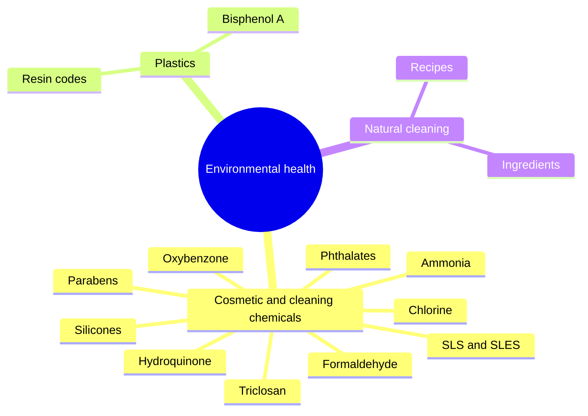

# Environmental health

Environmental health studies how chemicals and materials in our surroundings affect health. These notes cover chemicals in cosmetics and household cleaners that are often labeled "dangerous", plastic types and bisphenol A, and natural cleaning products and recipes. For each substance, the notes separate documented risks (irritation, allergy, toxic gases from mixing) from concerns that are debated or not supported at typical exposures.

## Map

## Reading order

1. [Sodium lauryl sulfate and sodium laureth sulfate](sls-and-sles.md)
2. [Parabens](parabens.md)
3. [Formaldehyde](formaldehyde.md)
4. [Triclosan](triclosan.md)
5. [Phthalates](phthalates.md)
6. [Silicones](silicones.md)
7. [Ammonia](ammonia.md)
8. [Chlorine and bleach](chlorine.md)
9. [Oxybenzone](oxybenzone.md)
10. [Hydroquinone](hydroquinone.md)
11. [Plastic resin codes](plastic-resin-codes.md)
12. [Bisphenol A](bisphenol-a.md)
13. [Natural cleaning ingredients](natural-cleaning.md)
14. [Natural cleaning recipes](natural-cleaning-recipes.md)

Sodium benzoate, which the notes also list among dangerous chemicals in cosmetics, is covered in [Sodium benzoate (E211)](../nutrition/food-additives/sodium-benzoate.md). The notes state it can turn into benzo(a)pyrene; the documented issue is formation of traces of benzene when benzoate meets vitamin C, heat or light.
