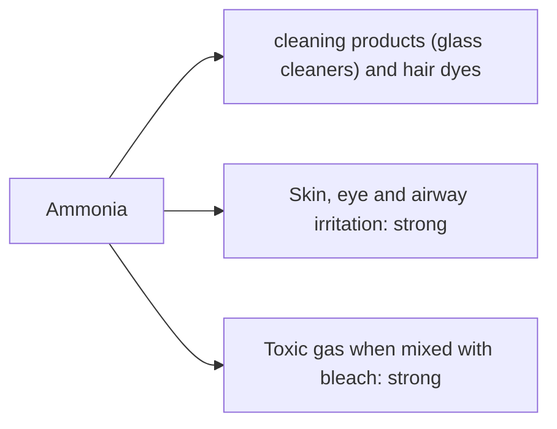

# Ammonia

## Summary

Ammonia is used in cleaning products (glass cleaners) and hair dyes. The concern raised in the notes: ammonia irritates skin, eyes and airways and can cause serious irritation and breathing problems. Ammonia is a strong irritant at high concentrations; household solutions are diluted but still irritate in poorly ventilated spaces. The main danger is mixing ammonia with bleach, which forms toxic chloramine gas. In hair dyes, ammonia opens the hair cuticle; "ammonia-free" dyes use other alkaline agents.

*This note is educational. It is not medical advice and does not replace a doctor, dietitian or pharmacist, especially during pregnancy, illness or when taking medicines.*

## Prerequisites

No prior notes are needed.

## Core concepts

### Definition

*Ammonia* (NH3) is an alkaline gas; household ammonia is an aqueous solution (ammonium hydroxide), typically 5 to 10 percent.

### Analogy

Ammonia in cleaners is like a strong wind that blows away greasy film from glass. Indoors, without ventilation, the same wind stings the eyes and throat. The analogy breaks because mixing it with bleach creates a different, much more dangerous gas.

### Mechanism

Ammonia dissolves in moist tissues, forming ammonium hydroxide, which causes alkaline irritation and burns. With sodium hypochlorite (bleach), it forms chloramines, which damage the lungs.

The flowchart links exposure routes to the documented and debated effects.

### Claimed risks and evidence

Each entry states the claimed risk and how strong the evidence for it is at typical exposures, using the grades in [Evidence grades](../nutrition/evidence-grades.md).

- **Skin, eye and airway irritation.** Well documented. Evidence: strong.
- **Toxic gas when mixed with bleach.** Chloramine poisoning cases are common. Evidence: strong.

## Worked example

A person cleans a bathroom with a bleach-based product and then sprays an ammonia glass cleaner. Within minutes they cough and feel short of breath: chloramine gas has formed. They leave the room, ventilate it and seek medical help if symptoms persist.

## Trade offs and when to use it

Ammonia cleaners are effective for glass; use with ventilation and never mix with bleach.

## Common mistakes

- **Mixing ammonia with bleach.** It produces toxic chloramine gas.

## Practice

1. What gas forms when ammonia meets bleach?
2. Why is ammonia used in hair dye?

### Answers

1. Chloramine.
2. To open the hair cuticle.

## Further reading

- Agency for Toxic Substances and Disease Registry (2004). Toxicological profile for ammonia. [Link](https://www.atsdr.cdc.gov/toxprofiles/tp126.pdf). Toxicological profile of ammonia.
