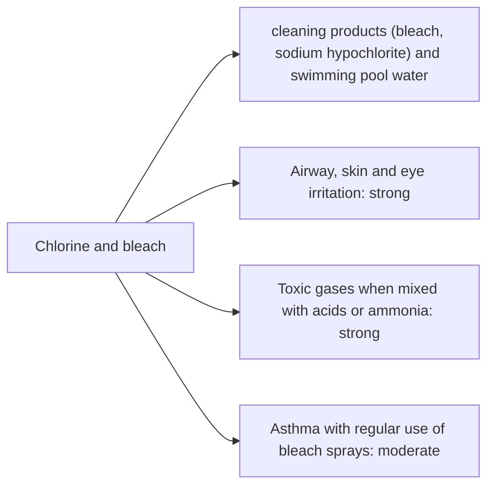

# Chlorine and bleach

## Summary

Chlorine and bleach is used in cleaning products (bleach, sodium hypochlorite) and swimming pool water. The concern raised in the notes: chlorine irritates the airways, skin and eyes and can react with other chemicals to form toxic compounds. Household bleach (sodium hypochlorite, about 3 to 6 percent) is an effective disinfectant. Mixed with acids (vinegar, toilet cleaners) it releases chlorine gas; with ammonia, chloramines. Regular use of bleach sprays is associated with asthma in cleaners. In pools, chloramines formed from sweat and urine cause "pool smell" and irritation.

*This note is educational. It is not medical advice and does not replace a doctor, dietitian or pharmacist, especially during pregnancy, illness or when taking medicines.*

## Prerequisites

No prior notes are needed.

## Core concepts

### Definition

*Sodium hypochlorite* (NaOCl) is the active ingredient of bleach. *Chlorine gas* (Cl2) forms when hypochlorite is acidified.

### Analogy

Bleach is like a strong chemical eraser that removes germs and stains. Mixed with the wrong partner, the eraser becomes a toxic cloud. The analogy breaks because the eraser also wears out what it cleans (fabrics, surfaces) over time.

### Mechanism

Hypochlorite oxidizes proteins and other molecules in microbes. Acidification releases chlorine gas, which forms hydrochloric and hypochlorous acids in moist airways, causing irritation, coughing and in severe cases lung edema.

The flowchart links exposure routes to the documented and debated effects.

### Claimed risks and evidence

Each entry states the claimed risk and how strong the evidence for it is at typical exposures, using the grades in [Evidence grades](../nutrition/evidence-grades.md).

- **Airway, skin and eye irritation.** Well documented. Evidence: strong.
- **Toxic gases when mixed with acids or ammonia.** Well documented poisonings. Evidence: strong.
- **Asthma with regular use of bleach sprays.** Observational studies in cleaners and households. Evidence: moderate.

## Worked example

A person pours bleach into a toilet already treated with an acidic descaler and smells a sharp, choking odor: chlorine gas. They leave the room and ventilate it. Using one product at a time, and rinsing between products, prevents this.

## Trade offs and when to use it

Bleach is valuable for disinfection (for example after illness) but is unnecessary for routine cleaning, where soap and water suffice.

## Common mistakes

- **Mixing bleach with acids or ammonia.** It releases toxic gases.
- **Using bleach sprays daily in small rooms.** Regular use is linked to asthma.

## Practice

1. What is the active ingredient of bleach?
2. What forms when bleach meets vinegar?
3. What causes "pool smell"?

### Answers

1. Sodium hypochlorite.
2. Chlorine gas.
3. Chloramines formed from chlorine and body substances.

## Further reading

- Centers for Disease Control and Prevention. Facts about chlorine. [Link](https://emergency.cdc.gov/agent/chlorine/basics/facts.asp). CDC facts on chlorine.
