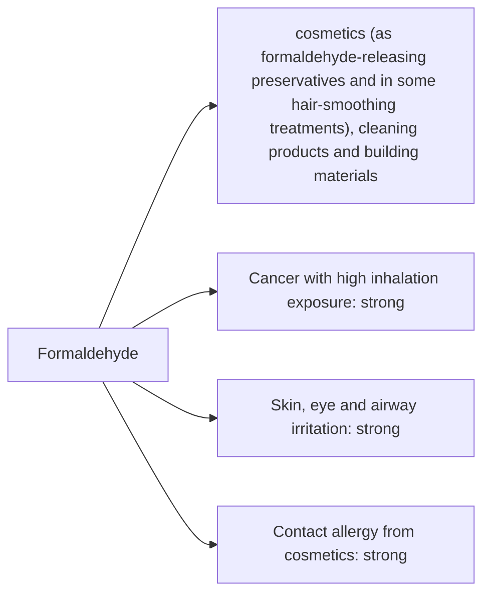

# Formaldehyde

## Summary

Formaldehyde is used in cosmetics (as formaldehyde-releasing preservatives and in some hair-smoothing treatments), cleaning products and building materials. The concern raised in the notes: formaldehyde is a known carcinogen and can irritate skin, eyes and airways. IARC classifies formaldehyde as carcinogenic to humans (Group 1), mainly for nasopharyngeal cancer and leukemia with high occupational inhalation. Indoor air from pressed-wood furniture and smoking is the main exposure for most people. In the EU, cosmetics containing formaldehyde releasers must be labeled, and formaldehyde itself is banned as a cosmetic ingredient. Keratin hair-smoothing treatments can release high levels.

*This note is educational. It is not medical advice and does not replace a doctor, dietitian or pharmacist, especially during pregnancy, illness or when taking medicines.*

## Prerequisites

No prior notes are needed.

## Core concepts

### Definition

*Formaldehyde* (HCHO) is a reactive gas. *Formaldehyde releasers* (for example DMDM hydantoin, quaternium-15) are preservatives that slowly release it.

### Analogy

Formaldehyde is like a strong glue at the molecular level: it cross-links proteins and DNA, which is useful for preserving tissue specimens but harmful to living cells. The analogy breaks because the body also makes formaldehyde naturally in small amounts and detoxifies it.

### Mechanism

Formaldehyde reacts with amino groups, cross-linking proteins and DNA. Inhaled, it irritates the eyes, nose and throat at about 0.5 to 1 ppm; chronic high exposure causes cancer. On skin, it is a common contact allergen.

The flowchart links exposure routes to the documented and debated effects.

### Claimed risks and evidence

Each entry states the claimed risk and how strong the evidence for it is at typical exposures, using the grades in [Evidence grades](../nutrition/evidence-grades.md).

- **Cancer with high inhalation exposure.** IARC Group 1; occupational studies. Evidence: strong.
- **Skin, eye and airway irritation.** Well documented. Evidence: strong.
- **Contact allergy from cosmetics.** Formaldehyde and releasers are common allergens. Evidence: strong.

## Worked example

A hairdresser performing keratin smoothing treatments develops eye irritation and coughing. Air measurements during such treatments have exceeded occupational limits. Good ventilation and formaldehyde-free products reduce exposure.

## Trade offs and when to use it

Low exposures from cosmetics are mainly an allergy issue; indoor air (new furniture, smoking) and occupational exposure matter more for cancer risk.

## Common mistakes

- **Using keratin smoothing treatments in poorly ventilated rooms.** They can release high formaldehyde levels.

## Practice

1. How does IARC classify formaldehyde?
2. What are formaldehyde releasers?
3. What is the main exposure source for most people?

### Answers

1. Carcinogenic to humans, Group 1.
2. Preservatives that slowly release formaldehyde.
3. Indoor air from pressed-wood products and smoking.

## Further reading

- International Agency for Research on Cancer (2012). *Formaldehyde. In: Chemical Agents and Related Occupations. IARC Monographs, Volume 100F*. [Link](https://publications.iarc.who.int/123). IARC monograph on formaldehyde.
- European Parliament and Council (2009). Regulation (EC) No 1223/2009 on cosmetic products. [Link](https://eur-lex.europa.eu/eli/reg/2009/1223/oj). EU cosmetics regulation.
