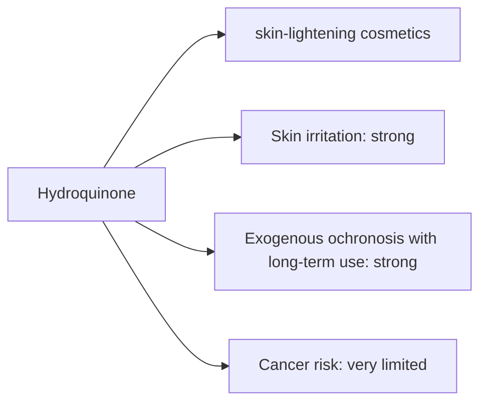

# Hydroquinone

## Summary

Hydroquinone is used in skin-lightening cosmetics. The concern raised in the notes: it can irritate the skin and, with long-term use, cause more serious problems including skin damage and possibly cancer. Hydroquinone inhibits tyrosinase, reducing melanin production. It is effective for melasma and hyperpigmentation under medical supervision. Long-term or high-concentration use can cause exogenous ochronosis, a paradoxical blue-black darkening of the skin. It is banned in EU cosmetics and available only as a prescription medicine; animal cancer data are debated. Illegal lightening creams may also contain mercury or steroids.

*This note is educational. It is not medical advice and does not replace a doctor, dietitian or pharmacist, especially during pregnancy, illness or when taking medicines.*

## Prerequisites

No prior notes are needed.

## Core concepts

### Definition

*Hydroquinone* (benzene-1,4-diol) is a depigmenting agent. *Exogenous ochronosis* is blue-black skin pigmentation caused by long-term hydroquinone use.

### Analogy

Hydroquinone is like turning down the pigment factory's main machine (tyrosinase). Used briefly under supervision, it fades dark spots; used for years at high strength, the factory produces strange dark deposits instead. The analogy breaks because the cause of ochronosis is not fully understood.

### Mechanism

Hydroquinone inhibits tyrosinase and is toxic to melanocytes. Prescription creams contain 2 to 4 percent, often combined with tretinoin and a steroid, for a limited time. Unregulated products may contain much higher concentrations.

The flowchart links exposure routes to the documented and debated effects.

### Claimed risks and evidence

Each entry states the claimed risk and how strong the evidence for it is at typical exposures, using the grades in [Evidence grades](../nutrition/evidence-grades.md).

- **Skin irritation.** Common. Evidence: strong.
- **Exogenous ochronosis with long-term use.** Documented, especially with high concentrations and prolonged use. Evidence: strong.
- **Cancer risk.** Animal data debated; no clear human evidence. Evidence: very limited.

## Worked example

A person with melasma uses a 4 percent hydroquinone cream prescribed by a dermatologist for 3 months together with daily sunscreen, then switches to maintenance with azelaic acid. This avoids long-term continuous use. Over-the-counter lightening creams from unregulated sources may contain mercury, which is toxic.

## Trade offs and when to use it

Effective for hyperpigmentation under supervision; unsafe in unregulated, long-term use.

## Common mistakes

- **Using unregulated lightening creams.** They may contain mercury or steroids.
- **Continuous use for years.** It risks ochronosis.

## Practice

1. How does hydroquinone lighten skin?
2. What is exogenous ochronosis?
3. What is its status in EU cosmetics?

### Answers

1. It inhibits tyrosinase and melanin production.
2. Blue-black skin darkening from long-term hydroquinone use.
3. Banned; available only as a prescription medicine.

## Further reading

- European Parliament and Council (2009). Regulation (EC) No 1223/2009 on cosmetic products. [Link](https://eur-lex.europa.eu/eli/reg/2009/1223/oj). EU cosmetics regulation.
