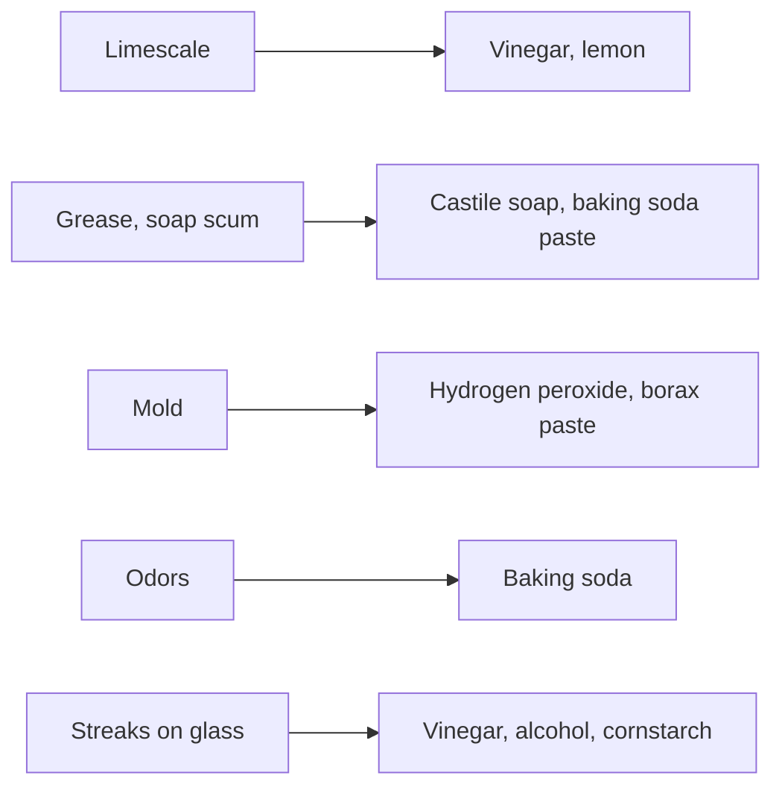

# Natural cleaning recipes

## Summary

This note collects household cleaning recipes based on vinegar, baking soda, lemon, castile soap, isopropyl alcohol, hydrogen peroxide, borax and essential oils: a washing machine cleaner, a mold spore remover, kitchen and bathroom cleaners, a floor cleaner, a carpet freshener, a glass cleaner, a limescale and soap scum remover, a mold and mildew remover, a daily shower spray and a paste for greasy shower glass. Each recipe is followed by notes on how it works and on safety.

## Prerequisites

- [Natural cleaning ingredients](natural-cleaning.md)

## Core concepts

### Definition

*Castile soap* is a vegetable oil-based soap. *Isopropyl alcohol* (70 percent) is a solvent and disinfectant. *Hydrogen peroxide* (3 percent) is an oxidizing disinfectant that kills mold spores.

### Analogy

These recipes are like a cookbook for cleaning: each combines a few basic ingredients for a specific job. As in cooking, some combinations work against each other, so understanding the chemistry helps.

### Mechanism

**1. Washing machine cleaner.** Ingredients: baking soda, white vinegar, half a lemon (or lemon juice), toothpaste. Put the lemon in the drum, add baking soda with vinegar to the door seal and apply toothpaste to the door glass. *Note:* a hot empty cycle with vinegar (or a commercial cleaner) is the main cleaning action; mixing soda and vinegar at the seal neutralizes them.

**2. Mold spore remover (hydrogen peroxide).** 2 tablespoons of dish soap, half a small bottle of 3 percent hydrogen peroxide, 10 to 20 drops of tea tree or clove oil. Apply and wipe, or leave for 15 minutes for a better effect, then rinse well. *Note:* hydrogen peroxide kills mold spores; do not mix it with vinegar in the same container.

**3. Kitchen cleaner.** 1 cup of white vinegar, 1 cup of water, 1 teaspoon of baking soda, a few drops of essential oil (lemon or tea tree). Pour water and vinegar into a spray bottle, add baking soda carefully (it foams), shake gently, then add the oil. Good for countertops, stoves and sinks. *Note:* the small amount of soda partly neutralizes the vinegar; not for natural stone.

**4. Bathroom cleaner.** Half a cup of baking soda, a quarter cup of vinegar, a quarter cup of lemon juice, a quarter cup of water. Mix soda and water into a paste, apply to tubs, sinks and tiles, leave a few minutes, spray with vinegar, wait and scrub with a sponge or brush.

**5. Floor cleaner.** Half a cup of vinegar, 1 gallon (about 4 liters) of warm water, 1 tablespoon of liquid castile soap, a few drops of essential oil (mint or lavender). Mix in a bucket, dip and wring the mop well. Suitable for tiles and linoleum; for wood, test first and use little water. *Note:* vinegar and castile soap partly react (the acid splits soap into fatty acids), which can leave a film; some people use one or the other.

**6. Carpet freshener.** 1 cup of baking soda, 10 to 15 drops of essential oil (lavender or eucalyptus). Mix, sprinkle evenly on the carpet, leave 15 to 30 minutes and vacuum thoroughly. Freshens and neutralizes odors. *Note:* keep pets away; many oils are toxic to cats and dogs.

**7. Glass and mirror cleaner.** A quarter cup of vinegar, a quarter cup of 70 percent isopropyl alcohol, 1 tablespoon of cornstarch, 2 cups of distilled water. Shake in a spray bottle, spray and wipe with a clean, dry cloth.

**8. Limescale and soap scum remover.** Half a cup of white vinegar, half a cup of water, a quarter cup of lemon juice, 1 tablespoon of castile soap (optional), 10 drops of essential oil (tea tree or lemon). Mix vinegar, water and lemon juice in a spray bottle, add soap and oil, spray the shower focusing on deposits, leave 10 to 15 minutes and wipe with a damp sponge or microfiber cloth. Vinegar and lemon dissolve limescale; soap lifts greasy soap scum.

**9. Mold and mildew remover.** Half a cup of borax, half a cup of baking soda, 1 cup of water, 10 drops of tea tree oil. Mix into a thick paste, add the oil, apply to mold on grout or silicone, leave 15 to 30 minutes, scrub with a grout brush and rinse thoroughly. *Note:* wear gloves (borax); persistent mold on silicone often needs replacement of the sealant.

**10. Daily shower spray.** Half a cup of water, half a cup of white vinegar, a quarter cup of isopropyl alcohol (optional, for extra disinfection), 1 tablespoon of castile soap, a few drops of essential oil (eucalyptus or lavender). Spray after each shower and let dry; no rinsing needed. Vinegar and alcohol prevent limescale and soap scum build-up.

**11. Greasy shower glass paste.** Half a cup of baking soda and the juice of one lemon. Mix into a paste, apply to the glass focusing on greasy spots, leave 5 to 10 minutes, rinse and dry. Baking soda scrubs and citric acid descales.

The notes describe these recipes as natural, effective and environmentally safe; they are generally gentler than commercial products, but not all are stronger cleaners, and several ingredients need care.

The flowchart matches cleaning problems to active ingredients.

### Claims and evidence

Each entry states the claimed risk and how strong the evidence for it is at typical exposures, using the grades in [Evidence grades](../nutrition/evidence-grades.md).

- **Effective for limescale and grease.** Supported by basic chemistry. Evidence: established physiology.
- **Hydrogen peroxide kills mold spores.** Documented antimicrobial action. Evidence: moderate.
- **Essential oils add disinfecting power.** Minor effect at the concentrations used. Evidence: very limited.

## Worked example

A person with limescale on a glass shower door sprays recipe 8, waits 15 minutes and wipes; the deposits dissolve. For mold in silicone sealant, recipe 2 removes the surface staining, but the mold returns because it grows inside the silicone, which needs replacing.

## Trade offs and when to use it

Homemade cleaners are cheap and reduce irritant exposure. Label bottles clearly, store them away from children and never mix with bleach.

## Common mistakes

- **Mixing products in unlabeled bottles.** Label all homemade cleaners.
- **Combining peroxide and vinegar in one bottle.** It forms irritating peracetic acid.

## Practice

1. Which ingredient kills mold spores in recipe 2?
2. Why should vinegar not be used on marble?
3. What does castile soap add to limescale remover?

### Answers

1. Hydrogen peroxide.
2. Acid etches stone.
3. It lifts greasy soap scum.

## Further reading

- European Chemicals Agency. Disodium tetraborate: substance information and harmonised classification (Repr. 1B). [Link](https://echa.europa.eu/substance-information/-/substanceinfo/100.110.355). Borax safety classification.
