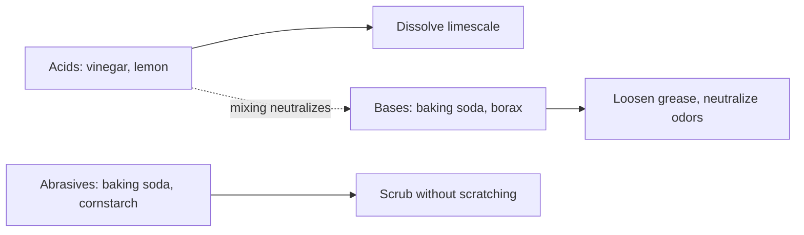

# Natural cleaning ingredients

## Summary

Natural cleaning products rely on a few household ingredients: white vinegar (an acid that dissolves limescale and grease), baking soda (a mild abrasive and deodorizer), lemon (citric acid, a descaler and mild bleach), essential oils (scent and some antimicrobial activity), borax (a disinfectant and laundry booster) and cornstarch (a gentle abrasive for glass and carpets). They work well for many tasks, but they disinfect less reliably than registered disinfectants, and borax is classified in the EU as toxic for reproduction.

## Prerequisites

No prior notes are needed.

## Core concepts

### Definition

*Natural cleaners* are cleaning agents made from common, minimally processed ingredients. Cleaning chemistry: *acids* (vinegar, citric acid) dissolve mineral deposits; *bases* (baking soda, borax) saponify grease and neutralize acids; *abrasives* scrub; *surfactants* (soap) lift oils.

### Analogy

Natural cleaning is like cooking with a few basic ingredients: vinegar is the acid, baking soda the base, soap the emulsifier. Used correctly they cover most jobs. The analogy breaks because mixing the acid and the base, as many recipes do, mostly neutralizes them, leaving salty water and some fizz.

### Mechanism

| Ingredient | Uses | Recipe from the notes | How it works and caveats |
| --- | --- | --- | --- |
| White vinegar | Glass, mirrors, countertops, floors, descaling | Mix 1:1 with water; a few drops of lavender or lemon oil for scent | Acetic acid (about 5 to 10 percent) dissolves limescale and cuts some grease; do not use on natural stone (marble, granite) or wood finishes |
| Baking soda | Ovens, tiles, bathrooms, air freshening, odors | Paste of baking soda with a little water or lemon juice | Mildly alkaline, abrasive and neutralizes odors |
| Lemon | Disinfecting and freshening surfaces, limescale, bleaching and stains | Rub half a lemon on the surface or add juice to vinegar and water | Citric acid descales and mildly bleaches; limited disinfecting power |
| Essential oils | Antibacterial and freshening | A few drops in vinegar or baking soda mixtures (tea tree, lavender, lemon, mint) | Mainly scent; some antimicrobial activity at high concentrations |
| Borax | Toilets, laundry, mold and mildew | 1 to 2 tablespoons dissolved in warm water | Alkaline, antifungal; classified in the EU as toxic for reproduction (Repr. 1B); avoid inhaling powder, keep away from children, wear gloves |
| Cornstarch | Glass and mirrors, carpet freshening | One quarter cup in 1 liter of water | Gentle abrasive that reduces streaks |

**Mixing chemistry.** Vinegar plus baking soda fizzes because they react and neutralize each other (forming sodium acetate, water and carbon dioxide); the fizz helps loosen debris, but the mixture has less cleaning power than either alone. Never mix hydrogen peroxide and vinegar in the same container (forms peracetic acid, an irritant), and never mix any product with bleach ([Chlorine and bleach](chlorine.md)).

The flowchart shows the chemistry of the main ingredients.

### Claims and evidence

Each entry states the claimed risk and how strong the evidence for it is at typical exposures, using the grades in [Evidence grades](../nutrition/evidence-grades.md).

- **Vinegar removes limescale.** Established chemistry. Evidence: established physiology.
- **Natural cleaners disinfect as well as registered disinfectants.** Vinegar and lemon are much weaker against many pathogens. Evidence: not supported.
- **Borax is safe because it is natural.** EU classifies it as toxic for reproduction. Evidence: not supported.
- **Baking soda neutralizes odors.** It reacts with acidic odor molecules. Evidence: established physiology.

## Worked example

A person replaces a commercial glass cleaner with vinegar and water 1:1 and gets streak-free windows. For a kitchen after handling raw chicken, they use hot soapy water and then a registered disinfectant or diluted bleach, because vinegar does not reliably kill Salmonella and Campylobacter on surfaces.

## Trade offs and when to use it

Natural cleaners reduce exposure to irritants and fragrances for everyday cleaning, but registered disinfectants are needed when disinfection matters.

## Common mistakes

- **Using vinegar on marble or granite.** Acid etches stone.
- **Assuming borax is harmless.** Use gloves and keep away from children.
- **Mixing vinegar and baking soda expecting stronger cleaning.** They neutralize each other.

## Practice

1. Why does vinegar remove limescale?
2. What happens when vinegar and baking soda are mixed?
3. Why should borax be used with care?

### Answers

1. Acetic acid dissolves calcium carbonate.
2. They neutralize each other, releasing carbon dioxide.
3. It is classified as toxic for reproduction in the EU.

## Further reading

- European Chemicals Agency. Disodium tetraborate: substance information and harmonised classification (Repr. 1B). [Link](https://echa.europa.eu/substance-information/-/substanceinfo/100.110.355). ECHA classification of borax.
- Centers for Disease Control and Prevention. Facts about chlorine. [Link](https://emergency.cdc.gov/agent/chlorine/basics/facts.asp). Chemical safety of bleach mixtures.
