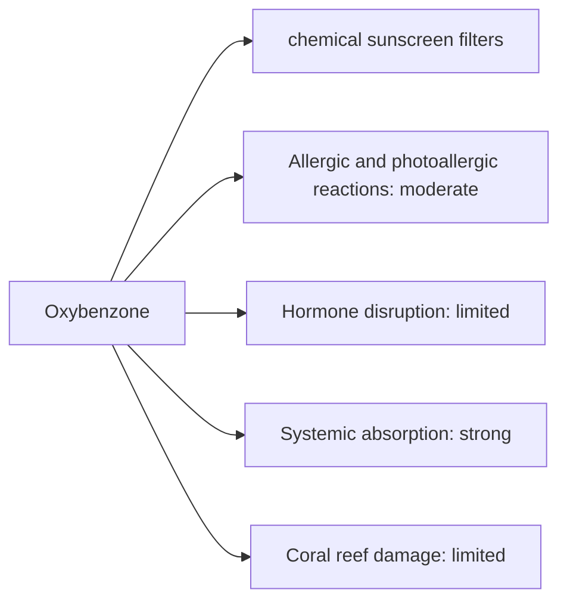

# Oxybenzone

## Summary

Oxybenzone is used in chemical sunscreen filters. The concern raised in the notes: oxybenzone may cause allergic reactions, disrupt hormones and damage the environment. Oxybenzone (benzophenone-3) is absorbed through skin: an FDA study found blood levels above the threshold that triggers further safety testing, which does not mean it is harmful. It is a relatively common photoallergen. Weak endocrine activity is seen in animals at high doses. Hawaii and some other places banned it because of concerns about coral reefs. The EU limits it to 6 percent in sunscreens.

*This note is educational. It is not medical advice and does not replace a doctor, dietitian or pharmacist, especially during pregnancy, illness or when taking medicines.*

## Prerequisites

No prior notes are needed.

## Core concepts

### Definition

*Oxybenzone* (benzophenone-3) is an organic UV filter that absorbs UVB and some UVA. *Photoallergy* is an allergic reaction triggered by a substance and light together.

### Analogy

Oxybenzone is like a sponge for UV light in the sunscreen layer. The question is how much of the sponge soaks into the body and the sea. The analogy breaks because the benefit of sunscreen (preventing skin cancer) is well proven, while the risks of oxybenzone are uncertain.

### Mechanism

Oxybenzone absorbs UV photons and releases the energy as heat. It penetrates the skin and is excreted in urine. Laboratory studies show weak estrogenic and anti-androgenic effects; human effects at sunscreen exposure are not established. Mineral filters (zinc oxide, titanium dioxide) are alternatives.

The flowchart links exposure routes to the documented and debated effects.

### Claimed risks and evidence

Each entry states the claimed risk and how strong the evidence for it is at typical exposures, using the grades in [Evidence grades](../nutrition/evidence-grades.md).

- **Allergic and photoallergic reactions.** Documented, though uncommon. Evidence: moderate.
- **Hormone disruption.** Animal and laboratory data at high doses. Evidence: limited.
- **Systemic absorption.** Blood levels exceed FDA thresholds for further testing. Evidence: strong.
- **Coral reef damage.** Laboratory studies; field relevance debated. Evidence: limited.

## Worked example

In an FDA trial (Matta and colleagues, 2020), volunteers applying sunscreen to 75 percent of their body four times a day had blood oxybenzone levels far above 0.5 ng/mL, the threshold for further toxicology studies. The authors stressed that people should continue to use sunscreen.

## Trade offs and when to use it

Sun protection prevents skin cancer; people concerned about oxybenzone can choose mineral sunscreens.

## Common mistakes

- **Avoiding sunscreen because of oxybenzone.** Choose another filter instead.

## Practice

1. What is oxybenzone?
2. What did the FDA absorption study show?
3. What are alternatives?

### Answers

1. An organic UV filter, benzophenone-3.
2. Blood levels above the threshold for further testing.
3. Mineral filters such as zinc oxide.

## Further reading

- Matta, M. K., Florian, J., Zusterzeel, R. et al. (2020). Effect of sunscreen application on plasma concentration of sunscreen active ingredients: a randomized clinical trial. JAMA, 323(3), 256-267. [DOI](https://doi.org/10.1001/jama.2019.20747). FDA trial of sunscreen absorption.
- European Parliament and Council (2009). Regulation (EC) No 1223/2009 on cosmetic products. [Link](https://eur-lex.europa.eu/eli/reg/2009/1223/oj). EU cosmetics regulation.
