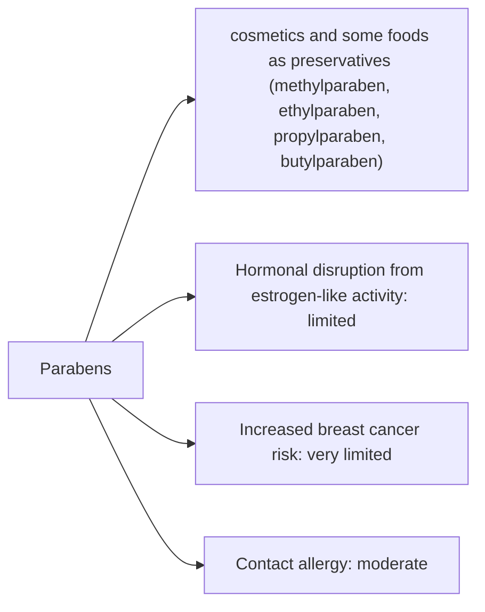

# Parabens

## Summary

Parabens is used in cosmetics and some foods as preservatives (methylparaben, ethylparaben, propylparaben, butylparaben). The concern raised in the notes: they may mimic estrogen in the body, causing hormonal disturbances and raising breast cancer risk. Parabens have weak estrogenic activity, thousands of times weaker than estradiol. A 2004 study detected parabens in breast tumor tissue but did not show they caused cancer. The EU banned five less-studied parabens in 2014 and limited propyl- and butylparaben; methyl- and ethylparaben are considered safe at permitted levels.

*This note is educational. It is not medical advice and does not replace a doctor, dietitian or pharmacist, especially during pregnancy, illness or when taking medicines.*

## Prerequisites

No prior notes are needed.

## Core concepts

### Definition

*Parabens* are esters of para-hydroxybenzoic acid used as broad-spectrum preservatives. Longer-chain parabens (propyl, butyl) are more estrogenic than short-chain ones (methyl, ethyl).

### Analogy

Parabens are like a very faint copy of the estrogen key: it fits the lock but barely turns it. The concern is whether many faint keys, used daily, add up. The analogy breaks because the body breaks parabens down quickly and they do not accumulate much.

### Mechanism

Parabens bind estrogen receptors weakly. They are absorbed through skin, metabolized to para-hydroxybenzoic acid and excreted in urine. Without preservatives, water-based cosmetics grow bacteria and fungi, which are a real health risk; paraben-free products use other preservatives, some more allergenic (for example methylisothiazolinone).

The flowchart links exposure routes to the documented and debated effects.

### Claimed risks and evidence

Each entry states the claimed risk and how strong the evidence for it is at typical exposures, using the grades in [Evidence grades](../nutrition/evidence-grades.md).

- **Hormonal disruption from estrogen-like activity.** Weak activity in laboratory studies; human effects at cosmetic exposure not shown. Evidence: limited.
- **Increased breast cancer risk.** Parabens found in tumor tissue, but no causal link shown. Evidence: very limited.
- **Contact allergy.** Parabens are rare sensitizers compared with other preservatives. Evidence: moderate.

## Worked example

A person replaces paraben-containing lotion with a "paraben-free" product preserved with methylisothiazolinone and develops contact dermatitis. Methylisothiazolinone caused a European allergy epidemic in the 2010s and is now restricted, illustrating that alternatives are not automatically safer.

## Trade offs and when to use it

Parabens are among the best-studied preservatives; regulators set limits based on long-chain parabens. Choosing paraben-free products is a personal choice, not a clear health gain.

## Common mistakes

- **Assuming paraben-free means safer.** Alternative preservatives can be more allergenic.

## Practice

1. What are parabens used for?
2. Which parabens are more estrogenic?
3. Did the 2004 study show that parabens cause breast cancer?

### Answers

1. As preservatives.
2. Longer-chain ones such as propyl- and butylparaben.
3. No, it only detected them in tumor tissue.

## Further reading

- Scientific Committee on Consumer Safety (2013). *Opinion on parabens (SCCS/1514/13)*. [Link](https://health.ec.europa.eu/scientific-committees/scientific-committee-consumer-safety-sccs_en). SCCS opinion on parabens.
- Darbre, P. D., Aljarrah, A., Miller, W. R. et al. (2004). Concentrations of parabens in human breast tumours. Journal of Applied Toxicology, 24(1), 5-13. [DOI](https://doi.org/10.1002/jat.958). Study of parabens in breast tumors.
