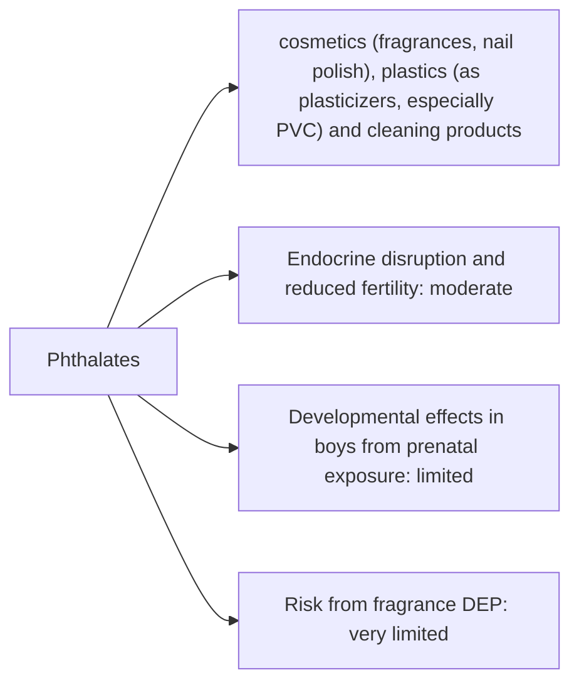

# Phthalates

## Summary

Phthalates is used in cosmetics (fragrances, nail polish), plastics (as plasticizers, especially PVC) and cleaning products. The concern raised in the notes: they can affect the endocrine system, causing fertility and developmental problems. Some phthalates (DEHP, DBP, BBP, DIBP) are anti-androgenic in animals and classified as toxic for reproduction in the EU; they are banned in cosmetics and restricted in toys and consumer articles. Human studies associate prenatal exposure with changes in genital development in boys and other outcomes, though causation is hard to prove. Diethyl phthalate (DEP), used in fragrances, is less toxic.

*This note is educational. It is not medical advice and does not replace a doctor, dietitian or pharmacist, especially during pregnancy, illness or when taking medicines.*

## Prerequisites

No prior notes are needed.

## Core concepts

### Definition

*Phthalates* are esters of phthalic acid used to make plastics flexible and to carry fragrances. *DEHP* is di(2-ethylhexyl) phthalate; *DBP* is dibutyl phthalate.

### Analogy

Phthalates are like oil between plastic molecules, making stiff PVC soft. Because they are not chemically bound, they slowly leak out, especially with heat and fat. The analogy breaks because some of the leaked "oil" interferes with hormones.

### Mechanism

Several phthalates and their metabolites reduce testosterone production in fetal testes in animals (the "phthalate syndrome"). Exposure is mainly through food (from packaging and processing), dust and personal care products. Phthalates have short half-lives, so exposure falls quickly when sources are reduced.

The flowchart links exposure routes to the documented and debated effects.

### Claimed risks and evidence

Each entry states the claimed risk and how strong the evidence for it is at typical exposures, using the grades in [Evidence grades](../nutrition/evidence-grades.md).

- **Endocrine disruption and reduced fertility.** Animal studies clear; human association studies mixed. Evidence: moderate.
- **Developmental effects in boys from prenatal exposure.** Association studies (anogenital distance). Evidence: limited.
- **Risk from fragrance DEP.** Less toxic; low concern at typical levels. Evidence: very limited.

## Worked example

A study in families found that switching to fresh, unpackaged food for a few days reduced urinary DEHP metabolites by more than half. Reducing processed and plastic-packaged food is a practical way to lower exposure.

## Trade offs and when to use it

Phthalate restrictions in the EU have reduced exposure. Avoiding heating food in plastic and choosing fresh foods further lowers it.

## Common mistakes

- **Microwaving food in soft plastic.** Heat increases migration.

## Practice

1. Why are phthalates added to plastics?
2. Which phthalates are restricted in the EU?
3. What is the main source of exposure?

### Answers

1. To make them flexible.
2. DEHP, DBP, BBP and DIBP.
3. Food contact materials and processed food.

## Further reading

- European Chemicals Agency (2018). Restriction of four phthalates (DEHP, BBP, DBP, DIBP) under REACH Annex XVII, entry 51. [Link](https://echa.europa.eu/hot-topics/phthalates). ECHA information on phthalate restrictions.
- European Parliament and Council (2009). Regulation (EC) No 1223/2009 on cosmetic products. [Link](https://eur-lex.europa.eu/eli/reg/2009/1223/oj). EU cosmetics regulation.
