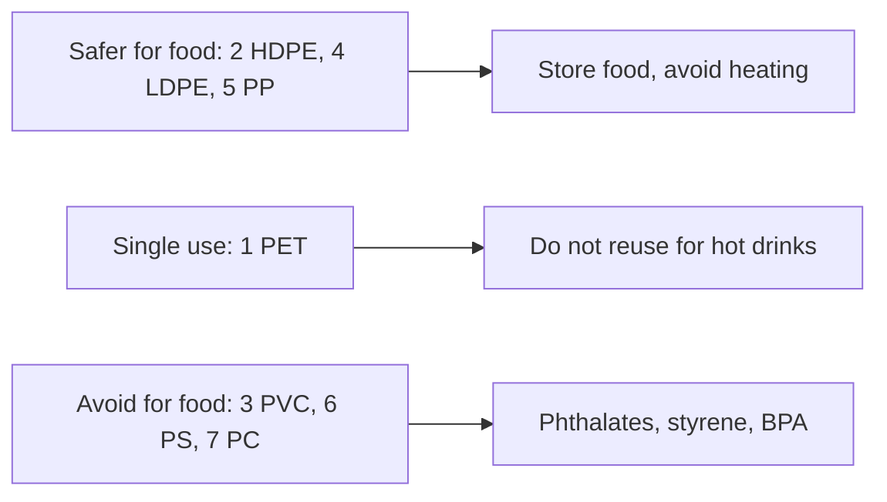

# Plastic resin codes

## Summary

The numbers 1 to 7 inside the recycling triangle on plastic products identify the type of plastic. Each has different properties and uses. HDPE (2), LDPE (4) and PP (5) are generally considered the safest for food contact; PET (1) is safe for single use; PVC (3), polystyrene (6) and polycarbonate in group 7 raise more concerns because of phthalates, styrene and bisphenol A. Heating food in plastic increases migration of chemicals from any type.

## Prerequisites

No prior notes are needed.

## Core concepts

### Definition

*Resin identification codes* (ASTM D7611) are numbers that identify the polymer. They are meant for sorting and recycling, not as safety ratings.

### Analogy

Resin codes are like the material labels on clothing: they tell you what the item is made of, which helps you guess how to care for it. They do not tell you whether it is safe for every use. The analogy breaks because even "safe" plastics can release chemicals when heated.

### Mechanism

| Code | Plastic | Uses | Safety notes |
| --- | --- | --- | --- |
| 1 | PET (polyethylene terephthalate) | Drink bottles, food containers, cosmetic packaging | Generally safe, intended for single use; reuse and heat can increase release of antimony and acetaldehyde in small amounts; avoid reusing for hot drinks |
| 2 | HDPE (high-density polyethylene) | Milk bottles, detergent bottles, food packaging, toys | Considered safe; rarely releases harmful substances; one of the safest plastics |
| 3 | PVC (polyvinyl chloride) | Pipes, cling film, toys, window frames | Avoid for food; may release phthalates (soft PVC) and hydrogen chloride when burned |
| 4 | LDPE (low-density polyethylene) | Shopping bags, cling film, food containers | Considered safe for food contact; do not heat food in it |
| 5 | PP (polypropylene) | Yogurt pots, caps, food containers, baby bottles | One of the safest for food; heat resistant and often marked microwave-safe |
| 6 | PS (polystyrene) | Disposable cups, food trays, fast food containers, foam | Avoid with hot or fatty food; may release styrene, probably carcinogenic (IARC Group 2A) |
| 7 | Other (polycarbonate, bioplastics) | Reusable bottles, food containers, lenses | Varies; polycarbonate (PC) may contain bisphenol A; bioplastics vary; look for "BPA-free" |

**Summary from the notes.** Safer plastics: 2 (HDPE), 4 (LDPE), 5 (PP). Plastics to avoid: 3 (PVC), 6 (PS), 7 (polycarbonate with BPA). Avoid heating food in plastic, especially types 1, 3, 6 and 7; look for "BPA-free" and choose plastics with low emissions. Note that "BPA-free" products may use substitutes such as BPS, which has similar activity in laboratory studies ([Bisphenol A](bisphenol-a.md)).

The flowchart summarizes the safety groups.

### Risks and evidence

Each entry states the claimed risk and how strong the evidence for it is at typical exposures, using the grades in [Evidence grades](../nutrition/evidence-grades.md).

- **Chemical migration increases with heat and fat.** Well documented for many plastics. Evidence: strong.
- **PS releases styrene.** Measured migration into hot food; styrene is IARC Group 2A. Evidence: moderate.
- **PET reuse is harmful.** Small increases in migration; risk at these levels is low. Evidence: limited.

## Worked example

A person reheats leftover soup in the polystyrene takeaway container in the microwave. Heat and fat increase styrene migration. Transferring the soup to a glass or ceramic bowl, or a PP container marked microwave-safe, avoids this.

## Trade offs and when to use it

Resin codes help choose containers, but glass, ceramic and stainless steel avoid plastic migration entirely. Recycling infrastructure varies by code.

## Common mistakes

- **Treating resin codes as safety ratings.** They identify material, not safety.
- **Microwaving food in non-microwave-safe plastic.** Use glass or ceramic.

## Practice

1. Which resin codes are considered safest for food?
2. Which plastic may release styrene?
3. What do resin codes identify?

### Answers

1. 2, 4 and 5.
2. Polystyrene, code 6.
3. The type of polymer.

## Further reading

- ASTM International (2020). ASTM D7611: Standard practice for coding plastic manufactured articles for resin identification. [Link](https://www.astm.org/d7611_d7611m-20.html). Standard for resin identification codes.
- International Agency for Research on Cancer (2019). *Styrene, styrene-7,8-oxide, and quinoline. IARC Monographs, Volume 121*. [Link](https://publications.iarc.who.int/582). IARC monograph on styrene.
