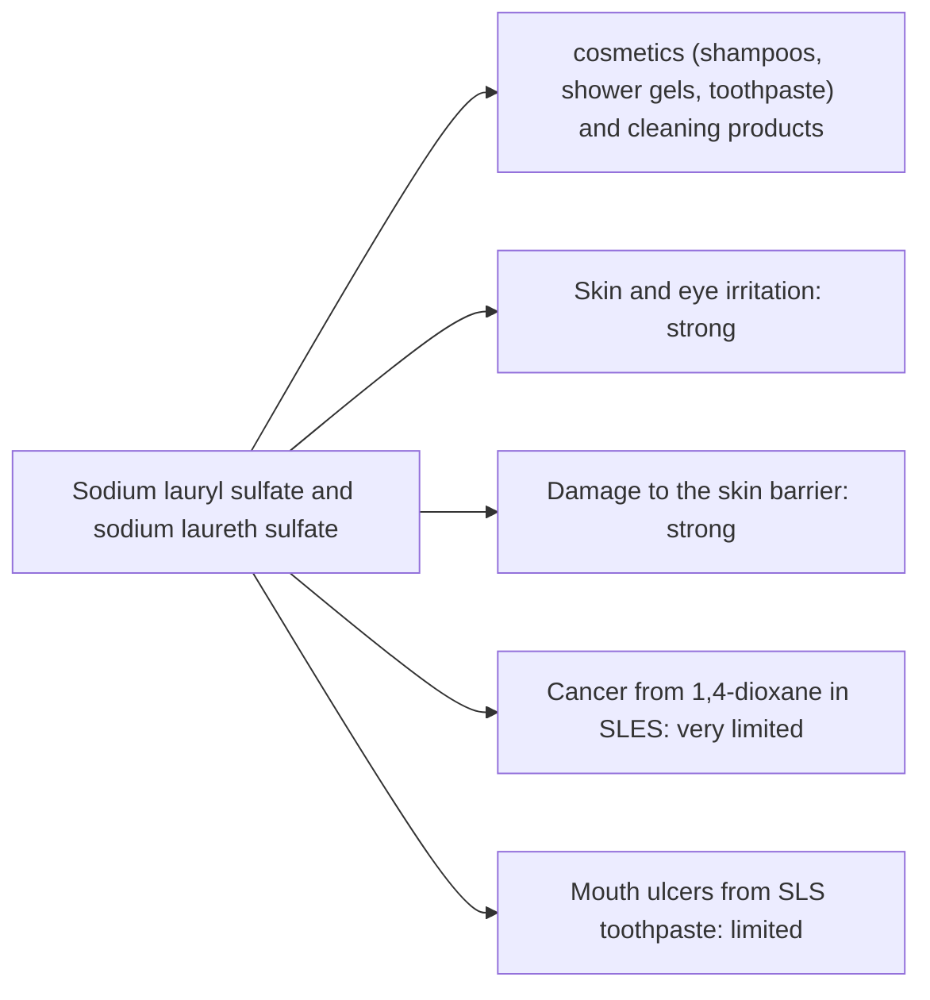

# Sodium lauryl sulfate and sodium laureth sulfate

## Summary

Sodium lauryl sulfate and sodium laureth sulfate is used in cosmetics (shampoos, shower gels, toothpaste) and cleaning products. The concern raised in the notes: both can irritate skin and eyes and affect the skin barrier; SLES may contain 1,4-dioxane, a possible carcinogen. SLS is a known irritant at high concentrations and in leave-on contact, and is used as a model irritant in skin tests. SLES is milder. 1,4-dioxane is a by-product of ethoxylation that manufacturers reduce by vacuum stripping; regulators limit it. Neither causes cancer at cosmetic use levels.

*This note is educational. It is not medical advice and does not replace a doctor, dietitian or pharmacist, especially during pregnancy, illness or when taking medicines.*

## Prerequisites

No prior notes are needed.

## Core concepts

### Definition

*Sodium lauryl sulfate* (SLS) is an anionic surfactant. *Sodium laureth sulfate* (SLES) is its ethoxylated form, milder to the skin. *1,4-Dioxane* is a by-product of ethoxylation, classified by IARC as possibly carcinogenic (Group 2B).

### Analogy

SLS is like a strong dish soap for the skin: it removes oil and dirt efficiently, but also strips the skin's own protective lipids. SLES is the same soap with a softening sleeve (ethoxylation). The analogy breaks because the softening process can leave traces of a contaminant, 1,4-dioxane.

### Mechanism

Surfactants have water-loving and oil-loving ends, lifting oils from surfaces. On skin, SLS disrupts the lipid barrier and denatures keratin, increasing water loss and irritation, especially with prolonged contact. In toothpaste, SLS may increase mouth ulcers in people prone to aphthous ulcers. Rinse-off use limits contact time.

The flowchart links exposure routes to the documented and debated effects.

### Claimed risks and evidence

Each entry states the claimed risk and how strong the evidence for it is at typical exposures, using the grades in [Evidence grades](../nutrition/evidence-grades.md).

- **Skin and eye irritation.** Well documented for SLS, concentration and contact time dependent. Evidence: strong.
- **Damage to the skin barrier.** SLS increases water loss; used as a model irritant. Evidence: strong.
- **Cancer from 1,4-dioxane in SLES.** Trace contaminant; regulated limits; no evidence of cancer from cosmetic use. Evidence: very limited.
- **Mouth ulcers from SLS toothpaste.** Some trials show fewer aphthous ulcers with SLS-free toothpaste. Evidence: limited.

## Worked example

A person with eczema notices their hands worsen with a foaming hand soap. Switching to a mild, SLS-free cleanser and applying moisturizer reduces irritation. For people with healthy skin, rinse-off SLES products are generally well tolerated.

## Trade offs and when to use it

SLS and SLES are effective, cheap cleansers. People with sensitive skin, eczema or recurrent mouth ulcers may benefit from milder surfactants.

## Common mistakes

- **Believing SLS causes cancer.** Its main risk is irritation.
- **Using strong SLS products on eczema.** Choose mild cleansers.

## Practice

1. What is the difference between SLS and SLES?
2. What contaminant can SLES contain?
3. What is the main documented risk of SLS?

### Answers

1. SLES is ethoxylated and milder.
2. 1,4-dioxane.
3. Skin irritation.

## Further reading

- Cosmetic Ingredient Review Expert Panel (1983). Final report on the safety assessment of sodium lauryl sulfate and ammonium lauryl sulfate. Journal of the American College of Toxicology, 2(7), 127-181. [DOI](https://doi.org/10.3109/10915818309142005). Safety assessment of SLS.
- European Parliament and Council (2009). Regulation (EC) No 1223/2009 on cosmetic products. [Link](https://eur-lex.europa.eu/eli/reg/2009/1223/oj). EU cosmetics regulation.
