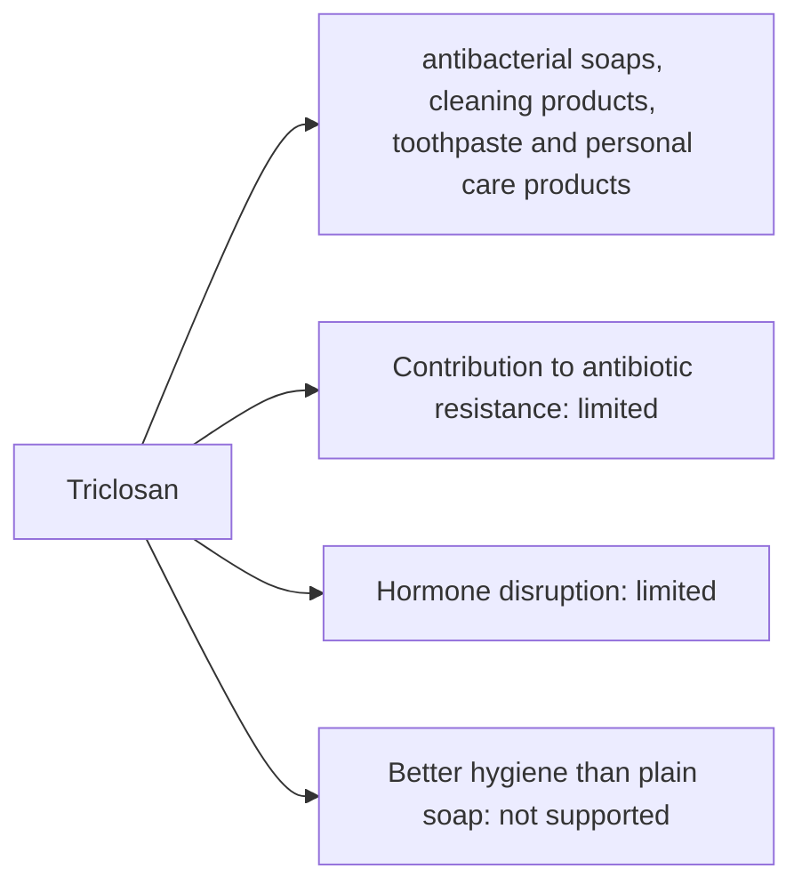

# Triclosan

## Summary

Triclosan is used in antibacterial soaps, cleaning products, toothpaste and personal care products. The concern raised in the notes: it may contribute to antibiotic resistance and disrupt hormone function. In 2016 the US FDA banned triclosan from consumer antiseptic washes because manufacturers did not show they work better than plain soap or that long-term use is safe. Laboratory studies link it to bacterial cross-resistance and thyroid hormone effects in animals. The EU restricted it; it remains permitted in some toothpastes at 0.3 percent, where it reduces gingivitis.

*This note is educational. It is not medical advice and does not replace a doctor, dietitian or pharmacist, especially during pregnancy, illness or when taking medicines.*

## Prerequisites

No prior notes are needed.

## Core concepts

### Definition

*Triclosan* is a chlorinated phenolic antibacterial agent that inhibits bacterial fatty acid synthesis (enoyl-ACP reductase).

### Analogy

Adding triclosan to soap is like putting a security guard in a building that is already locked: plain soap and water already remove germs mechanically. The analogy breaks because the "guard" may also train intruders to resist (resistance) and leak into the environment.

### Mechanism

Triclosan blocks FabI in bacteria. Bacteria exposed to sub-lethal levels can develop resistance and sometimes cross-resistance to antibiotics in the laboratory. It is detected in human urine and breast milk and is persistent in water environments.

The flowchart links exposure routes to the documented and debated effects.

### Claimed risks and evidence

Each entry states the claimed risk and how strong the evidence for it is at typical exposures, using the grades in [Evidence grades](../nutrition/evidence-grades.md).

- **Contribution to antibiotic resistance.** Laboratory evidence of cross-resistance; clinical impact uncertain. Evidence: limited.
- **Hormone disruption.** Thyroid effects in animal studies. Evidence: limited.
- **Better hygiene than plain soap.** FDA found no evidence of benefit in consumer washes. Evidence: not supported.

## Worked example

Hand washing with plain soap for 20 seconds removes most germs mechanically. Antibacterial soaps with triclosan did not reduce illness more than plain soap in household studies, which is why the FDA removed them from the US market.

## Trade offs and when to use it

Plain soap is sufficient for everyday hygiene. In toothpaste, triclosan with copolymer reduces plaque and gingivitis, but many brands have removed it.

## Common mistakes

- **Buying antibacterial soap for home use.** Plain soap works as well.

## Practice

1. What did the FDA decide in 2016?
2. What enzyme does triclosan inhibit?
3. Is antibacterial soap better than plain soap at home?

### Answers

1. It banned triclosan from consumer antiseptic washes.
2. Bacterial enoyl-ACP reductase (FabI).
3. No evidence that it is.

## Further reading

- US Food and Drug Administration (2016). Safety and effectiveness of consumer antiseptics; topical antimicrobial drug products for over-the-counter human use (final rule, 81 FR 61106). [Link](https://www.federalregister.gov/documents/2016/09/06/2016-21337). FDA final rule on consumer antiseptic washes.
