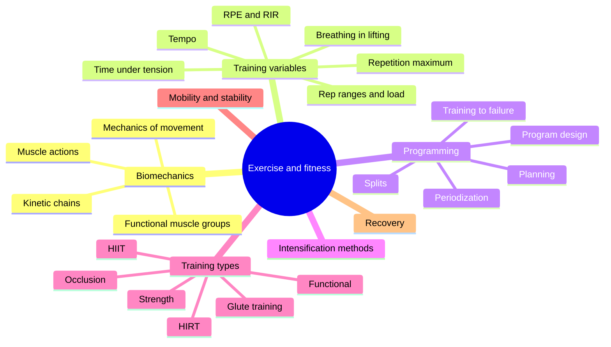

# Exercise and fitness

This field applies anatomy and physiology to training: how movement works mechanically, which variables define a training program, how programs are planned and periodized, which methods intensify training, the main types of training, mobility and stability, and recovery. Notes give the evidence behind each recommendation and mark practices that rest on tradition rather than research.

## Map of the field

## Reading order

1. [Biomechanics](biomechanics/README.md): forces, levers, kinetic chains, how muscles cooperate and the three muscle actions.
2. [Training variables](training-variables/README.md): load, effort, repetitions, tempo and breathing.
3. [Programming](programming/README.md): designing and periodizing a training plan.
4. [Intensification methods](intensification-methods/README.md): drop sets, supersets, myo-reps and 13 other techniques.
5. [Training types](training-types/README.md): strength, HIRT, HIIT, functional and occlusion training, and glute training by shape.
6. [Mobility and stability](mobility/README.md): the joint-by-joint approach, anti-movements and the core.
7. [Recovery](recovery/README.md): regeneration and delayed onset muscle soreness.

## Scope and evidence

- Recommendations follow position stands (American College of Sports Medicine, International Society of Sports Nutrition, National Strength and Conditioning Association) and meta-analyses where available.
- Many popular methods in strength training have little direct research. The notes describe them as practiced and say what is known.
- Training advice here is educational. People with health conditions should get medical clearance before starting hard training.
