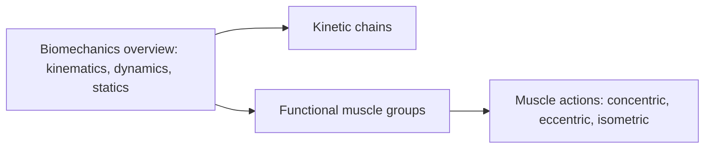

# Biomechanics

Biomechanics applies the laws of mechanics to the human body. Every machine in a gym is designed around biomechanics, so that its range of motion and lever arms suit the body, and the floor, the shoe, body position and the bar all affect the outcome of training. These notes cover the basic mechanics, kinetic chains, how muscles cooperate and the three muscle actions.

## Map

## Reading order

1. [Biomechanics overview](biomechanics-overview.md)
2. [Kinetic chains](kinetic-chains.md)
3. [Functional muscle groups](functional-muscle-groups.md)
4. [Muscle actions: concentric, eccentric and isometric](muscle-actions.md)
