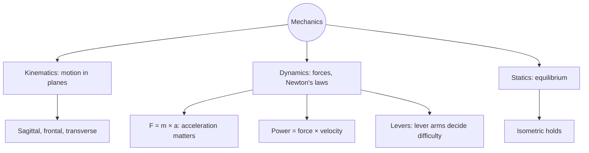

# Biomechanics overview

## Summary

Biomechanics studies how forces act on and are produced by the body. Its basis is mechanics, with three parts: kinematics (describing motion), dynamics (the forces that cause motion) and statics (forces in balance). In training, Newton's second law (force equals mass times acceleration) explains why moving a load faster requires more force, power (force times velocity) explains why explosive training matters, and levers explain why small changes in body position change how hard a lift feels.

## Prerequisites

- [Axes and planes of the body](../../anatomy/anatomical-terminology/axes-and-planes.md)

## Core concepts

### Definition

*Biomechanics* is the application of mechanical principles to living organisms. *Kinematics* describes motion (position, velocity, acceleration, joint angles) without regard to its causes. *Kinetics* or *dynamics* studies the forces that cause motion. *Statics* deals with bodies at rest or in equilibrium, such as holding a plank.

### Analogy

Biomechanics is like the engineering behind a crane. Kinematics describes how the arm swings, dynamics calculates the forces the motors must produce, and statics checks that the crane does not tip over while holding a load. The body is a crane built of bones (beams), joints (pivots) and muscles (motors and cables). The analogy breaks because the body's beams and cables adapt and grow stronger with use.

### Mechanism

**Kinematics.** Motion is described relative to the three body planes ([Axes and planes of the body](../../anatomy/anatomical-terminology/axes-and-planes.md)): the sagittal plane for flexion and extension, the frontal plane for abduction and adduction, the transverse plane for rotation and pronation and supination.

**Dynamics and Newton's laws.** Movement follows Newton's three laws. The second law, F = m × a, is most relevant to training: the force needed depends on the mass and the acceleration. Developing acceleration, and thus speed, has a large effect on strength results. This is why powerlifting programs devote a large part of training to dynamic work. Louie Simmons, founder of Westside Barbell, built about half of his method on dynamic effort training. Resistance bands and chains change the load across the range of motion, so a lifter can push hard through the whole movement.

**Power.** Power is force multiplied by velocity. It is key to continued strength progress and to sport performance. Power training uses relatively light loads, about 50 to 70 percent of 1RM, moved fast, often with plyometric exercises.

**Force-velocity.** In the 1930s, Archibald Hill showed that the force a muscle produces depends on the speed of shortening or lengthening, and that in the eccentric phase a muscle can resist more load than it can lift concentrically. Estimates of the eccentric advantage range from about 20 to 50 percent over maximal isometric force in humans. This is used in training with negatives above 100 percent of 1RM (see [Force, length and velocity of muscle](../../physiology/muscle/force-length-velocity.md)).

**Levers.** Muscles transmit forces to the skeleton, which works as a system of levers. Bones are the lever arms, joints the pivots, muscles the effort and the load the resistance. Most human levers are third-class levers: the muscle attaches between the joint and the load, which favors speed and range over force. The shorter the resistance lever arm, the heavier the load that can be moved. This is why the starting position in a deadlift matters: a small increase in the horizontal distance between the bar and the hips lengthens the lever and can decide whether a lift succeeds. Training is a constant search for the best lever arrangement.

**Statics.** In isometric holds, all forces and torques balance. A plank holds the trunk straight because the abdominal muscles produce a torque equal to that of gravity on the body.

The diagram shows the parts of mechanics and their training uses.

### Torque in a lift

Torque is force multiplied by the perpendicular distance from the axis (moment arm). In a squat, leaning the trunk forward increases the moment arm at the hips and decreases it at the knees, shifting work from the quadriceps to the hip extensors. Bar position (high bar versus low bar) and stance width change these moment arms.

## Worked example

A lifter holds a 100 kg barbell in a deadlift start. If the horizontal distance from the hip joint to the bar is 30 cm, the torque at the hips from the bar is about 100 × 9.81 × 0.30 ≈ 294 N·m. If the bar drifts 5 cm further forward (35 cm), the torque rises to about 343 N·m, about 17 percent more, for the same weight. Keeping the bar close to the body is therefore one of the most important technique cues.

## Trade offs and when to use it

- Third-class levers give speed and range of motion at the cost of requiring large muscle forces, which load tendons and joints.
- Bands and chains match resistance to the strength curve but complicate load measurement.

## Common mistakes

- **Letting the bar drift away from the body in deadlifts and rows.** Longer moment arms increase the load on the back.
- **Thinking only the weight on the bar decides difficulty.** Lever arms and speed matter too.

## Practice

1. What are the three parts of mechanics?
2. Why does power training use loads of about 50 to 70 percent of 1RM?
3. Calculate the torque of a 60 kg load at 0.4 m from a joint.

### Answers

1. Kinematics, dynamics and statics.
2. Power is force times velocity and peaks at moderate loads moved fast.
3. About 60 × 9.81 × 0.4 ≈ 235 N·m.

## Further reading

- Haff, G. G., Triplett, N. T. (Eds.) (2016). *Essentials of Strength Training and Conditioning (4th ed.)*. Human Kinetics. Chapter on biomechanics of resistance exercise.
- Hill, A. V. (1938). The heat of shortening and the dynamic constants of muscle. Proceedings of the Royal Society B, 126(843), 136-195. [DOI](https://doi.org/10.1098/rspb.1938.0050). Force-velocity relationship.
- Simmons, L. (2007). *Westside Barbell Book of Methods*. Westside Barbell. Westside methods including dynamic effort training.
