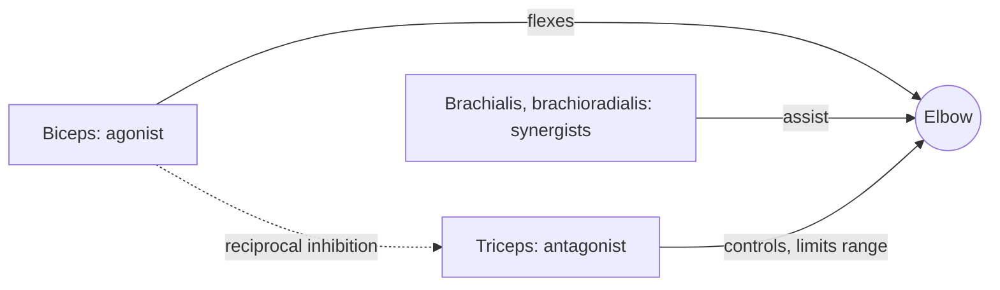

# Functional muscle groups

## Summary

In every movement, muscles take on three functional roles. The agonist produces the movement, the antagonist acts in the opposite direction and controls the movement, and synergists assist the agonist and stabilize the joint. When the biceps flexes the elbow, the triceps is the antagonist and the brachialis a synergist. The same muscle can be an agonist in one movement and an antagonist in another. Reciprocal inhibition, the relaxation of the antagonist when the agonist contracts, is one of the arguments for supersets of opposing muscles.

## Prerequisites

- [Muscle classification](../../anatomy/muscular-system/muscle-classification.md)

## Core concepts

### Definition

An *agonist* (prime mover) is the muscle that produces a given movement. An *antagonist* is a muscle whose action opposes that movement. A *synergist* is a muscle that assists the agonist, either by adding force in the same direction or by stabilizing a joint so the agonist can act efficiently. *Reciprocal inhibition* is the reflex relaxation of the antagonist when the agonist contracts, described by Charles Sherrington.

### Analogy

The roles are like a team moving a heavy cabinet. The agonist pushes, the antagonist at the other end holds back to stop the cabinet from tipping or sliding too far, and synergists steady the sides. The analogy breaks because in the body the "holding back" is often a reflex that relaxes the antagonist so it does not fight the movement.

### Mechanism

**Agonists.** The agonist performs a specific movement; its antagonist is responsible for the opposite movement and allows precise control. Depending on the direction of movement, the same muscle acts as agonist or antagonist.

**Antagonists.** Their main task is to protect the movement while the other muscle works. In elbow flexion, the biceps shortens and the triceps lengthens, guards the movement and gradually limits its range, so the biceps does not shorten excessively. Knowledge of antagonists is the basis of split training plans that train each muscle group separately (see [Split training](../programming/split-training.md)).

**Synergists.** Synergists support the agonist, stabilize the joint and reduce injury risk; they are helper muscles; and they always act as a group producing the same type of movement. Examples include the intercostal muscles in breathing, the trunk muscles, the front and back parts of the deltoid in arm raising, and the brachioradialis in elbow flexion. Training synergists is recommended in every sport.

**Reciprocal inhibition.** Tension in the agonist, through spinal reflexes from muscle spindles, inhibits the motor neurons of the antagonist. This is one argument for supersets and for training opposing muscle groups in the same session; another is that fatigue in one group interferes little with its opponent.

The diagram shows the roles in elbow flexion.

### Programming implications

- Antagonistic muscle groups are often combined in one session, so that their fatigue does not interfere (for example chest and back).
- Supersets pair exercises for opposing groups within one set: biceps with triceps, hamstrings with quadriceps.
- Synergists also tire during compound lifts, which can limit the agonist; for example, triceps fatigue limits the bench press.

## Worked example

In a superset of bench press and barbell row, the chest and back alternate. A 2010 study (Robbins and colleagues) found that pairing these exercises allowed similar performance with less total session time than traditional sets, supporting supersets as an efficient way to train opposing groups. Strength results over longer periods are similar to traditional sets when volume is equal.

## Trade offs and when to use it

- Supersets of antagonists save time with little loss in performance. Supersets of the same muscle (compound sets) are a different, more fatiguing technique.

## Common mistakes

- **Assuming roles are fixed.** A muscle's role depends on the movement.
- **Neglecting synergists.** Weak synergists limit the main lifts and joint stability.

## Practice

1. In a triceps pushdown, which muscle is the antagonist?
2. What is reciprocal inhibition?
3. Give an example of a synergist in elbow flexion.

### Answers

1. The biceps brachii (and brachialis).
2. Reflex relaxation of the antagonist when the agonist contracts.
3. The brachialis or the brachioradialis.

## Further reading

- Sherrington, C. S. (1906). *The Integrative Action of the Nervous System*. Yale University Press. Original description of reciprocal innervation.
- Robbins, D. W., Young, W. B., Behm, D. G. et al. (2010). Agonist-antagonist paired set resistance training: a brief review. Journal of Strength and Conditioning Research, 24(10), 2873-2882. [DOI](https://doi.org/10.1519/JSC.0b013e3181e8d7c4). Study of agonist-antagonist paired sets.
- Betts, J. G., Young, K. A., Wise, J. A. et al. (2022). *Anatomy and Physiology 2e*. OpenStax, Rice University. [Link](https://openstax.org/details/books/anatomy-and-physiology-2e). Section 11.1 on interactions of skeletal muscles.
