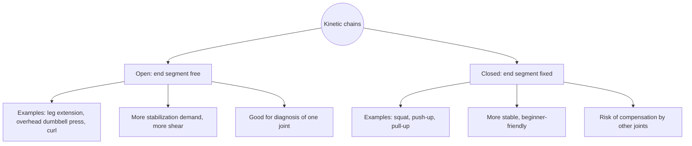

# Kinetic chains

## Summary

A kinetic chain is a series of body segments linked by joints, through which force and movement are transmitted. In an open kinetic chain exercise, the end segment (hand or foot) moves freely, as in an overhead dumbbell press or a leg extension. In a closed kinetic chain exercise, the end segment is fixed against the ground or a stable object, as in a squat or a push-up. Open chain exercises demand more stabilization of the free joint and produce more shear forces; closed chain exercises are more stable and easier for beginners, but allow compensation by other joints.

## Prerequisites

- [Biomechanics overview](biomechanics-overview.md)

## Core concepts

### Definition

The concept of a *kinematic chain* was introduced in mechanics in 1875 (Franz Reuleaux) as a combination of segments connected to each other, divided into open and closed chains. A more technical definition is a connected set of links joined into *kinematic pairs*, a kinematic pair being a movable connection between two links that restricts their relative motion. In the body, the links are bones and the pairs are joints. The mobility of a chain is given by its *degrees of freedom* relative to a fixed base. Arthur Steindler applied the concept to human movement in 1955, and it is commonly called the *kinetic chain* in training.

### Analogy

An open chain is like a fishing rod held at one end: the tip can move anywhere, so controlling it takes skill. A closed chain is like a ladder leaning against a wall: both ends are fixed, so movement at one rung forces movement at others. The analogy breaks because the body can switch between the two within one movement, for example in running, where the leg alternates between swing (open) and stance (closed).

### Mechanism

**Open kinetic chain.** The last link (joint) is not connected to anything or supported on the ground or another stable element. The joint is free, which requires more stabilization and more work of the deep muscles. Examples: a standing overhead dumbbell press (the hand holding the dumbbell is not stabilized or supported), leg extension, biceps curl. These exercises are good tools for strengthening stabilization and activating deep muscles, but they produce more shear forces in the joint. For a coach, open chain exercises are good diagnostic tools, because problems in a single joint are easy to see.

**Closed kinetic chain.** The last joint in the chain does not move freely but is supported, for example on the ground. These exercises are more stable, easier and less injury-prone for beginners. Examples: barbell squat, push-up, pull-up. The bench press is often classed as closed because the bar is held by both hands on a fixed path, although strictly the bar is not fixed. In closed chains, compensations can appear: a stiff ankle in a squat may be compensated by the knees, hips or lower back.

The diagram contrasts the two types.

## Worked example

After anterior cruciate ligament reconstruction, therapists traditionally preferred closed chain exercises such as mini squats, because the leg extension (open chain) produces anterior shear at the knee that strains the graft at certain angles. Current rehabilitation uses both: closed chain early, and open chain leg extensions within a protected range of motion (for example 90 to 45 degrees of flexion) from about week 4 to 6, progressing later, because the quadriceps need specific strengthening.

## Trade offs and when to use it

- Closed chain exercises transfer well to standing activities and are safer to start with; open chain exercises isolate and diagnose individual joints and muscles.
- Many programs combine both.

## Common mistakes

- **Labeling one type as always safer.** Each loads joints differently; dose and technique matter.
- **Ignoring compensations in closed chain exercises.** Watch for movement shifting to neighboring joints.

## Practice

1. Is a push-up an open or closed chain exercise?
2. Why are open chain exercises useful for diagnosis?
3. What is a kinematic pair?

### Answers

1. Closed: the hands are fixed on the floor.
2. They isolate one joint, so problems in it are easy to see.
3. A movable connection between two links that limits their relative motion.

## Further reading

- Steindler, A. (1955). *Kinesiology of the Human Body under Normal and Pathological Conditions*. Charles C Thomas. Application of kinetic chain concepts to human movement.
- Haff, G. G., Triplett, N. T. (Eds.) (2016). *Essentials of Strength Training and Conditioning (4th ed.)*. Human Kinetics. Exercise technique and classification.
