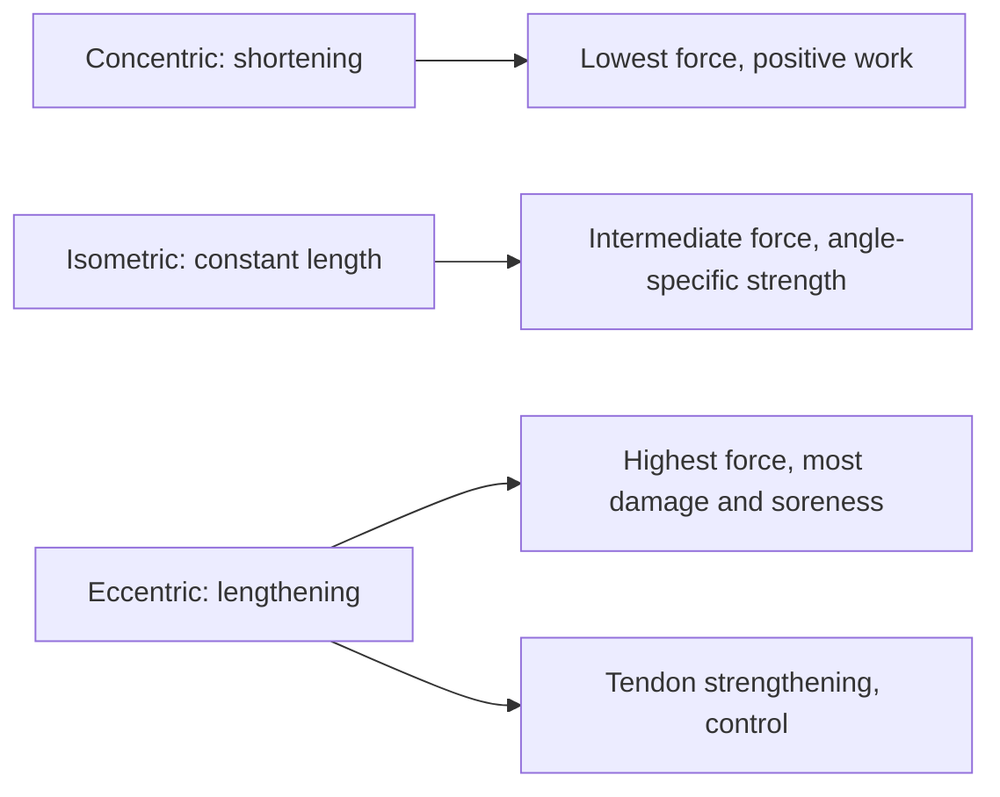

# Muscle actions: concentric, eccentric and isometric

## Summary

Muscles act in three ways. In a concentric action, the muscle shortens and its attachments come closer (the "positive" phase, such as lifting in a pull-up). In an eccentric action, the muscle lengthens under tension (the "negative" phase, such as lowering in a bench press or squat). In an isometric action, the muscle stays the same length while tense (holding a plank). Eccentric actions produce the highest forces and the most muscle damage and soreness. Meta-analyses show that both concentric and eccentric training build muscle, with a small advantage for eccentric training in some outcomes.

## Prerequisites

- [Force, length and velocity of muscle](../../physiology/muscle/force-length-velocity.md)

## Core concepts

### Definition

A *concentric* action is muscle shortening while producing force. An *eccentric* action is muscle lengthening while producing force, because the external load exceeds the force produced. An *isometric* action is force production without a change in muscle length. Strictly, "contraction" means activation; the terms "action" or "muscle work" avoid the paradox of a "lengthening contraction".

### Analogy

Lifting and lowering a heavy box onto a shelf shows all three. Lifting it up is concentric (the arms do positive work), holding it at chest height is isometric, and lowering it slowly is eccentric (the muscles act as brakes). The analogy breaks because the muscles do not experience these as equally tiring: lowering feels easier but causes more damage.

### Mechanism

**Concentric.** The attachments move closer as the muscle shortens. Examples: pulling up in a pull-up, hip extension in a hip thrust. Force is lower than in the other actions because cross-bridges cycle quickly.

**Eccentric.** The muscle lengthens and its attachments move apart while it resists a load. Examples: lowering the bar to the chest in a bench press, the descent of a squat. Muscles can produce about 20 to 50 percent more force eccentrically than isometrically (some sources say about 120 percent of concentric maximum or more). Eccentric work costs less energy per unit of force, demands precise neuromuscular control (which helps learn technique), strengthens tendons and ligaments and causes the most muscle damage, which is linked to soreness ([Delayed onset muscle soreness (DOMS)](../recovery/doms.md)).

**Isometric.** Muscle length stays constant under tension. Examples: pausing in an exercise, or static exercises such as a plank. Strength gains are greatest at the trained joint angle, with some carry-over of about 15 to 20 degrees on either side. Pausing at the bottom of a squat or at the longest muscle length adds time under tension and can improve strength in that position.

The diagram compares the three actions.

### Effects on muscle and strength

Older sources claim that eccentric training causes hypertrophy while concentric training only improves strength without growth, and that concentric training causes no soreness because it causes no microdamage. In one study often cited for this (Hortobágyi and colleagues, 1996), men trained only eccentric or only concentric phases in 4 to 6 sets of 8 to 12 repetitions, 3 times a week for 12 weeks; type I fiber area did not increase in either group, while type II fiber area increased about ten times more in the eccentric group (fiber size, not fiber number). A later meta-analysis (Schoenfeld and colleagues, 2017) found that both concentric and eccentric training produce hypertrophy, with a small, non-significant advantage for eccentric training. Concentric-only training causes little soreness but still produces growth.

Practical summary:

- **Concentric emphasis**: suitable when returning from injury or a long break, when there is little strength for effective eccentric work; little soreness.
- **Eccentric emphasis**: improves neuromuscular coordination and technique, strengthens tendons, contributes to hypertrophy and strength; more soreness, used in tendon rehabilitation.
- **Isometric emphasis**: builds strength at specific angles and can contribute to growth when held at long muscle lengths; useful when a person lacks strength at one point of a movement and in pain-relief protocols for tendons.

## Worked example

Nordic hamstring curls are eccentric-only for most people: the athlete lowers the trunk forward slowly, resisting with the hamstrings, and catches themselves with the hands. Six weeks of Nordics increased eccentric hamstring strength by roughly 10 to 20 percent in trials and lengthened the fascicles of the biceps femoris, which is thought to explain part of the reduction in hamstring strains ([Hamstrings](../../anatomy/muscular-system/lower-limb/hamstrings.md)).

## Trade offs and when to use it

- Eccentric overload is effective but causes soreness and requires gradual introduction.
- Isometrics are safe and easy to dose but angle-specific.

## Common mistakes

- **Dropping the weight in the lowering phase.** This wastes the most productive part of the repetition.
- **Believing concentric training does not build muscle.** It does, though eccentric emphasis may add a little.

## Practice

1. Which action is the descent of a squat?
2. Which action produces the highest force?
3. Why might a returning athlete start with concentric emphasis?

### Answers

1. Eccentric (for the hip and knee extensors).
2. Eccentric.
3. It causes little soreness and less mechanical stress while strength is rebuilt.

## Further reading

- Hortobágyi, T., Hill, J. P., Houmard, J. A. et al. (1996). Adaptive responses to muscle lengthening and shortening in humans. Journal of Applied Physiology, 80(3), 765-772. [DOI](https://doi.org/10.1152/jappl.1996.80.3.765). Study of eccentric versus concentric training adaptations.
- Schoenfeld, B. J., Ogborn, D. I., Vigotsky, A. D. et al. (2017). Hypertrophic effects of concentric vs. eccentric muscle actions: a systematic review and meta-analysis. Journal of Strength and Conditioning Research, 31(9), 2599-2608. [DOI](https://doi.org/10.1519/JSC.0000000000001983). Meta-analysis of concentric versus eccentric hypertrophy.
- Hill, A. V. (1938). The heat of shortening and the dynamic constants of muscle. Proceedings of the Royal Society B, 126(843), 136-195. [DOI](https://doi.org/10.1098/rspb.1938.0050). Force-velocity relationship.
