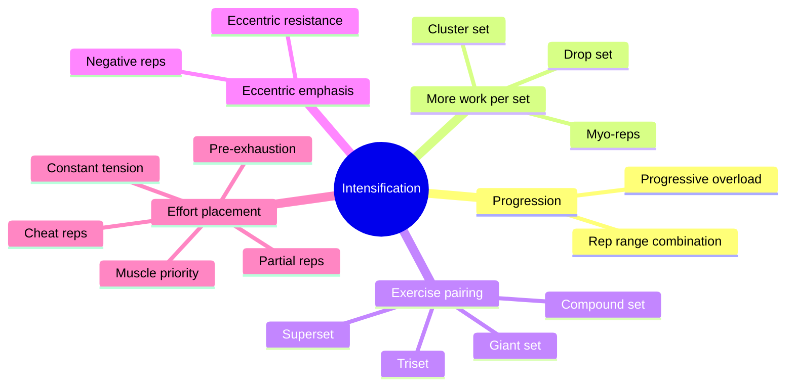

# Intensification methods

Intensification methods are techniques that make a set or a session harder without simply adding more ordinary sets. Some add volume in less time (drop sets, supersets, giant sets), some raise the load the muscle sees (cluster sets, negative repetitions), and some change where the effort goes (pre-exhaustion, muscle priority, partial repetitions). Most of them are tools from bodybuilding practice with limited direct research. Each note says what is known.

## Map

The mindmap groups the methods by how they make training harder.

## Reading order

1. [Progressive overload](progressive-overload.md)
2. [Rep range combination](rep-range-combination.md)
3. [Drop set](drop-set.md)
4. [Cluster set](cluster-set.md)
5. [Myo-reps](myo-reps.md)
6. [Superset](superset.md)
7. [Compound set](compound-set.md)
8. [Triset](triset.md)
9. [Giant set](giant-set.md)
10. [Eccentric resistance](eccentric-resistance.md)
11. [Negative repetitions](negative-reps.md)
12. [Muscle priority](muscle-priority.md)
13. [Pre-exhaustion](pre-exhaustion.md)
14. [Partial repetitions](partial-reps.md)
15. [Constant tension](constant-tension.md)
16. [Cheat repetitions](cheat-reps.md)
