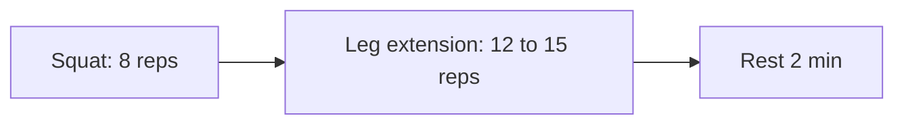

# Compound set

## Summary

A compound set combines two exercises for the same muscle group without rest between them, for example squats followed by leg extensions. It adds volume quickly and produces a strong "pump", because the second exercise continues to fatigue a muscle that is already tired.

## Prerequisites

- [Repetition ranges and load](../training-variables/rep-ranges-and-load.md)

## Core concepts

### Definition

A *compound set* is two exercises for the same muscle group performed consecutively without rest. In some gyms it is also called a superset.

### Analogy

A compound set is like cleaning a floor with a broom and then immediately mopping it: two different tools on the same surface, one after the other. The analogy breaks because the second exercise is weaker than it would be fresh, so its load must be lower.

### Mechanism

The first exercise fatigues the target muscle. The second exercise, often an isolation movement, continues the work, raising metabolic stress (lactate, cell swelling) and the number of repetitions done near failure.

The flowchart shows a compound set for the quadriceps.

### Claimed effects and evidence

Each entry states the claimed effect and how strong the evidence in trained or untrained adults is, using the grades defined in the [Evidence grades](../../nutrition/evidence-grades.md) note.

- **Strong pump and metabolic stress.** Consistent with acute studies of reduced rest. Evidence: established physiology.
- **More hypertrophy than equal volume of straight sets.** Not shown. Evidence: not supported.

## Worked example

For chest, a lifter does 8 bench presses at 80 kg and moves immediately to 12 cable flies at 15 kg per side. After 2 minutes of rest they repeat for 3 rounds. The compound set adds 3 sets of flies in the time normally used for rest.

## Trade offs and when to use it

Compound sets save time and add volume, but fatigue lowers the load on the second exercise. Do the more demanding exercise first unless using pre-exhaustion on purpose.

## Common mistakes

- **Placing the heavy compound lift second without intending to.** Fatigue makes heavy lifts risky; see pre-exhaustion for the deliberate version.
- **Confusing compound sets with supersets.** Compound sets target the same muscle.

## Practice

1. What is a compound set?
2. Give an example.
3. What is the main effect?

### Answers

1. Two exercises for the same muscle group without rest.
2. Squats followed by leg extensions.
3. A strong pump and extra volume in less time.

## Further reading

- Weakley, J. J. S., Till, K., Read, D. B. et al. (2017). The effects of traditional, superset, and tri-set resistance training structures on perceived intensity and physiological responses. European Journal of Applied Physiology, 117(9), 1877-1889. [DOI](https://doi.org/10.1007/s00421-017-3680-3). Physiological responses to combined set structures.
