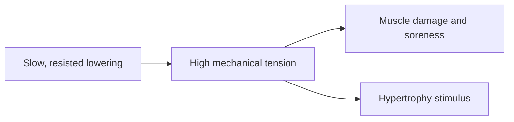

# Eccentric resistance

## Summary

The eccentric resistance method intensifies training by actively resisting the load during the eccentric (lowering) phase, making the lowering slow and effortful. It causes considerable muscle soreness and is a strong stimulus for hypertrophy. Muscles can control about 20 to 50 percent more load eccentrically than concentrically, which this method uses.

## Prerequisites

- [Muscle actions: concentric, eccentric and isometric](../biomechanics/muscle-actions.md)

## Core concepts

### Definition

*Eccentric resistance* means deliberately braking the load during the lengthening phase of a repetition, often with a slow tempo or an added eccentric load.

### Analogy

Eccentric resistance is like lowering a heavy piano down the stairs: you do not lift it, but holding it back takes great effort and control. The analogy breaks because muscles can resist more load while lowering than while lifting, which a piano mover does not exploit.

### Mechanism

During eccentric actions, cross-bridges are stretched as they resist, producing high force with fewer active motor units and lower energy cost. High eccentric force creates more mechanical tension and more muscle damage than concentric work, causing soreness. Meta-analyses show eccentric training produces somewhat greater strength gains and similar or slightly greater hypertrophy than concentric training. See [Muscle actions: concentric, eccentric and isometric](../biomechanics/muscle-actions.md).

The flowchart shows the effect of emphasizing the eccentric phase.

### Claimed effects and evidence

Each entry states the claimed effect and how strong the evidence in trained or untrained adults is, using the grades defined in the [Evidence grades](../../nutrition/evidence-grades.md) note.

- **Strength and hypertrophy gains.** Eccentric training produced greater strength and similar or slightly greater muscle mass than concentric training. Evidence: moderate.
- **Marked delayed soreness.** Eccentric actions cause the most soreness. Evidence: strong.

## Worked example

On a leg press, a lifter lifts with both legs and lowers with one leg over 4 seconds. The eccentric load per leg is about twice the concentric load, using the greater eccentric strength.

## Trade offs and when to use it

Eccentric emphasis is effective but causes soreness and takes longer to recover from; introduce it gradually.

## Common mistakes

- **Introducing heavy eccentrics suddenly.** Start with small volumes to limit soreness.
- **Letting the weight drop.** The eccentric phase must be controlled.

## Practice

1. What is eccentric resistance?
2. Why does it cause soreness?
3. How much more load can muscles control eccentrically?

### Answers

1. Actively braking the load during the lowering phase.
2. High eccentric forces create more muscle damage.
3. About 20 to 50 percent more than concentrically.

## Further reading

- Roig, M., O'Brien, K., Kirk, G. et al. (2009). The effects of eccentric versus concentric resistance training on muscle strength and mass in healthy adults: a systematic review with meta-analysis. British Journal of Sports Medicine, 43(8), 556-568. [DOI](https://doi.org/10.1136/bjsm.2008.051417). Meta-analysis of eccentric versus concentric training.
- Hill, A. V. (1938). The heat of shortening and the dynamic constants of muscle. Proceedings of the Royal Society B, 126(843), 136-195. [DOI](https://doi.org/10.1098/rspb.1938.0050). Force-velocity relationship.
