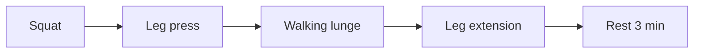

# Giant set

## Summary

A giant set is a sequence of three to five (sometimes more) exercises for the same muscle group performed without rest. It extends the idea of the compound set and triset and is used to accumulate a lot of volume and metabolic stress quickly.

## Prerequisites

- [Repetition ranges and load](../training-variables/rep-ranges-and-load.md)

## Core concepts

### Definition

A *giant set* is a sequence of usually four or more consecutive exercises without rest, targeting one muscle group. Definitions overlap with the triset at three exercises.

### Analogy

A giant set is like a relay race in which one runner runs every leg: each leg uses a different route, but the same legs do all the work. The analogy breaks because the muscle gets weaker with each "leg", so loads must drop.

### Mechanism

Several exercises in a row maximize time under tension, metabolic stress and fatigue for one muscle. Varying exercises targets different parts or angles.

The flowchart shows a giant set for the legs.

### Claimed effects and evidence

Each entry states the claimed effect and how strong the evidence in trained or untrained adults is, using the grades defined in the [Evidence grades](../../nutrition/evidence-grades.md) note.

- **Large metabolic stress and pump.** Consistent with physiology of short rest training. Evidence: established physiology.
- **Superior hypertrophy.** No direct evidence. Evidence: very limited.

## Worked example

For the legs, a lifter does 10 squats, 12 leg presses, 10 lunges per leg and 15 leg extensions without rest, then rests 3 minutes and repeats twice. The session finishes 12 sets in about 15 minutes.

## Trade offs and when to use it

Giant sets are very fatiguing and best used occasionally, for example to finish a session or in time-limited workouts; they are not for heavy strength work.

## Common mistakes

- **Using giant sets every session.** Fatigue and recovery cost are high.
- **Starting with an isolation exercise.** Put the most demanding exercise first.

## Practice

1. How many exercises does a giant set usually contain?
2. What distinguishes a giant set from a superset?
3. When are giant sets useful?

### Answers

1. Three to five, sometimes more.
2. A giant set uses several exercises for the same muscle; a superset pairs two antagonists.
3. To accumulate volume quickly or finish a session.

## Further reading

- Weakley, J. J. S., Till, K., Read, D. B. et al. (2017). The effects of traditional, superset, and tri-set resistance training structures on perceived intensity and physiological responses. European Journal of Applied Physiology, 117(9), 1877-1889. [DOI](https://doi.org/10.1007/s00421-017-3680-3). Physiological responses to combined set structures.
