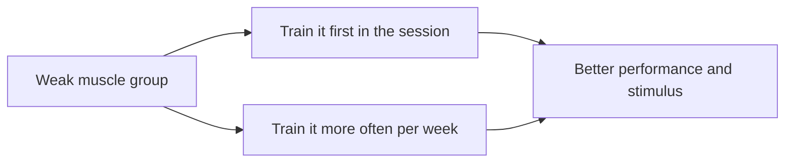

# Muscle priority

## Summary

The muscle priority method improves a weaker muscle group by training it first in a session, when energy and focus are highest, for example shoulders before chest. Another way is to train the weak muscle more often, for example in two sessions a week. Research shows exercises performed first in a session achieve more repetitions and larger strength gains.

## Prerequisites

- [Repetition ranges and load](../training-variables/rep-ranges-and-load.md)

## Core concepts

### Definition

*Muscle priority* is placing a lagging muscle group at the start of a session or giving it more frequent training to give it the best possible stimulus.

### Analogy

Muscle priority is like doing the hardest homework subject first, when your mind is fresh. You perform better on it than if you left it for last. The analogy breaks because training order also affects the later exercises, which will be done in a fatigued state.

### Mechanism

Exercises done early in a session are performed with less fatigue, so more repetitions and higher loads are possible. A review (Simão and colleagues, 2012) found that exercises performed first show greater gains in strength. Higher weekly frequency and volume for a muscle also increase its stimulus.

The flowchart shows two ways to prioritize a muscle.

### Claimed effects and evidence

Each entry states the claimed effect and how strong the evidence in trained or untrained adults is, using the grades defined in the [Evidence grades](../../nutrition/evidence-grades.md) note.

- **Greater strength gains in exercises performed first.** Supported by a review of exercise order. Evidence: moderate.
- **Greater hypertrophy of prioritized muscles.** Less consistent than for strength. Evidence: limited.

## Worked example

A lifter whose shoulders lag behind their chest switches order: overhead press and lateral raises first, then bench press. They also add a second shoulder session on another day. After 12 weeks their overhead press rises more than in the previous block.

## Trade offs and when to use it

Prioritizing one muscle means others are trained in a fatigued state; rotate priorities between blocks.

## Common mistakes

- **Prioritizing too many muscles at once.** Only one or two can be first.
- **Ignoring recovery when adding frequency.** Adjust volume to avoid excessive fatigue.

## Practice

1. What are two ways to apply muscle priority?
2. Why does order matter?
3. What is the cost of prioritizing a muscle?

### Answers

1. Train the weak muscle first, or train it more often.
2. Exercises performed first have less fatigue and give better performance and strength gains.
3. Other muscles are trained in a fatigued state.

## Further reading

- Simão, R., de Salles, B. F., Figueiredo, T. et al. (2012). Exercise order in resistance training. Sports Medicine, 42(3), 251-265. [DOI](https://doi.org/10.2165/11597240-000000000-00000). Review of exercise order in resistance training.
