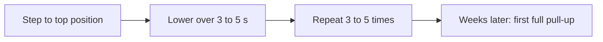

# Negative repetitions

## Summary

Negative repetitions are repetitions in which only the eccentric (lowering) phase is performed, slowly and under control. They work well with heavy loads and difficult exercises. Someone who cannot yet do a pull-up can learn it with negatives: jump or step to the top and lower the body slowly. In compound exercises, doing only negatives helps the lifter later handle heavier loads.

## Prerequisites

- [Muscle actions: concentric, eccentric and isometric](../biomechanics/muscle-actions.md)

## Core concepts

### Definition

A *negative repetition* is a repetition consisting only of the eccentric phase, with the concentric phase skipped or assisted.

### Analogy

Negative repetitions are like learning to walk down a steep slope before climbing it. Going down with control builds the strength and confidence to go up later. The analogy breaks because muscles are stronger in lowering than lifting, while walking downhill is not always easier for the joints.

### Mechanism

Because eccentric strength exceeds concentric strength, a lifter can lower a load they cannot lift. This exposes the muscle to high tension and teaches control in the movement path, building strength that later transfers to the full movement.

The flowchart shows how negatives build toward a pull-up.

### Claimed effects and evidence

Each entry states the claimed effect and how strong the evidence in trained or untrained adults is, using the grades defined in the [Evidence grades](../../nutrition/evidence-grades.md) note.

- **Learning difficult bodyweight exercises.** Eccentric training improves strength and transfers to concentric performance. Evidence: moderate.
- **Strength with supramaximal loads.** Eccentric loads above 100 percent of 1RM increase strength in trained lifters. Evidence: limited.

## Worked example

A trainee who cannot do a pull-up does 4 sets of 3 negatives, each lowering lasting 5 seconds, twice a week. When they can control a 10-second lowering, they try a full pull-up. Many trainees achieve their first pull-up within several weeks.

## Trade offs and when to use it

Negatives build strength and technique but cause soreness and need a spotter or setup when loads exceed 1RM.

## Common mistakes

- **Dropping quickly instead of lowering slowly.** Lowering should take 3 to 5 seconds or more.
- **Using supramaximal loads without a spotter.** Heavy negatives need safety measures.

## Practice

1. What is a negative repetition?
2. How do negatives help learn pull-ups?
3. What safety measure do heavy negatives need?

### Answers

1. A repetition with only the lowering phase.
2. Slow lowering builds strength and control that transfer to the full movement.
3. A spotter or safety setup.

## Further reading

- Roig, M., O'Brien, K., Kirk, G. et al. (2009). The effects of eccentric versus concentric resistance training on muscle strength and mass in healthy adults: a systematic review with meta-analysis. British Journal of Sports Medicine, 43(8), 556-568. [DOI](https://doi.org/10.1136/bjsm.2008.051417). Meta-analysis of eccentric training.
