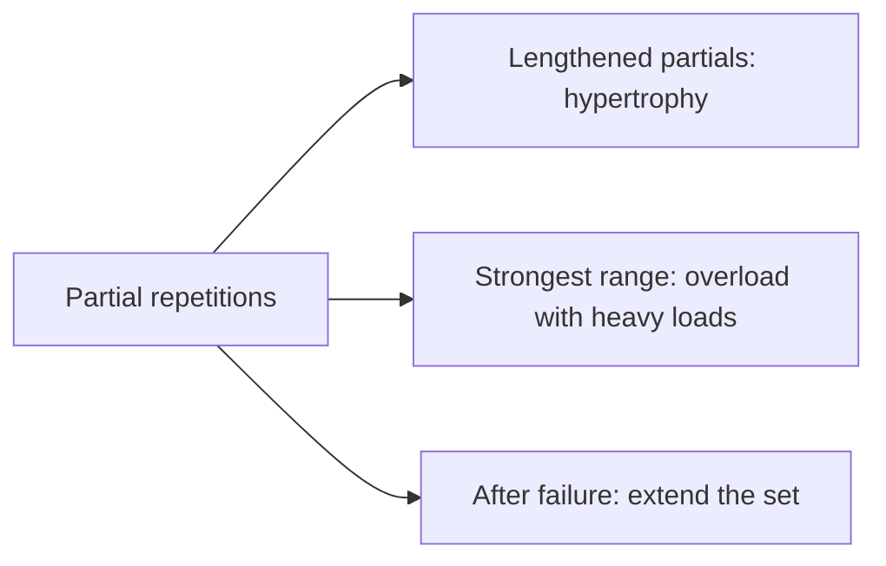

# Partial repetitions

## Summary

Partial repetitions use only part of an exercise's range of motion, often in compound exercises. They allow heavier loads in the strongest part of the range or extra repetitions after failure. They are used to build strength and muscle mass and to train weaker muscle groups. Research suggests partial repetitions at long muscle lengths (the stretched position) can produce similar or even greater hypertrophy than full range, while partials at short lengths are less effective.

## Prerequisites

- [Force, length and velocity of muscle](../../physiology/muscle/force-length-velocity.md)

## Core concepts

### Definition

*Partial repetitions* are repetitions performed through only part of the full range of motion. *Lengthened partials* are performed in the part of the range where the muscle is stretched.

### Analogy

Partial repetitions are like practicing only the hardest bar of a piece of music many times: you work exactly where it matters most. The analogy breaks because, unlike a piece of music, the strongest part of a lift is often not the most useful to practice.

### Mechanism

In the strongest part of the range, heavier loads can be used, raising tension. In the stretched part, muscles experience high tension at long lengths, which appears to be a strong hypertrophy stimulus. Partial repetitions after failure (in the range still possible) extend the set.

A study (Pedrosa and colleagues, 2022) found that partial knee extensions at long muscle lengths produced greater quadriceps hypertrophy than partials at short lengths and similar or greater hypertrophy than full range.

The flowchart shows uses of partial repetitions.

### Claimed effects and evidence

Each entry states the claimed effect and how strong the evidence in trained or untrained adults is, using the grades defined in the [Evidence grades](../../nutrition/evidence-grades.md) note.

- **Hypertrophy with lengthened partials.** Similar or greater than full range in some studies. Evidence: moderate.
- **Strength in the trained range.** Strength gains are largely specific to the range trained. Evidence: moderate.

## Worked example

In a Romanian deadlift, a lifter performs full repetitions to near failure and then adds 4 partial repetitions in the bottom half (stretched hamstrings). On leg extensions, they use the first half of the range (knee flexed) for lengthened partials.

## Trade offs and when to use it

Partials add stimulus and allow overload, but strength gains are specific to the range trained; combine them with full-range work.

## Common mistakes

- **Using partials to lift loads with ego.** Short partials at the top of the range give little stimulus.
- **Replacing all full-range work.** Full range builds strength across the whole movement.

## Practice

1. What are lengthened partials?
2. What did Pedrosa and colleagues (2022) find?
3. What is a limitation of partials?

### Answers

1. Partial repetitions in the stretched part of the range.
2. Lengthened partials produced more hypertrophy than shortened partials and similar or greater than full range.
3. Strength gains are specific to the range trained.

## Further reading

- Pedrosa, G. F., Lima, F. V., Schoenfeld, B. J. et al. (2022). Partial range of motion training elicits favorable improvements in muscular adaptations when carried out at long muscle lengths. European Journal of Sport Science, 22(8), 1250-1260. [DOI](https://doi.org/10.1080/17461391.2021.1927199). Study of partial range of motion at long muscle lengths.
