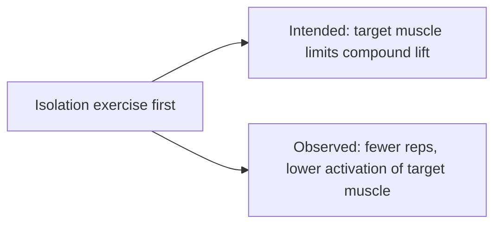

# Pre-exhaustion

## Summary

Pre-exhaustion means fatiguing a muscle with an exercise, usually an isolation movement, before a compound exercise that uses the same muscle, for example cable flies before barbell bench press. The idea is that the pre-fatigued muscle becomes the limiting factor in the compound lift. Studies show the opposite of what is often assumed: pre-exhaustion tends to reduce performance in the compound exercise and does not increase activation of the pre-fatigued muscle.

## Prerequisites

- [Repetition ranges and load](../training-variables/rep-ranges-and-load.md)

## Core concepts

### Definition

*Pre-exhaustion* is performing an isolation exercise for a target muscle immediately before a compound exercise that uses it.

### Analogy

Pre-exhaustion is like tiring a lead singer before a choir performance so that you can "hear" them better. In practice, the tired singer sings more quietly and the rest of the choir takes over. The analogy breaks because muscles are not consciously choosing to contribute.

### Mechanism

The rationale was that in a compound lift, smaller muscles (such as the triceps in a bench press) fail before the target muscle (pectorals); pre-fatiguing the target muscle should make it the limiting factor. A study of leg presses (Augustsson and colleagues, 2003) found that pre-exhaustion with leg extensions reduced quadriceps activation and performance in the leg press. Other studies show similar reductions in repetitions and total load.

The flowchart compares the intended and observed effects.

### Claimed effects and evidence

Each entry states the claimed effect and how strong the evidence in trained or untrained adults is, using the grades defined in the [Evidence grades](../../nutrition/evidence-grades.md) note.

- **Greater activation of the target muscle in the compound lift.** Studies found the opposite or no effect. Evidence: not supported.
- **Fewer repetitions and less load in the compound lift.** Consistent finding. Evidence: moderate.

## Worked example

A lifter does 15 cable flies to near failure and immediately benches. Their bench press drops from 8 to 5 repetitions at 80 kg. Total chest volume is not higher than doing the bench press first, and the heavy lift is performed in a fatigued state.

## Trade offs and when to use it

Pre-exhaustion can be useful when the compound lift must be done with lighter loads (for example to protect a joint), but it is not a way to enhance target-muscle activation.

## Common mistakes

- **Believing pre-exhaustion increases target-muscle activation.** Research does not support this.
- **Using it before heavy compound lifts.** Fatigue lowers performance and may compromise technique.

## Practice

1. What is pre-exhaustion?
2. What did Augustsson and colleagues find?
3. When can pre-exhaustion be useful?

### Answers

1. An isolation exercise before a compound exercise for the same muscle.
2. Pre-exhaustion reduced quadriceps activation and leg press performance.
3. When the compound lift should be done with lighter loads, for example to spare a joint.

## Further reading

- Augustsson, J., Thomeé, R., Hörnstedt, P. et al. (2003). Effect of pre-exhaustion exercise on lower-extremity muscle activation during a leg press exercise. Journal of Strength and Conditioning Research, 17(2), 411-416. Study of pre-exhaustion in the leg press.
- Simão, R., de Salles, B. F., Figueiredo, T. et al. (2012). Exercise order in resistance training. Sports Medicine, 42(3), 251-265. [DOI](https://doi.org/10.2165/11597240-000000000-00000). Review of exercise order.
