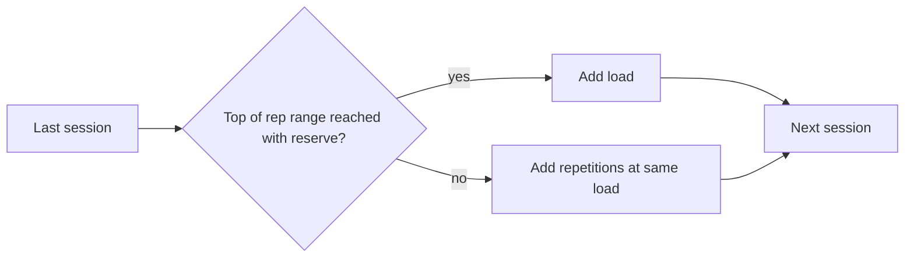

# Progressive overload

## Summary

Progressive overload is the gradual increase of the training stimulus so that the body keeps adapting. The stimulus can grow by adding load, repetitions, sets or effort. Recent research shows that progressing by adding repetitions and progressing by adding load give comparable gains in strength and muscle mass, and that muscle grows similarly across a wide range of about 6 to 35 repetitions per set when sets end close to failure.

## Prerequisites

- [Repetition ranges and load](../training-variables/rep-ranges-and-load.md)

## Core concepts

### Definition

*Progressive overload* is the principle that training demands must rise over time, because a body adapted to a stimulus stops responding to it. It is the practical consequence of the [General adaptation syndrome](../programming/general-adaptation-syndrome.md).

### Analogy

Progressive overload is like raising the bar in a high jump competition. Once you clear a height easily, jumping it again teaches nothing new; the bar has to go up a little. The analogy breaks because in training the "bar" can rise in several ways (more weight, more repetitions, more sets), not only one.

### Mechanism

Adaptation reduces the disturbance that a given workout causes. To keep the stimulus effective, at least one variable must rise:

- **Load**: more weight for the same repetitions.
- **Repetitions**: more repetitions with the same weight (within a range, for example 6 to 35).
- **Sets**: more hard sets per muscle per week.
- **Effort**: sets closer to failure (lower RIR).
- **Density and technique**: same work in less time, or a better range of motion.

A 2022 trial (Plotkin and colleagues) compared adding load each session with adding repetitions each session in trained people for 8 weeks. Hypertrophy was similar, with a small advantage in 1RM strength for the load group. Meta-analyses of the repetition continuum show similar hypertrophy for low and high loads when sets are taken near failure, while heavy loads give more maximal strength.

The flowchart shows the decision a lifter makes each session.

### Claimed effects and evidence

Each entry states the claimed effect and how strong the evidence in trained or untrained adults is, using the grades defined in the [Evidence grades](../../nutrition/evidence-grades.md) note.

- **Strength and hypertrophy gains over time.** Training that does not progress stalls; progression in some variable is necessary for continued adaptation. Evidence: established physiology.
- **Adding repetitions is as effective as adding load for hypertrophy.** Shown in a direct comparison in trained adults. Evidence: moderate.
- **Similar hypertrophy across about 6 to 35 repetitions.** When sets end near failure; maximal strength favors heavier loads. Evidence: moderate.

## Worked example

A lifter does dumbbell presses with 24 kg for 3 sets in a range of 8 to 12. Week 1: 10, 9, 8. Week 2: 11, 10, 9. Week 3: 12, 12, 11. Week 4: 12, 12, 12, so in week 5 they move to 26 kg and drop back to about 8 to 9 repetitions. This is double progression: repetitions first, then load.

## Trade offs and when to use it

Progressive overload is required for long-term progress, but progress is not linear. Beginners can add load almost every session; advanced lifters progress over weeks or months and need deloads and periodization.

## Common mistakes

- **Adding load at the cost of technique.** Range of motion or form that worsens means the load did not really rise for the muscle.
- **Thinking load is the only variable.** Repetitions, sets and effort are valid ways to overload.

## Practice

1. Name four ways to apply progressive overload.
2. What did Plotkin and colleagues (2022) find?
3. What is double progression?

### Answers

1. Add load, repetitions, sets or effort (also density).
2. Adding repetitions and adding load produced similar hypertrophy; load progression gave a small strength advantage.
3. Adding repetitions within a range until the top is reached, then increasing load.

## Further reading

- Plotkin, D., Coleman, M., Van Every, D. et al. (2022). Progressive overload without progressing load? The effects of load or repetition progression on muscular adaptations. PeerJ, 10, e14142. [DOI](https://doi.org/10.7717/peerj.14142). Trial comparing load and repetition progression.
- Schoenfeld, B. J., Grgic, J., Van Every, D. W. et al. (2021). Loading recommendations for muscle strength, hypertrophy, and local endurance: a re-examination of the repetition continuum. Sports, 9(2), 32. [DOI](https://doi.org/10.3390/sports9020032). Review of loading across the repetition continuum.
- American College of Sports Medicine (2009). Progression models in resistance training for healthy adults. Medicine and Science in Sports and Exercise, 41(3), 687-708. [DOI](https://doi.org/10.1249/MSS.0b013e3181915670). Progression models in resistance training.
