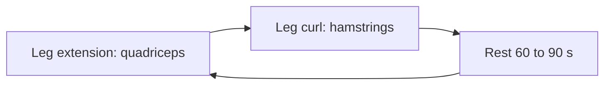

# Superset

## Summary

A superset pairs two exercises for opposing muscle groups, done one after the other with only the time to move between stations, for example leg extensions with leg curls, or dumbbell presses with barbell rows. Because the antagonist rests while the agonist works, supersets save time without large losses in performance. A study found supersets halved session time with similar total work compared with traditional sets.

## Prerequisites

- [Functional muscle groups](../biomechanics/functional-muscle-groups.md)

## Core concepts

### Definition

A *superset* is two exercises for antagonistic muscle groups done back to back with minimal rest. Some coaches use "superset" for any pair of exercises; this library uses the antagonist definition and calls same-muscle pairs a [compound set](compound-set.md).

### Analogy

A superset is like two workers sharing one shovel: while one digs, the other rests, and they swap without a break. The job gets done twice as fast without either one getting exhausted. The analogy breaks because the "resting" muscle still feels some general fatigue (heart rate, breathing).

### Mechanism

Agonist and antagonist muscles act on opposite sides of a joint ([Functional muscle groups](../biomechanics/functional-muscle-groups.md)). Training them alternately lets one recover while the other works. The principle of reciprocal inhibition (contraction of the agonist relaxes the antagonist) is often cited as a further argument, although its effect on performance is small.

Structure: one set of exercise A, a short move to exercise B, one set of B, then rest and repeat.

The flowchart shows a superset round.

### Claimed effects and evidence

Each entry states the claimed effect and how strong the evidence in trained or untrained adults is, using the grades defined in the [Evidence grades](../../nutrition/evidence-grades.md) note.

- **Shorter sessions with similar work.** Shown in acute studies. Evidence: moderate.
- **Performance enhancement through reciprocal inhibition.** Small and inconsistent effects. Evidence: limited.

## Worked example

A lifter with 40 minutes pairs dumbbell bench press with barbell rows for 4 rounds, then biceps curls with triceps pushdowns for 3 rounds. They complete 14 sets in about 25 minutes, compared with about 45 minutes with traditional rests.

## Trade offs and when to use it

Supersets save time and suit hypertrophy and general fitness. They raise heart rate and perceived effort and can slightly reduce performance on the second exercise if it uses shared stabilizers.

## Common mistakes

- **Pairing exercises that share muscles.** Pair true antagonists (push and pull, flexion and extension).
- **Using supersets for maximal strength work.** Heavy lifts need full rest.

## Practice

1. What is a superset?
2. Give two examples of superset pairs.
3. What is the main benefit of supersets?

### Answers

1. Two exercises for opposing muscle groups done back to back with minimal rest.
2. Leg extension and leg curl; dumbbell press and barbell row.
3. They save time with similar total work.

## Further reading

- Weakley, J. J. S., Till, K., Read, D. B. et al. (2017). The effects of traditional, superset, and tri-set resistance training structures on perceived intensity and physiological responses. European Journal of Applied Physiology, 117(9), 1877-1889. [DOI](https://doi.org/10.1007/s00421-017-3680-3). Study of superset and tri-set structures.
- Sherrington, C. S. (1906). *The Integrative Action of the Nervous System*. Yale University Press. Original description of reciprocal inhibition.
