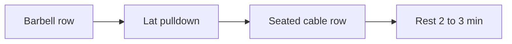

# Triset

## Summary

A triset is three exercises for one muscle group performed without rest, followed by a rest period. An example for the back is barbell rows, lat pulldowns and seated cable rows. The long duration of the combined set produces a large training load.

## Prerequisites

- [Repetition ranges and load](../training-variables/rep-ranges-and-load.md)

## Core concepts

### Definition

A *triset* is a sequence of three consecutive exercises without rest, usually for the same muscle group. Some coaches also use the term for three exercises for different muscle groups.

### Analogy

A triset is like climbing three flights of stairs without stopping at the landings: each flight is ordinary, but together they make one long, hard effort. The analogy breaks because each exercise can attack the muscle from a different angle, unlike identical flights.

### Mechanism

Three exercises in a row extend the time under tension and metabolic stress far beyond a normal set. Choosing exercises with different angles (horizontal row, vertical pull, cable row) spreads the stimulus across the muscle.

The flowchart shows a back triset.

### Claimed effects and evidence

Each entry states the claimed effect and how strong the evidence in trained or untrained adults is, using the grades defined in the [Evidence grades](../../nutrition/evidence-grades.md) note.

- **High training load in short time.** Tri-sets increased perceived exertion and metabolic responses compared with traditional sets. Evidence: moderate.
- **Superior hypertrophy.** Not shown at equal volume. Evidence: not supported.

## Worked example

A lifter does 10 barbell rows, 12 lat pulldowns and 15 seated cable rows in sequence, rests 2 minutes and repeats 3 times. Total: 9 sets for the back in about 12 minutes.

## Trade offs and when to use it

Trisets save time and raise metabolic stress, but heavy fatigue lowers loads and technique; they suit hypertrophy and conditioning phases more than strength phases.

## Common mistakes

- **Choosing three similar exercises.** Vary angles to spread the stimulus.
- **Using heavy loads on all three.** Fatigue requires lighter loads on later exercises.

## Practice

1. What is a triset?
2. Give an example for the back.
3. Why are trisets demanding?

### Answers

1. Three exercises for one muscle group performed without rest.
2. Barbell row, lat pulldown, seated cable row.
3. The long continuous effort creates a high training load.

## Further reading

- Weakley, J. J. S., Till, K., Read, D. B. et al. (2017). The effects of traditional, superset, and tri-set resistance training structures on perceived intensity and physiological responses. European Journal of Applied Physiology, 117(9), 1877-1889. [DOI](https://doi.org/10.1007/s00421-017-3680-3). Study comparing traditional, superset and tri-set structures.
