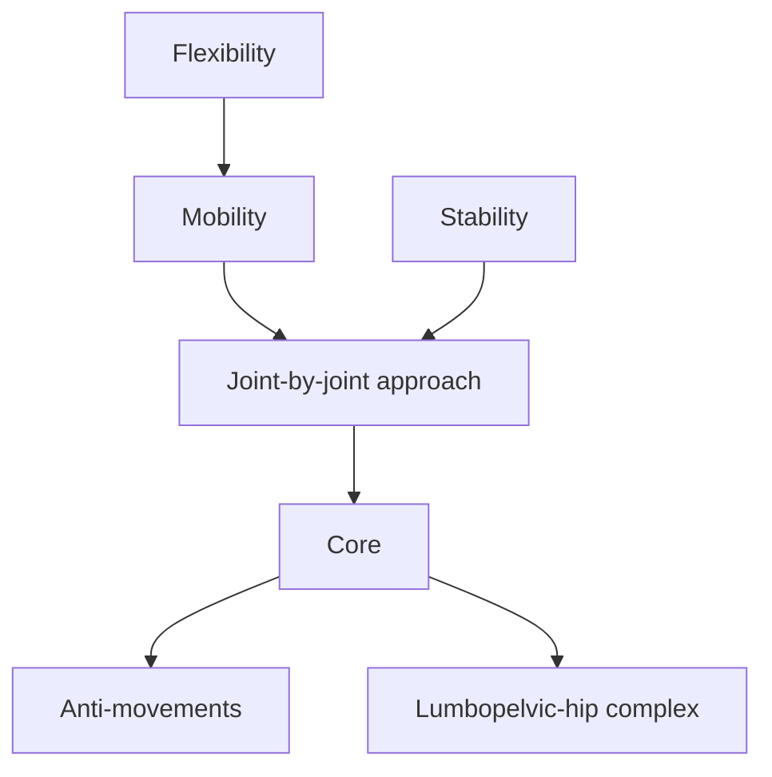

# Mobility and stability

The human body can be seen as a set of joints, the movable connections between parts of the skeleton: a series of stable segments moving on mobile joints. Some joints mainly need stability, others mainly need mobility. These notes define mobility, stability and flexibility, present the joint-by-joint approach, describe anti-movement exercises and the core, and explain the lumbopelvic-hip complex.

## Map

## Reading order

1. [Mobility](mobility.md)
2. [Stability](stability.md)
3. [Flexibility](flexibility.md)
4. [Joint-by-joint approach](joint-by-joint-approach.md)
5. [Core stability](core.md)
6. [Anti-movements](anti-movements.md)
7. [Lumbopelvic-hip complex](lumbopelvic-hip-complex.md)
