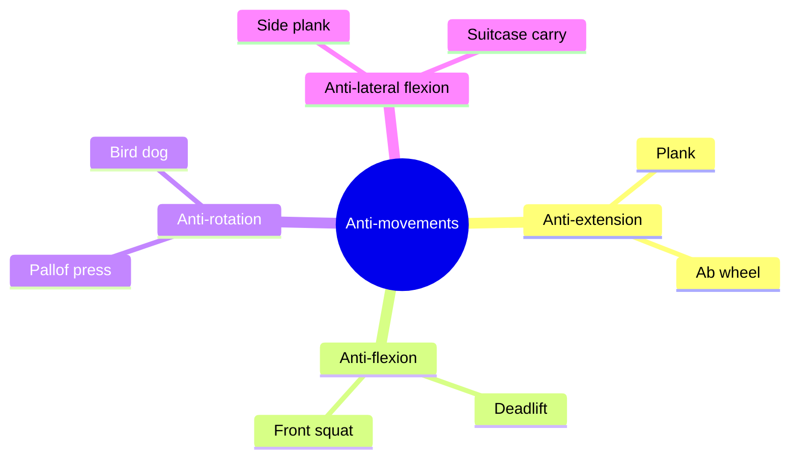

# Anti-movements

## Summary

Anti-movement exercises train the core to resist motion rather than create it. There are four types: anti-extension (resisting arching of the lower back), anti-flexion (resisting rounding of the lower back), anti-rotation (resisting twisting) and anti-lateral flexion (resisting side bending). They stabilize the trunk, lumbar spine and pelvis and teach the body to generate and brake forces.

## Prerequisites

- [Core stability](core.md)

## Core concepts

### Definition

*Anti-movement training* is core training in which the trunk resists an external force that tries to move the spine, so the spine stays in a neutral position.

### Analogy

Anti-movements are like holding a door shut while someone pushes on it. You do not move the door; you prevent it from moving. The analogy breaks because in exercise, the push can come from any direction, and the body must resist without visible movement.

### Mechanism

**Anti-extension.** Core work that prevents an increase of lumbar lordosis. You actively resist a force that tries to extend the spine. This stabilizes the trunk, lumbar spine and pelvis, reduces lumbar tension and sets the spine in a neutral position. These exercises strongly engage the external oblique and the rectus abdominis. Examples: plank, ab wheel rollout, dead bug.

**Anti-flexion.** The goal is to prevent flexion of the lumbar spine. This is the type of trunk work that occurs in squats and deadlifts. The back muscles (erector spinae, multifidus) work strongly. Examples: deadlift, front squat, farmer carry with an upright posture.

**Anti-rotation.** Exercises that actively resist rotation of the lumbar spine. They teach you to generate and to brake rotational forces. Examples: Pallof press, single-arm row, bird dog.

**Anti-lateral flexion.** The core resists side bending of the spine. The quadratus lumborum and the obliques do much of the work, stabilizing the hips and pelvis. Examples: side plank, suitcase carry.

The mindmap shows the four anti-movements and example exercises.

### Claimed effects and evidence

Each entry states the claimed effect and how strong the evidence is, using the grades defined in the [Evidence grades](../../nutrition/evidence-grades.md) note.

- **Improved trunk stability under load.** Consistent with biomechanics and electromyography studies. Evidence: moderate.
- **Reduced back pain.** Core and motor control exercises help some people, similar to other exercise. Evidence: moderate.

## Worked example

A beginner learns anti-movements in 4 weeks: front plank and dead bug (anti-extension), Pallof press (anti-rotation), side plank and suitcase carry (anti-lateral flexion). Anti-flexion is trained through goblet squats and Romanian deadlifts with a neutral spine.

## Trade offs and when to use it

Anti-movement work builds trunk control safely; it complements, not replaces, rotational and dynamic training for sports that need power.

## Common mistakes

- **Letting the lower back sag in a plank.** Keep the pelvis slightly tucked and ribs down.
- **Holding the breath constantly.** Learn to brace while breathing.

## Practice

1. Name the four types of anti-movements.
2. Which muscles work most in anti-lateral flexion?
3. Give an example of anti-rotation.

### Answers

1. Anti-extension, anti-flexion, anti-rotation and anti-lateral flexion.
2. The quadratus lumborum and the obliques.
3. Pallof press.

## Further reading

- McGill, S. (2015). *Low Back Disorders: Evidence-Based Prevention and Rehabilitation (3rd ed.)*. Human Kinetics. Core training principles.
- Boyle, M. (2016). *New Functional Training for Sports (2nd ed.)*. Human Kinetics. Anti-movement training in functional training.
