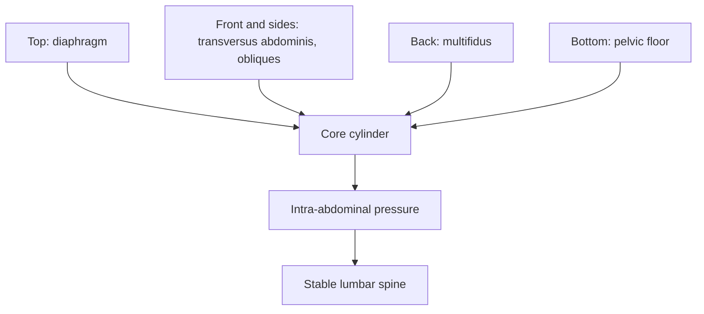

# Core stability

## Summary

The core is the muscular corset of the trunk that maintains posture and stabilizes the spine. Core stability is the synchronized cooperation of many muscle groups, agonists and antagonists, harmonized with the bones, joints and ligaments, that controls the center of the body both at rest and in motion. The core can be pictured as a double-walled cylinder whose inner wall is formed by deep muscles: transversus abdominis, multifidus, internal oblique, pelvic floor and diaphragm.

## Prerequisites

- [Transversus abdominis](../../anatomy/muscular-system/trunk/transversus-abdominis.md)

## Core concepts

### Definition

*Core stability* is the capacity of the deep trunk muscles to control the lumbar spine, pelvis and hip girdle during static positions and movement. The term *core* covers the lumbar spine, the pelvic girdle and the hip girdle.

### Analogy

The core is like the trunk of a tree: branches (limbs) can move a lot only because the trunk stays firm and transfers forces to the roots. The analogy breaks because the human core is not rigid; it moves, but in a controlled way.

### Mechanism

**Anatomy.** Picture a double-walled cylinder made of the lower and upper back, the abdomen and the chest. The inner wall is formed by deep muscles. Stability requires correct length relationships of muscles and of the force vectors they develop, more or less dynamically, in different directions.

Muscles with the largest role in core stability:

- **Transversus abdominis**: forms a belt around the waist; the deepest abdominal muscle. Its contraction raises intra-abdominal pressure, which stabilizes the lumbar spine ([Transversus abdominis](../../anatomy/muscular-system/trunk/transversus-abdominis.md)).
- **Multifidus**: a deep paraspinal muscle running along the spine; a postural muscle that keeps the spine upright ([Multifidus](../../anatomy/muscular-system/trunk/multifidus.md)).
- **Internal oblique**: lies under the external oblique; flexes the trunk forward and sideways and rotates it ([Internal oblique](../../anatomy/muscular-system/trunk/internal-oblique.md)).
- **Pelvic floor muscles**: support the organs and form part of the abdominal press; attach to the coccyx and help keep the body upright ([Pelvic floor muscles](../../anatomy/muscular-system/trunk/pelvic-floor.md)).
- **Diaphragm**: the main, thin, dome-shaped breathing muscle (often described as kidney-shaped in outline) separating the chest from the abdomen; an inspiratory muscle. Through its attachments to the lumbar vertebrae, it helps stabilize the trunk ([Diaphragm](../../anatomy/muscular-system/trunk/diaphragm.md)).

**Functions.** Contracting, the core muscles hold the spine in its most stable, neutral position. They are activated during every body movement and keep the trunk upright. People with low back pain often show delayed activation of deep muscles (Hodges and Richardson, 1996), which leads to less controlled trunk movement. Well-functioning core muscles protect and strengthen the trunk, improve movement control and posture, protect against sports injuries and improve stabilization of the center of gravity.

**Exercise categories.**

- Stabilization against forward-backward movement, for example the front plank.
- Stabilization against side-to-side movement, for example the side plank, which strengthens the obliques.
- Rotational exercises, or rather exercises that prevent excessive rotation ([Anti-movements](anti-movements.md)).

The diagram shows the cylinder of the core.

### Claimed effects and evidence

Each entry states the claimed effect and how strong the evidence is, using the grades defined in the [Evidence grades](../../nutrition/evidence-grades.md) note.

- **Better sports performance.** Strengthening muscles contributes to performance; direct transfer of core training to sport performance is small. Evidence: limited.
- **Better health and fewer injuries.** Core and motor control exercise help some people with low back pain, similar to other exercise. Evidence: moderate.
- **Longer sports career.** Plausible through fewer injuries; not directly studied. Evidence: very limited.
- **Injury prevention.** Exercise programs including core work reduce some injuries in team sports. Evidence: limited.
- **Better transfer of force between upper and lower body.** Consistent with biomechanics; legs alone do not run fast, the upper body and the link between them matter. Evidence: limited.
- **Greater stability while running.** Better running technique allows faster and safer running, important in sports based on running such as soccer. Evidence: limited.

## Worked example

A soccer player adds three core exercises twice a week: front plank 3 × 40 seconds, side plank 3 × 30 seconds per side and Pallof press 3 × 10 per side. Over a season, they report better balance in tackles. This is consistent with, but not proof of, the benefits listed above.

## Trade offs and when to use it

Core training is useful, but heavy compound lifts also train the core. Isolated core exercises are most useful for beginners, rehabilitation and specific weaknesses.

## Common mistakes

- **Equating the core with the rectus abdominis.** The core includes deep muscles, the diaphragm and the pelvic floor.
- **Doing only crunches.** Train anti-movement and bracing patterns.

## Practice

1. Name five deep core muscles.
2. How does the transversus abdominis stabilize the spine?
3. Name three categories of core exercises.

### Answers

1. Transversus abdominis, multifidus, internal oblique, pelvic floor and diaphragm.
2. It raises intra-abdominal pressure.
3. Front-back stabilization, side-to-side stabilization and anti-rotation.

## Further reading

- Hodges, P. W., Richardson, C. A. (1996). Inefficient muscular stabilization of the lumbar spine associated with low back pain: a motor control evaluation of transversus abdominis. Spine, 21(22), 2640-2650. [DOI](https://doi.org/10.1097/00007632-199611150-00014). Delayed transversus abdominis activation in low back pain.
- McGill, S. (2015). *Low Back Disorders: Evidence-Based Prevention and Rehabilitation (3rd ed.)*. Human Kinetics. Spine stability and core training.
- Panjabi, M. M. (1992). The stabilizing system of the spine. Part I. Function, dysfunction, adaptation, and enhancement. Journal of Spinal Disorders, 5(4), 383-389. [DOI](https://doi.org/10.1097/00002517-199212000-00001). Stabilizing system of the spine.
