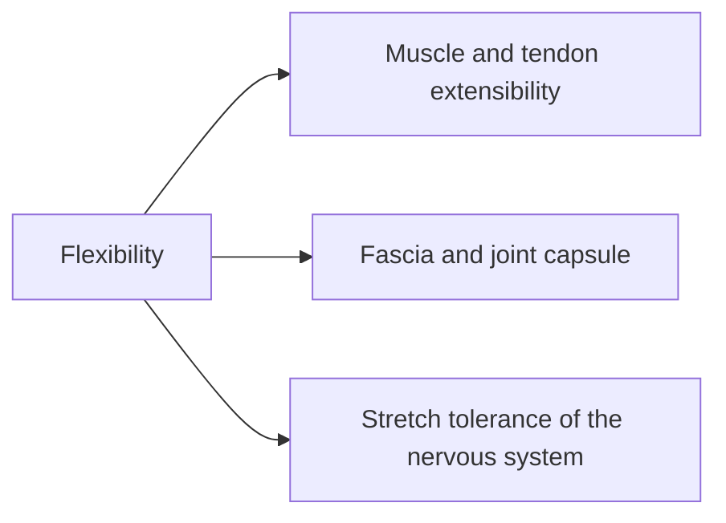

# Flexibility

## Summary

Flexibility is the ability of a muscle and other soft tissues to lengthen, allowing a joint to move through its range of motion, usually measured passively. It is one component of mobility. Regular stretching increases flexibility, mainly by increasing tolerance to stretch rather than by permanently lengthening muscles. Long static stretches right before strength or power performance can reduce it slightly.

## Prerequisites

- [Mobility](mobility.md)

## Core concepts

### Definition

*Flexibility* is the passive range of motion available at a joint, determined by the extensibility of muscles, tendons, fascia and the joint capsule. *Stretch tolerance* is how much stretch a person can tolerate before discomfort.

### Analogy

Flexibility is like the slack in a rope tied between two posts. More slack lets the posts move further apart. The analogy breaks because stretching mostly changes how far the nervous system lets the rope go, not the length of the rope itself.

### Mechanism

**Types of stretching.**

- *Static stretching*: holding a lengthened position, usually 15 to 60 seconds.
- *Dynamic stretching*: controlled movements through the range of motion.
- *Proprioceptive neuromuscular facilitation (PNF)*: contracting the stretched muscle, then relaxing it into a deeper stretch (see post-isometric relaxation in [Trapezius self-relaxation](../../physiotherapy/trapezius-self-relaxation.md)).
- *Ballistic stretching*: bouncing movements at end range; less common.

**What changes.** Short-term gains in range come mostly from increased stretch tolerance. Long-term training may add small structural changes (more sarcomeres in series, changed tendon properties).

**Acute effects.** Static stretches longer than about 60 seconds per muscle immediately before activity can slightly reduce strength and power; shorter stretches within a full warm-up have small or negligible effects.

The flowchart shows the factors that limit flexibility.

### Claimed effects and evidence

Each entry states the claimed effect and how strong the evidence is, using the grades defined in the [Evidence grades](../../nutrition/evidence-grades.md) note.

- **Stretching increases range of motion.** Consistent finding. Evidence: strong.
- **Long static stretching before activity reduces strength and power.** Small effect, mainly with stretches over 60 seconds. Evidence: moderate.
- **Stretching prevents injuries.** Evidence is mixed. Evidence: limited.

## Worked example

A person with tight hamstrings (knee extension angle of 30 degrees short of straight in a supine test) stretches the hamstrings for 3 × 30 seconds daily. After 6 weeks, the deficit falls to about 15 degrees. Much of the change is greater stretch tolerance.

## Trade offs and when to use it

Flexibility is useful when a sport or task needs range, but more is not always better. Combine stretching with strength in the new range.

## Common mistakes

- **Long static stretching right before heavy lifting.** Use dynamic warm-ups; keep static stretches short.
- **Expecting stretching to prevent soreness.** Stretching does not reduce delayed soreness ([Delayed onset muscle soreness (DOMS)](../recovery/doms.md)).

## Practice

1. What is flexibility?
2. What explains most short-term gains in flexibility?
3. Name four types of stretching.

### Answers

1. The passive range of motion at a joint, set by tissue extensibility.
2. Increased stretch tolerance.
3. Static, dynamic, PNF and ballistic.

## Further reading

- Behm, D. G., Blazevich, A. J., Kay, A. D. et al. (2016). Acute effects of muscle stretching on physical performance, range of motion, and injury incidence in healthy active individuals: a systematic review. Applied Physiology, Nutrition, and Metabolism, 41(1), 1-11. [DOI](https://doi.org/10.1139/apnm-2015-0235). Systematic review of acute stretching effects.
- Page, P. (2012). Current concepts in muscle stretching for exercise and rehabilitation. International Journal of Sports Physical Therapy, 7(1), 109-119. Review of stretching concepts for exercise and rehabilitation.
