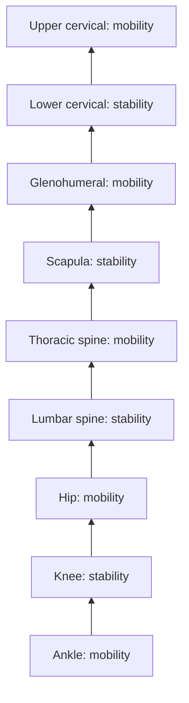

# Joint-by-joint approach

## Summary

The joint-by-joint approach, popularized by Gray Cook and Mike Boyle, proposes that joints alternate between needing mainly mobility and mainly stability from the foot up. When a mobile joint loses mobility, a neighboring stable joint compensates by moving more, which leads to instability, abnormal movement, microtrauma and pain. The model is a useful coaching heuristic but has not been tested directly in research.

## Prerequisites

- [Mobility](mobility.md)
- [Stability](stability.md)

## Core concepts

### Definition

The *joint-by-joint approach* is a model of the body as a stack of joints, each with a primary need: mobility or stability. It explains pain in one area as compensation for dysfunction in a neighboring joint.

### Analogy

The joint-by-joint approach is like a team carrying a long beam. If one person refuses to move (lost mobility), their neighbors must twist and stretch (compensation), and they are the ones who get hurt. The analogy breaks because joints are not simply "mobile" or "stable"; every joint needs both to some degree.

### Mechanism

**Joints or segments that mainly need stability:**

- the knee;
- the lumbar spine;
- the scapula (scapulothoracic joint);
- the lower cervical spine;
- the elbow.

**Joints or segments that mainly need mobility:**

- the ankle (talocrural joint);
- the hip;
- the thoracic spine;
- the glenohumeral joint;
- the upper cervical spine;
- the wrist (radiocarpal joint).

**Compensation.** When a joint loses its dominant function, the nearest segment compensates. If the thoracic spine loses mobility, for example after years of sitting, the body looks for movement one segment lower, in the lumbar spine. This leads to excess lumbar motion and instability, which raises the risk of pain and disc problems.

**Chain of consequences.**

1. Loss of mobility in a joint causes loss of stability in the neighboring joint.
2. Disturbed joint function creates compensatory movement patterns.
3. Compensatory patterns cause abnormal joint motion and microtrauma.
4. Accumulated microtrauma leads to chronic pain and injury.

The diagram shows the alternating pattern from the ankle up.

The second flowchart shows the chain of consequences.

### Claimed effects and evidence

Each entry states the claimed effect and how strong the evidence is, using the grades defined in the [Evidence grades](../../nutrition/evidence-grades.md) note.

- **Thoracic stiffness increases lumbar load.** Plausible; some biomechanical support. Evidence: limited.
- **The joint-by-joint model predicts injury.** Not tested directly. Evidence: very limited.

## Worked example

A desk worker with low back pain during overhead presses has a stiff thoracic spine and limited shoulder flexion. To reach overhead, they arch the lower back. Thoracic extension mobility drills and shoulder flexion work, combined with core bracing, let them press without arching, and the back pain during pressing disappears.

## Trade offs and when to use it

The model directs attention to joints above and below a painful area, which is often helpful. It oversimplifies: the knee needs mobility to flex, and the hip needs stability in single-leg stance.

## Common mistakes

- **Treating only the painful joint.** Check mobility of the joints above and below.
- **Treating the model as proven.** It is a heuristic; individual assessment is still needed.

## Practice

1. List the joints that mainly need stability in the model.
2. What happens when the thoracic spine loses mobility?
3. Describe the chain of consequences.

### Answers

1. Knee, lumbar spine, scapula, lower cervical spine and elbow.
2. The lumbar spine compensates with excess motion, risking instability and pain.
3. Lost mobility, instability next door, compensatory patterns, microtrauma, chronic pain.

## Further reading

- Cook, G. (2010). *Movement: Functional Movement Systems. Screening, Assessment and Corrective Strategies*. On Target Publications. Original description of joint-by-joint concepts in movement screening.
- Boyle, M. (2016). *New Functional Training for Sports (2nd ed.)*. Human Kinetics. Joint-by-joint approach in functional training.
