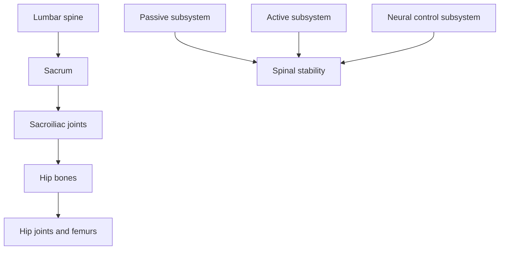

# Lumbopelvic-hip complex

## Summary

The lumbopelvic-hip complex (LPHC) is the real foundation of the body. Loads carried by the spine rest on the broad base of the sacrum, which is wedged between the pelvic bones, which in turn rest on the heads of the femurs. A disturbance in this area can affect the biomechanics and alignment of the whole body. Because the lumbar spine is relatively mobile, it needs, according to Panjabi, a three-part system of protection: passive, active and neural control.

## Prerequisites

- [Core stability](core.md)

## Core concepts

### Definition

The *lumbopelvic-hip complex* is the functional unit formed by the lumbar spine, the pelvis (including the sacrum and sacroiliac joints) and the hip joints, together with the muscles that cross them.

### Analogy

The LPHC is like the foundation and ground floor of a building: everything above it depends on its alignment, and a crack here shows up as tilted walls upstairs. The analogy breaks because this foundation moves, and its stability is active.

### Mechanism

**Structure.** Spinal loads pass to the sacrum ([Sacrum](../../anatomy/skeletal-system/vertebral-column/sacrum.md)), through the sacroiliac joints ([Sacroiliac joint](../../anatomy/joints/sacroiliac-joint.md)) to the hip bones and through the hip joints ([Hip joint](../../anatomy/joints/hip-joint.md)) to the femurs. The lumbar spine is relatively mobile: it flexes, extends, bends sideways and rotates. As part of a stable core it needs a three-level system of protection.

**Panjabi's subsystems of spinal stability.**

- **Passive**: the bones and ligaments.
- **Active**: the muscles and tendons.
- **Neural control**: activates the muscles at the right moment, with the right force and in the right order (timing).

If one subsystem is weak, the others must compensate; if they cannot, the spine becomes unstable within its neutral zone.

The diagram shows the load path and the three subsystems.

### Claimed effects and evidence

Each entry states the claimed effect and how strong the evidence is, using the grades defined in the [Evidence grades](../../nutrition/evidence-grades.md) note.

- **Panjabi model explains spinal stability.** Widely accepted conceptual model. Evidence: established physiology.
- **Misalignment of the LPHC causes widespread dysfunction.** Plausible; evidence linking posture to pain is weak. Evidence: limited.

## Worked example

A runner with recurring hamstring strains shows excessive anterior pelvic tilt and poor control of the pelvis in single-leg stance. Training gluteus medius, core anti-movements and hip hinge patterns improves pelvic control. Hamstring injuries have many causes, but pelvic control is one modifiable factor.

## Trade offs and when to use it

Viewing the LPHC as one unit helps in assessing back, pelvic and hip problems; avoid attributing all pain to "misalignment".

## Common mistakes

- **Treating the lumbar spine in isolation.** Assess the pelvis and hips as well.
- **Ignoring neural control.** Timing matters as much as strength.

## Practice

1. What forms the lumbopelvic-hip complex?
2. Name Panjabi's three subsystems.
3. What does the neural subsystem do?

### Answers

1. The lumbar spine, the pelvis and the hip joints with their muscles.
2. Passive, active and neural control.
3. Activates muscles at the right time, with the right force and order.

## Further reading

- Panjabi, M. M. (1992). The stabilizing system of the spine. Part I. Function, dysfunction, adaptation, and enhancement. Journal of Spinal Disorders, 5(4), 383-389. [DOI](https://doi.org/10.1097/00002517-199212000-00001). Model of the three spinal stability subsystems.
- McGill, S. (2015). *Low Back Disorders: Evidence-Based Prevention and Rehabilitation (3rd ed.)*. Human Kinetics. Spinal stability.
