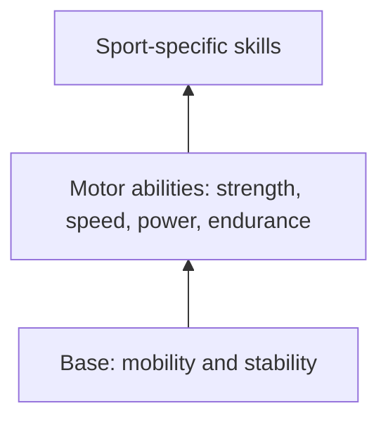

# Mobility

## Summary

Mobility is the ability of the neuromuscular system to perform effective movement at a joint through its full, pain-free range. It describes what a joint can do, its potential for movement. Mobility, together with stability, forms the base on which strength, speed and sport skills are built. Mobilization techniques, such as compression, joint and stretching mobilization, are used to restore it.

## Prerequisites

No prior notes are needed.

## Core concepts

### Definition

*Mobility* is the ability to move a joint actively and with control through its full, pain-free range of motion. It differs from *flexibility*, which is the passive length of tissues ([Flexibility](flexibility.md)).

### Analogy

A mobile joint works like a new, well-oiled door that opens fully without effort. A stiff joint is a door that sticks halfway: you can still get through, but you have to twist your body (compensate). The analogy breaks because the "hinge" of a joint is controlled by muscles and the nervous system, not only by its mechanical condition.

### Mechanism

Mobility depends on joint structure, the extensibility of muscles and fascia, and the nervous system's control and tolerance of end ranges. Limited mobility forces the body to find the movement elsewhere, usually in the nearest segment (see [Joint-by-joint approach](joint-by-joint-approach.md)).

**The movement pyramid.** In Gray Cook's optimum performance pyramid (presented in the early 2000s), stability and mobility form the base for motor abilities (strength, speed, power) and the technical skills needed for sport. They are the foundation of healthy movement that does not cause injuries from compensation.

**Mobilization types.**

- *Compression mobilization*: applying pressure to soft tissues (for example with a ball, roller or band wrap) to improve tissue glide and reduce tension.
- *Joint mobilization*: moving a joint passively or actively through small or large oscillations, often with a band, to improve joint motion.
- *Stretching mobilization*: lengthening muscles and fascia, statically or dynamically, often combined with active control at end range.

The pyramid shows how mobility and stability support performance.

### Claimed effects and evidence

Each entry states the claimed effect and how strong the evidence is, using the grades defined in the [Evidence grades](../../nutrition/evidence-grades.md) note.

- **Mobility work increases range of motion.** Stretching and mobility training reliably increase range of motion. Evidence: strong.
- **Better mobility reduces injury risk.** Evidence is mixed and depends on sport and injury type. Evidence: limited.

## Worked example

A lifter cannot squat deep without the heels lifting. Testing shows limited ankle dorsiflexion (knee-to-wall distance 5 cm). After 6 weeks of daily ankle joint mobilizations with a band and loaded calf stretches, the distance improves to 10 cm, and the lifter squats deeper with heels down.

## Trade offs and when to use it

Mobility work should target joints that limit a needed movement. Unlimited mobility is not a goal: excess mobility without control can reduce stability.

## Common mistakes

- **Stretching everything without assessment.** Find the joint that actually limits the movement.
- **Gaining range without control.** Train strength and control in the new range.

## Practice

1. What is mobility?
2. Name three types of mobilization.
3. What forms the base of Cook's performance pyramid?

### Answers

1. The ability to move a joint actively and with control through its full, pain-free range.
2. Compression, joint and stretching mobilization.
3. Mobility and stability.

## Further reading

- Cook, G. (2010). *Movement: Functional Movement Systems. Screening, Assessment and Corrective Strategies*. On Target Publications. Movement screening and the performance pyramid.
- Behm, D. G., Blazevich, A. J., Kay, A. D. et al. (2016). Acute effects of muscle stretching on physical performance, range of motion, and injury incidence in healthy active individuals: a systematic review. Applied Physiology, Nutrition, and Metabolism, 41(1), 1-11. [DOI](https://doi.org/10.1139/apnm-2015-0235). Systematic review of stretching and range of motion.
