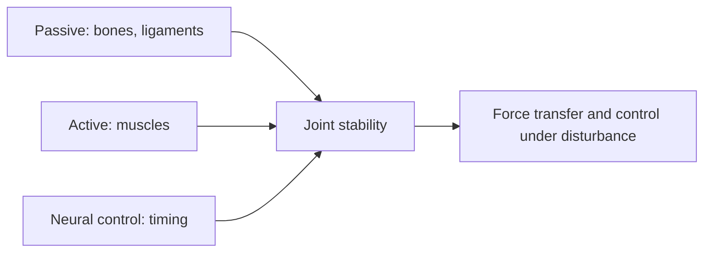

# Stability

## Summary

Stability is active control of a joint's position that allows forces to be transferred using the elasticity of muscle tissue and the mobility of the joint. A stable scapula, for example, lets you press a weight overhead and hold it there. A stable joint maintains control when the movement is disturbed or changed.

## Prerequisites

- [Mobility](mobility.md)

## Core concepts

### Definition

*Stability* is the ability to control joint position and movement, especially in the presence of load or disturbance. It is produced by passive structures (bones, ligaments), active structures (muscles) and neural control ([Lumbopelvic-hip complex](lumbopelvic-hip-complex.md)).

### Analogy

Stability is like a camera tripod: it holds the camera steady while you move the lens. Without it, every adjustment shakes the picture. The analogy breaks because joint stability is dynamic: the "tripod" constantly adjusts its legs as the body moves.

### Mechanism

Muscles around a joint co-contract and respond to perturbations, keeping the joint centered while force passes through it. The nervous system times and scales these contractions. Stability depends on strength, endurance and especially motor control.

Examples of joints that mainly need stability: the knee, the lumbar spine, the scapula (scapulothoracic joint), the lower cervical spine and the elbow (see [Joint-by-joint approach](joint-by-joint-approach.md)).

The flowchart shows how stability supports force transfer.

### Claimed effects and evidence

Each entry states the claimed effect and how strong the evidence is, using the grades defined in the [Evidence grades](../../nutrition/evidence-grades.md) note.

- **Stability training improves control under load.** Consistent with motor control research. Evidence: moderate.

## Worked example

An overhead press requires the scapula to stay stable and upwardly rotated. A lifter whose shoulder blade wings during pressing trains serratus anterior with wall slides and push-up plus for 4 weeks; their overhead press becomes smoother and pain-free.

## Trade offs and when to use it

Stability and mobility must be balanced: a joint that is too stiff loses function, and a joint with mobility but no control is vulnerable.

## Common mistakes

- **Confusing stability with stiffness.** Stability is controlled movement, not rigidity.
- **Training only static holds.** Include dynamic stability under changing conditions.

## Practice

1. What is stability?
2. Name three systems that provide stability.
3. Give an example of a joint that mainly needs stability.

### Answers

1. Active control of joint position that allows force transfer.
2. Passive (bones, ligaments), active (muscles) and neural control.
3. The knee or the lumbar spine.

## Further reading

- Panjabi, M. M. (1992). The stabilizing system of the spine. Part I. Function, dysfunction, adaptation, and enhancement. Journal of Spinal Disorders, 5(4), 383-389. [DOI](https://doi.org/10.1097/00002517-199212000-00001). Model of the spinal stabilizing system.
- Cook, G. (2010). *Movement: Functional Movement Systems. Screening, Assessment and Corrective Strategies*. On Target Publications. Stability in movement assessment.
