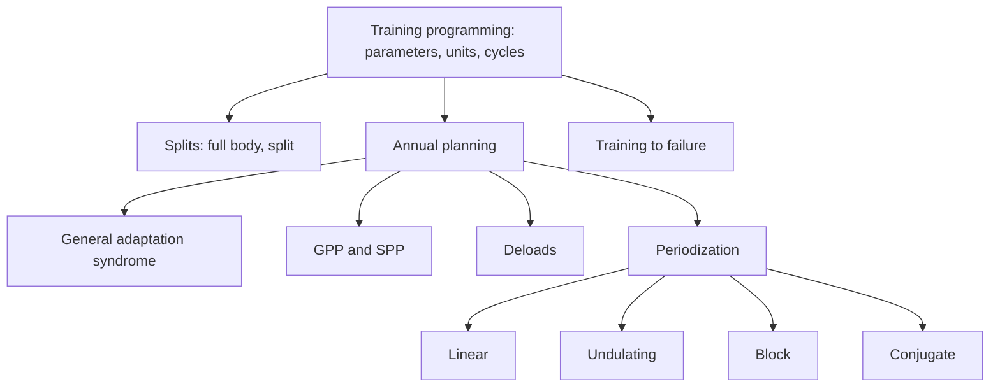

# Programming

Programming is long-term planning of training. These notes explain the parameters of a training program, the main ways to split the body across sessions, how a year of training is planned (preparation phases, adaptation and deloads), training to failure, and the main models of periodization.

## Map

## Reading order

1. [Training programming](training-programming.md)
2. [Full body training (FBW)](full-body-training.md)
3. [Split training](split-training.md)
4. [Annual planning](annual-planning.md)
5. [General adaptation syndrome](general-adaptation-syndrome.md)
6. [GPP and SPP](gpp-and-spp.md)
7. [Deloads](deloads.md)
8. [Training to failure](training-to-failure.md)
9. [Periodization](periodization.md)
10. [Linear periodization](linear-periodization.md)
11. [Undulating periodization](undulating-periodization.md)
12. [Block periodization](block-periodization.md)
13. [Conjugate periodization](conjugate-periodization.md)
