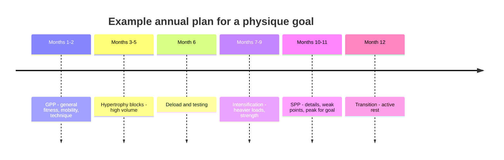

# Annual planning

## Summary

Annual planning maps out a year of training in advance. It starts from a vision and an overriding goal, such as a physique competition, the best beach shape or better strength endurance, and builds training blocks that work together toward it. An annual plan defines the periodization model and progression methods, describes all training parameters, divides the year into general preparation (GPP), adaptation phases and specific preparation (SPP), and includes deloads.

## Prerequisites

- [Training programming](training-programming.md)

## Core concepts

### Definition

*Annual planning* is the long-term outline of training over a year, specifying goals, the order of training phases, periodization, parameters and recovery periods. It defines the macrocycle, mesocycles (about a month), microcycles (a week) and sessions.

### Analogy

An annual plan is like a farmer's year: prepare the soil (GPP), plant and grow (adaptation and specific phases), harvest at the right time (competition or goal), and let the field rest (deloads). A farmer who plants without preparing or never rests the field gets poorer harvests. The analogy breaks because training responses differ more between individuals than crop yields do.

### Mechanism

**Periodization.** Every annual plan needs a periodization model with progression methods. Depending on needs, preferences and training experience, choose linear, non-linear (undulating weekly or daily), block or conjugate periodization ([Periodization](periodization.md)).

**Vision and overriding goal.** The overriding goal could be a physique show, the best possible beach shape, or improved conditioning and strength endurance. Training blocks are built to serve it so that they work together.

**Training parameters.** The annual plan describes all parameters used in the program. Hypertrophy training follows certain rules: working close to muscle failure, suitable repetition ranges and sets, appropriate loads and enough recovery. Training without a plan, "guerrilla style", moves you away from the goal and induces unnecessary central and peripheral fatigue. Parameters are the set of variables manipulated across the plan:

- *Volume*: total work in a session, from sets, repetitions and load, considering whether the effort was hard enough.
- *Intensity*: the load for each exercise, determined by the goal and current strength.
- *Frequency*: sessions per week, the primary parameter of the microcycle. It allows the volume of each session to be adjusted so that central and peripheral fatigue, which lengthen recovery, stay manageable.
- *Repetition ranges*, *tempo* and *rest intervals* as described in [Training programming](training-programming.md).

**Training close to failure.** Research supports training close to muscle failure to trigger adaptation ([Training to failure](training-to-failure.md)).

**Structure of the year.** Regardless of experience, the year is commonly divided into:

- GPP (general physical preparedness);
- GAS (general adaptation syndrome) phases, including intensification and high-volume phases;
- SPP (specific physical preparedness), with focus on details and the overriding goal.

See [General adaptation syndrome](general-adaptation-syndrome.md) and [GPP and SPP](gpp-and-spp.md).

**Deloads.** The plan must contain breaks ([Deloads](deloads.md)).

The diagram shows a typical year.

## Worked example

A lifter aims for a physique competition in 12 months. The plan starts with 8 weeks of GPP (movement quality, conditioning), followed by three 6-week hypertrophy mesocycles with increasing volume, each ending with a deload week. Then come two 5-week blocks focusing on heavier loads to build strength, and a final 12-week phase combining a calorie deficit with SPP (posing, weak points). After the show, 2 weeks of active rest close the year.

## Trade offs and when to use it

- A yearly plan gives direction, but rigid plans fail with illness or life events; build in flexibility and review every mesocycle.

## Common mistakes

- **Planning only exercises, not parameters and recovery.**
- **Training hard all year without deloads.**

## Practice

1. Name the three main divisions of an annual plan.
2. Why is frequency called the primary parameter of the microcycle?
3. What does "guerrilla" training mean, and why is it a problem?

### Answers

1. GPP, GAS phases (intensification and high volume) and SPP.
2. It sets how volume is distributed across sessions, which controls fatigue and recovery.
3. Training without a plan; it leads away from the goal and creates unnecessary fatigue.

## Further reading

- Haff, G. G., Triplett, N. T. (Eds.) (2016). *Essentials of Strength Training and Conditioning (4th ed.)*. Human Kinetics. Periodization and annual planning.
- Issurin, V. B. (2010). New horizons for the methodology and physiology of training periodization. Sports Medicine, 40(3), 189-206. [DOI](https://doi.org/10.2165/11319770-000000000-00000). Review of periodization models.
